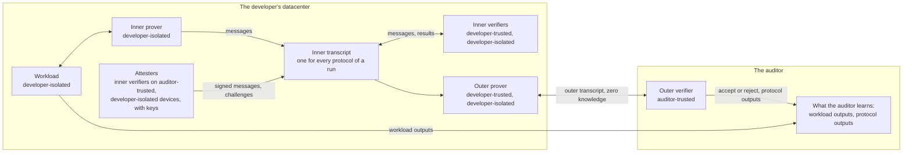
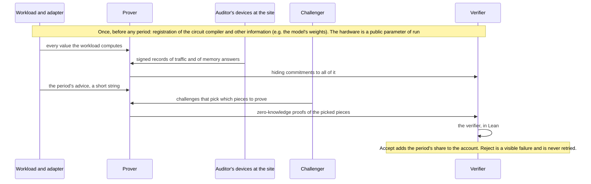
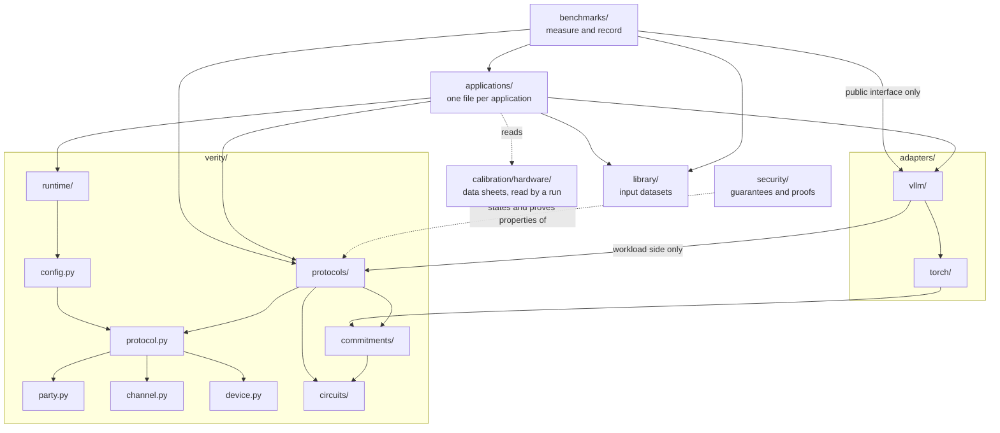
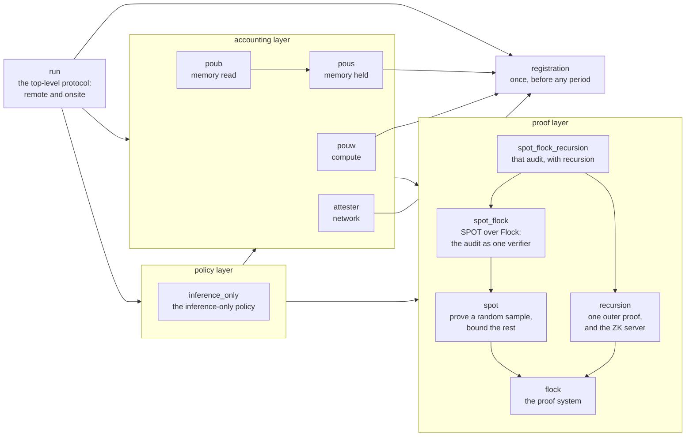
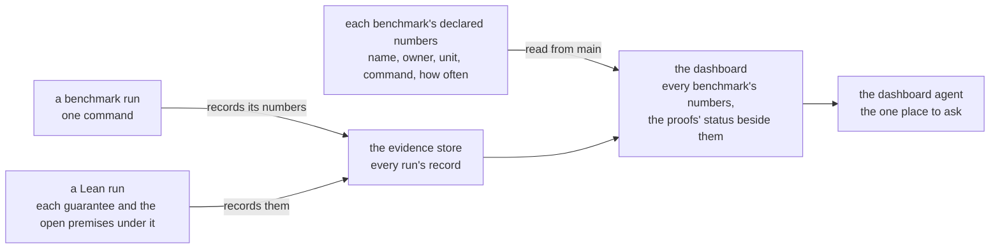

# Verity: the system and its repository at the end state

This file is Verity's architecture: the system and its repository at the end state, in sections 1 to 7.
Sections 1 and 2 state the settled design, the section after them what is still open, and section 7 where `main` differs.
[GLOSSARY.md](GLOSSARY.md) is the Glossary. [AGENTS.md](AGENTS.md) says what is true on `main` now.

## 1. The system in one picture

Verity lets a developer prove to an auditor that the workloads its hardware runs have stated properties, and that its hardware did little else. The auditor never runs the workload. It learns the workload's outputs and the protocols' outputs, and nothing else.

Verity is two protocols. The inner protocol is everything that checks the workload, and it may see private information. The outer protocol is a zero-knowledge argument that the inner verifier accepts an inner transcript consistent with the outer transcript. The outer protocol is the only path from private information to the auditor.



- **Only messages cross between machines.** Every message is in one of two transcripts: the inner transcript, which every protocol of a run shares, or the outer transcript, between the outer prover and the outer verifier.
- **Only developer-isolated devices learn private information.** Such a device reaches the auditor only through a developer-trusted device, so what leaves is the workload's outputs and what the outer protocol releases.
- **A challenge is a message in the transcript sent by an auditor-trusted device.**
- **Whatever the auditor decides, a verifier decides, and every verifier is Lean.**

## 2. The ideas that organize everything

1. **Two protocols, inner and outer.** The outer protocol is a zero-knowledge argument that the inner verifier accepts an inner transcript consistent with the outer transcript. It is the same for every application. Its zero knowledge holds for any inner prover and any choice of challenges, so nothing the inner protocol does can make it leak. The inner protocol is everything else, and it may see private information.
2. **Three properties of a device.** A device is auditor-trusted if it correctly runs what the auditor wants, developer-trusted if it correctly runs what the developer wants, and developer-isolated if its only channel to the auditor is through a developer-trusted device. Only developer-isolated devices learn private information. No device needs to be both auditor-trusted and developer-trusted. An attester is not a separate role: it is an inner verifier on an auditor-trusted, developer-isolated device, used for physical facts, which cannot be proved.

    | Runs | On a device that is |
    | --- | --- |
    | The workload and the inner prover | developer-isolated; they need not be developer-trusted |
    | An inner verifier | developer-trusted and developer-isolated, covered by the outer proof; or auditor-trusted and developer-isolated, with keys, its messages signed |
    | The outer prover | developer-trusted and developer-isolated |
    | The outer verifier | auditor-trusted |

3. **One type: the protocol.** A protocol is a prover and a verifier, each a next-message machine over a transcript. Protocols call protocols: a prover calls the provers of the protocols it calls, and a verifier calls their verifiers and uses their results. The same call with the same arguments is one run. There is no primitive or composite kind, no separate step that composes protocols, and no tie that holds two protocols' values equal afterwards. The inner protocol is one protocol, the policy, and whatever it calls. Resource accounting is a protocol that calls others: its verifier computes numbers from their results and the hardware description, and its prover may send messages of its own but commits to nothing another protocol already sent.
4. **One inner transcript.** All protocols of a run share one inner transcript, and each machine sees only the message types it uses. Each message type has one sender. A message several protocols use, such as the registration or the commitment to the declared circuit, is sent once. Everything an inner verifier writes is a function of the transcript, and it may write a result as a message so that other protocols can read it. A challenge is a message sent by an auditor-trusted device.
5. **Every guarantee is about the actual circuit.** The actual circuit is what the developer's hardware computed; the declared circuit is what the prover says it computed; registered information is what was committed in advance. Each protocol's guarantee has one form: if it accepts in an epoch then, except with small probability, the actual circuit lies in a set whose members have a stated property. The inner protocol's guarantee is the intersection of those sets. An epoch is one round, in which the hardware runs and then the run is verified; a monitoring period is many epochs.
6. **What the auditor learns.** The auditor learns the workload's outputs and the protocols' outputs. The protocols' outputs are zero knowledge. Verity does not interfere with the workload's outputs. Timing is outside the model for now.
7. **The directories.** Every protocol's directory has the same three parts: `verifier/` (its verifier), `prover/` (the developer's side, with the GPU code it runs) and `attester/` (an inner verifier on the auditor's own devices, never the developer's GPUs). The directories group protocols by layer. The proof layer is the proof system (Flock), with sampling (SPOT) and recursion on it, which any protocol calls to prove a statement about committed values. The accounting layer is resource accounting and what it calls: compilation, compute (PoUW), memory (PoUS and PoUB), network (network attestation) and registration. The policy layer holds one protocol, inference-only, which calls resource accounting. `run` runs the inner protocol in each epoch of a monitoring period, with no rule of its own. The hardware description is a public parameter, not registration. Registration is a protocol because its verifier can reject (the simplest rule: one registration, on day one). Remote and onsite are two applications, which differ in the devices the auditor has at the site.
8. **Verity knows circuits and values, never models.** Only an adapter names PyTorch, vLLM or a model, and Verity's values are bit strings, not typed tensors. A new serving system is a new adapter and changes nothing in `verity/`. The workload is the developer's private input: a compiler (a function from advice to a circuit and its partitions), the advice (requests among it; its length is the number, in log space, of choices the prover made after registration about its declared circuit) and the trace (the declared circuit's values). The adapter holds the compiler, written in the circuit language, finds the engine's values and calls Verity's commitment functions; everything soundness or zero knowledge rests on is in `verity/`. A workload reads its circuit's inputs from an input dataset, and Verity quantifies over all of them.
9. **What decides is Lean. What must be fast is Python and CUDA. Public facts are TOML.** Python never returns accept or reject and never re-implements a verifier.
10. **Parameters flow one way.** A protocol is pure logic: it takes every parameter as a public input and holds none. `security/` states and proves what holds as a function of the parameters. Calibration chooses the parameters, and each value carries its source: a data sheet, a measurement of ours, or a named premise. Nothing imports calibration code. An application is one file that sets every parameter of a run, with which protocols run and which party runs on which machine; `verity run NAME` runs it.
11. **Benchmarks measure performance and cost, and nothing else.** A benchmark never decides a verdict and never chooses a parameter: a run that chooses one, or tests an assumption a parameter rests on, is calibration. What a guarantee gives at an application's parameters is a security figure, not a benchmark. Every benchmark's numbers show on one dashboard.
12. **Trust follows the device.** The auditor relies on its auditor-trusted devices to run what it wants: the outer verifier, the challenger and the attesters. An inner verifier on the developer's devices is each protocol's `verifier/`, and the auditor relies on the outer proof that it accepted, not on the device. What a reader checks to believe a guarantee is its statement and its named assumptions in `security/`, and that Lean's kernel accepted its proof, which the check does again on every change. Nothing else in the repository is trusted.
13. **What a guarantee may rest on.** That SHA-512 resists collisions, that Lean's kernel is right, that the auditor's verifier and devices are honest and sample uniformly random challenges, and the few assumptions approved by name. Anything else a guarantee needs is an open premise with an owner and a date, printed beside the figure.
14. **GPU code implements and never defines.** A kernel computes what its owner states: a commitment, a protocol's circuit, an operation the adapter serves. It lives beside the prover or adapter that runs it, a run names it by the hash of its binary, and a benchmark measures the same binary the served run loads.

## Open

These are not settled. Each is stated with the options named so far, and none is picked.

- **Scheduling.** Whether "a machine sends its next message once the messages it depends on exist" is the only rule. Deadlines and timed rounds exist, and that rule does not express them.
- **Units.** The proposal: every statement is about one epoch, and the statements for a session and for a monitoring period are derived from it by one stated rule. A guarantee proved on a sample has a tolerance that is counted once over a monitoring period; adding each epoch's error loses that.
- **Compilation.** Nothing yet holds the declared circuit to the registered compiler's output on the committed advice. The options: prove the compile step in a proof block every epoch; have the verifier run a lowering on a few numbers read from the advice; register the largest circuit of a class, with a stated rule that restricts it by the advice's numbers; fix the circuit of a class before serving; or hold nothing and charge the declared circuit's description as unregistered input.
- **Calls before the run.** Whether every call can be resolved before the run. What depends on the run, such as the sample, is then a message and not an argument.
- **The form of a statement.** Being settled: "if I accept in an epoch then, except with probability e, the actual circuit is outside a set I rely on or inside my set", for every prover. Each set relied on is one another protocol establishes or one that is assumed. A premise is proved, assumed (a physical fact about the developer's hardware) or conjectured (a mathematical claim independent of any developer). The hardware description is a node of assumed sets. Acceptance is the compiled verifier's answer on the transcript. Each statement ships with an honest accepted run and a circuit outside its set, and the proof's dependency graph equals the call graph. Open within it: how to state the protocols that establish facts about the transcript only (registration, SPOT's proofs, compilation, the outer protocol); what status a not yet proved lemma about our own verifier's code has; and where trust in the auditor's own devices is stated.

## 3. One period, step by step

This section describes `main` today; sections 1 and 2 state the design it moves to.



The compiler is the adapter's, written in the circuit language and registered up front. Given the period's advice (which requests ran together, how long each was) it outputs the circuit the workload ran, cut into pieces small enough to prove one at a time. In the first version compilation is a protocol that accepts everything, every result says "compilation not verified" beside it, and there is no outer proof, so the auditor sees the circuit's description.

## 4. The parts and their interfaces

| Part | What it does | Takes in | Hands out | Never knows |
| --- | --- | --- | --- | --- |
| **Workload** (not Verity) | The developer's computation. | What the prover sends it. | Every value it computes. | Anything about the auditor. |
| **Adapter** `adapters/` | Makes one serving system a workload Verity can audit. `vllm/` sits on `torch/`. It holds the compiler and the circuits of the kernels the system serves, and its completeness tests hold them to what the engine computes. It holds only what completeness rests on. | The serving system and its settings. From the prover: what a protocol asks of the workload (run this multiply under PoUW, store these weights). | To the prover only. Up front: the compiler and the weights. Each period: the values and the advice. | The verifier, the auditor's devices, the runtime; how a protocol samples or decides. It may import any part of `verity/`, and holds no commitment, salt, sample, record or verdict code of its own. |
| **Circuits** `verity/circuits/` | The language circuits are written in, and the circuits a protocol itself names: each GPU operation bit for bit, SHA-512, the universal circuit. | Nothing. | Circuits, each named by its hash. | Models, hardware schedules, proof systems. |
| **Commitments** `verity/commitments/` | Hiding commitments to values, the one hash, signatures. Where the values sit on a GPU, GPU code computes the same bytes there. | Values. | Roots, and openings on request. | What a value means. |
| **Flock** `verity/protocols/proof/flock` | The proof system: proves in zero knowledge that one statement about one circuit holds of committed values. | A circuit, commitments, challenges. | A proof. Its verifier says accept or reject. | Where the circuit came from. |
| **SPOT** `verity/protocols/proof/spot` | Sampling: the challenger picks pieces at random after the commitments; from proofs of those it bounds how many of all pieces can be wrong. In its two-stage form it first picks whole requests, the prover then commits the inside of each picked request, and it picks pieces of those. | Commitments, challenges, proofs. | "At most this share is wrong, except with this probability." | What the pieces compute. |
| **Recursion** `verity/protocols/proof/recursion` | One outer proof says the verifier accepted the developer's proofs. Holds the ZK server, the only exit from the datacenter to the auditor. | Flock's proofs. | One outer proof per statement. | Which protocol asked. |
| **SPOT[Flock]** `verity/protocols/proof/spot_flock` | SPOT applied to Flock: the sampled audit as one verifier an auditor runs, in its one-stage and two-stage forms, with the check of what a caller hands in. It is what stands on `run`'s lists for the proofs. | What the calling protocol passes in (the circuit, its pieces, the sampling rule), commitments, challenges, Flock's proofs. | Accept or reject, with SPOT's bound. | Recursion; which protocol called. |
| **SPOT[Flock] with recursion** `verity/protocols/proof/spot_flock_recursion` | The recursive audit: the same sampled audit, with recursion's outer proofs standing for the developer's proofs. It sits on `spot_flock` and `recursion`, and nothing below uses it. | What SPOT[Flock] takes, and recursion's outer proofs. | Accept or reject, with SPOT's bound. | Which protocol called. |
| **PoUW** `verity/protocols/accounting/compute/pouw` | Compute: how many of the served matrix multiplies' multiply-adds the GPU really computed, credited against its data sheet's capacity. A workload makes one call, "run this matrix multiply under PoUW", over GPU buffers. Its GPU code is one subsystem of schemes, builds and one driver (`prover/README.md`). | The registered devices and their data sheets, the prover's commitments to each multiply, the challenger's challenges, proofs of the sampled tiles. | Credited work for the period, with its error, to `run`'s account. | Memory, network; the served values in the clear; the GPU's own word on what it is. |
| **PoUS** and **PoUB** `verity/protocols/accounting/memory/pous`, `poub` | Memory. PoUS: how much of the registered store each device held, with the memory wipe inside it (between two stretches of serving, a server's whole memory is overwritten, so nothing it held before survives). PoUB: how many reads of the store a node made, and so how much of its memory's read rate is left uncertified. | The registered memory and its data sheets, the prover's commitments, the memory attester's signed records, the challenger's challenges. Through `run`, the network attester's counts of what entered and left the node. | Bits held and bits read for the period, each with its error, to `run`'s account. | Compute; the weights; another protocol's code. |
| **Network attestation** `verity/protocols/accounting/network` | Network: what left on a link is what the registered circuit produces from what entered. The auditor's device sits on every registered link out of a host, releases traffic on a fixed schedule and signs a record of what crossed. | The registered links, the network attester's signed records, the prover's commitments to requests and responses, the challenger's challenges. | To `run`'s account: the period's exfiltration capacity (how many bits could have left unseen), with its error. Through `run`, to memory: what entered and left each node. | Compute, memory, the weights. |
| **Inference-only** `verity/protocols/policy/training_detection/inference_only` | The policy: the registered circuit divides into inference blocks that each read few unregistered inputs. | The circuit's description, and from the accounting layer, verified properties of its blocks. From training, as data: how much such a circuit slows training. | Accept or reject, to `run`. | Values, traffic. |
| **Registration** `verity/protocols/registration` | The protocol that runs once, before any challenge, a protocol because its verifier can reject (the simplest rule: one registration, on day one). The developer sends the registration: the circuit compiler, and commitments to other information such as the model's weights. The hardware is a public parameter of `run`, not registration; today's registration still carries it, and its verifier accepts only if each device's figures are its data sheet's and every registered device is accounted for by a protocol on the run's list. It measures nothing itself: it fixes what the other accounting protocols account for. | The registration, the auditor's data sheets, the run's list of protocols. | Accepted or refused. An accepted registration is what the other accounting protocols, the policy and `run` then read. A protocol that calls the proofs passes them the declared circuit, and the proofs read no registration. | How any other protocol works inside. |
| **Run** `verity/protocols/run` | What an auditor runs: the inner protocol, the policy and every protocol it calls, in each epoch of a monitoring period, with no rule of its own. Protocols share one inner transcript, so nothing is held equal afterwards. The inner protocol's guarantee is the intersection of its protocols' sets: a prover who adapts across all of them at once is still held to each one's, except with the summed error. | The public parameters, the hardware description among them; the workload. | One verdict an epoch, and the monitoring period's account. | How any one protocol works inside. |
| **Party, channel, device, protocol, config** five files in `verity/` | The shared types: what a party is, what two parties exchange, the registered hardware, what a protocol declares, the file a run starts from. | Nothing. | Types every protocol uses. | Any one protocol. |
| **Runtime** `verity/runtime/` | Runs a configuration's parties on real machines: sockets, randomness, clock, transcripts. | A configuration. | Running parties and their transcripts. | Any protocol's rules. |
| **Hardware** `calibration/hardware/`, to move to library/hardware/ | One data sheet per GPU, host or server model: what one device can do in a second and what it holds. Each figure names its source and says whether it is a ceiling or a measurement. Data, no code. The auditor brings it. | The vendor's published figures and our own measurements, written in by hand. | Figures an application passes to `run` as public parameters. Today the protocols take a device's capacity from the registration. | Everything. It never holds a figure the audited device reports about itself. |
| **Library** `library/` | What applications and benchmarks share and Verity never looks at: `datasets/`, the input datasets a workload reads its circuit's inputs from through one read API, timing a view over one; to come, `circuits/` (every workload circuit Definition) and `hardware/` (the data sheets). | Definitions of datasets and circuits; it may import `verity`. | Records, circuits and figures, to applications, adapters and benchmarks. | Nothing under `verity/` uses it. |
| **Applications** `applications/` | One file each, a configuration: its protocols, its adapter, which party on which machine. The remote application, and the onsite application at three sizes: network, compute (the default) and full. An application holds no code and is never tuned. | All of the above. | A run anyone can repeat with one command. | Nothing uses an application. |
| **Security** `security/` | Lean, in three parts: what each protocol guarantees, written to be read; what ties each guarantee to the verifier's own Lean code; and the proofs. A statement never reads a proof. | The verifiers' Lean. | Guarantees, each with its named assumptions and its open premises; one composition theorem for any list of protocols; and the error budget, each failure chance summed over a week, a month and a year (above 1 it prints "no bound at this period"). | Nothing in the system uses it. |
| **The Lean check and the guarantee record** `tools/`, and one record file beside each Lean package | Has Lean's kernel check every proof again. Refuses a missing proof, an added axiom or a way around the kernel. Records each guarantee's statement and every premise it rests on. | Every Lean file: each protocol's `verifier/`, and `security/`. | Pass or fail, to the check. For each guarantee the deployed system rests on, the open premises still under it, to the dashboard. | What a proof is about. It decides no verdict. |
| **Benchmarks** `benchmarks/` | Each benchmark is one command that records named numbers, each marked measured or modeled. Each benchmark's directory declares its numbers: name, owner, unit, command, and how often it should run. | The system, as a user. | Numbers, in the evidence store. | It never decides a verdict, and nothing uses a benchmark. |
| **The training slowdown** its bound in `security/`, its calculator in `benchmarks/slowdown/` | What an accepted period buys: the least factor by which a training run hidden inside declared inference is slowed. | From `run`: the policy that held and the compute left uncredited. From `calibration/hardware/`: the data sheets. As stated parameters: the share of hardware that is unregistered, and the reference training run. | The slowdown for a week, a month and a year, with the premises it rests on, to the dashboard. | A model, a value, any protocol's insides. Nothing in the system uses it. |
| **Dashboard** (the team's website, not this repository) | Shows every maintained benchmark's numbers under its owner: value, unit, measured or modeled, the run and commit, and age. The proofs' status sits beside them. | From `main`, read-only: each benchmark's declared numbers and who owns each. From the evidence store: every run's record, the Lean run's included. | The page to its reader, and the same report to every agent. | Verity's code. It never runs a benchmark or Lean, never computes or edits a number, and nothing in the repository reads it. |
| **Tools** `tools/` | The `verity` command and the check. The check runs everything that can fail on one commit: every test suite, the Lean build and its proof audit, and the circuit checker. | A commit. | A verdict for each step: pass or fail, and which test failed. | What a change means. It never trusts a developer's word that something passed, and nothing in the system uses it. |

Who runs what, and who must trust it:

| Runs on | What | Who must trust it |
| --- | --- | --- |
| Developer-isolated devices | The workload, the adapter, the inner prover (every protocol's `prover/`) | Nobody. A wrong prover can only get honest work rejected. |
| Developer-trusted, developer-isolated devices | The outer prover (the ZK server), and inner verifiers (each protocol's `verifier/`, in Lean) that the outer proof covers | The developer, for zero knowledge. The auditor relies on the outer proof, not on the device. |
| Auditor-trusted, developer-isolated devices, on machines the developer does not control | Every protocol's `attester/`: the network attester, the memory attester, inner verifiers whose messages are signed | The auditor. |
| Auditor-trusted devices | The outer verifier, in Lean, and the challenger | The auditor. |

## 5. How the parts depend on each other

An arrow reads "uses". Nothing points upward.



Inside `verity/protocols/`:



How a number reaches its reader:



## 6. The repository at the end state

```text
verity/
  party.py         what a party is
  channel.py       what two parties exchange: a message and its types
  device.py        the registered hardware: hosts, devices, memory, links
  protocol.py      the one type: a prover and a verifier, each a next-message machine over the transcript,
                   and the message types each reads and sends
  config.py        reads the one public file a run starts from
  runtime/         runs parties over channels: sockets, randomness and clock, transcripts
  protocols/       each protocol with verifier/ (its Lean verifier), prover/ (with the GPU code it runs) and attester/
    proof/         flock, spot, recursion, spot_flock, spot_flock_recursion: what the other protocols call to prove
    accounting/    compilation first, then compute/pouw, memory/pous, memory/poub, network
    registration/  runs once, before any challenge: the circuit compiler, the commitments to other information
    policy/        training_detection/inference_only, on accounting/
    run/           runs the inner protocol in each epoch of a monitoring period; remote and onsite
    experimental/  a protocol being tried, which no application lists: dither, pearl_c4
    interface/     the shape every protocol's verifier has in Lean, with the registered hardware's type and the
                   account, which every protocol's package reads
  circuits/        the circuit language; ops/ holds the circuits a protocol names
  commitments/     hiding commitments, the one hash, signatures, and their GPU code
adapters/
  torch/
  vllm/            on torch/: its compiler, its value acquisition and its completeness tests
library/           what applications and benchmarks share, which Verity never looks at
  datasets/        the input datasets, one read API
  circuits/        every workload circuit Definition
  hardware/        data only: one data sheet per GPU or host model
applications/             one file per application, the configuration `verity run` reads. An application holds no code
  README.md        one table: the file, what it shows, its command, how far it runs and is proved
  remote.toml      SPOT, PoUW and the inference-only policy
  onsite_full.toml       SPOT, PoUW, the inference-only policy, the network attester, the memory wipe, PoUS and PoUB
security/          Lean: what each protocol guarantees, and the proofs
benchmarks/        every measurement, each one command, each on the dashboard
tools/             the verity command, the check, the test harnesses
tests/             the rules of the whole tree, as tests
```

Not in it: `fixtures/` (each file goes beside its reader), an archive directory (deleted), and the team's own platform (`infra/`: our machines, the check's runner, the run recorder, the merge queue that moves `main`, and the agents' messages with their lead registry and message router), which is not part of the system. The team's website with the dashboard is already in the platform repository.

The rules that keep the parts apart. A test enforces each one:

1. Nothing in `verity/` uses `adapters/`, `applications/` or `library/`, or names PyTorch, vLLM or a model. `library/` may use `verity/`.
2. No code uses `security/` or library/hardware/. A run reads the data sheets and passes them in.
3. `runtime/` uses no protocol, and no protocol or adapter uses `runtime/`. Only what starts a run does.
4. `party.py`, `channel.py` and `device.py` use nothing. `protocol.py` uses only those three. `config.py` uses only `protocol.py`.
5. `circuits/` uses nothing. `commitments/` uses only `circuits/`.
6. An adapter may use any part of `verity/` (for PoUW, one call over GPU buffers: "run this matrix multiply"), and holds no commitment, salt, sample, record or verdict code of its own. A protocol never uses an adapter.
7. Inside `verity/protocols/`: four protocols, the proof layer, the accounting layer (compute/pouw, memory/pous, memory/poub, network), the policy layer (training_detection/inference_only) and `run`, with registration beside them, policy on accounting and `run` on top. The accounting and policy layers use the proofs (flock, with spot and recursion on it, spot_flock on those and spot_flock_recursion on top), and the proofs use neither layer, so they read no registration: a protocol that calls them passes in the circuit, its pieces and the sampling rule. Registration is the base of resource accounting: it uses the shared files and `commitments/` and no other protocol, and the other accounting protocols, the policy and `run` read the registration it accepted. Each group is a directory of its own: `proof/`, `accounting/` and `policy/`.
8. A verifier uses no prover code.
9. Nothing uses a benchmark, and nothing in the repository reads the dashboard. A measurement reaches a guarantee one way only: a person writes it into a data sheet with its source, marked as a measurement, and the guarantee takes the sheet as a parameter.
10. The tree above is one file in the repository, and a test fails on anything that is not in it. Both are on `main`. The file also lists the places `main` still holds that the tree does not (one, `infra/`), each with its owner and its day, and that list only shrinks.
11. Outside code uses an adapter through its public interface only. The test is on `main` today, with 133 exceptions listed.

| Written in | What goes there |
| --- | --- |
| Lean | Everything that decides: each protocol's verifier, registration's, whether a configuration is acceptable, `run`'s verdict. And every guarantee with its proof. |
| TOML | Public facts with no logic: a run's configuration, the hardware data sheets. |
| Python and CUDA | What must be fast or touch the world: provers, adapters, sockets and processes. Python restates Lean only where the prover needs speed, and a test holds each such copy to the Lean. A Python copy of a verifier is deleted with its generator and its difftest once the Lean's cases are frozen as a committed fixture or `#guard`s. |

## 7. Where `main` differs today

Each difference's owner and day are in `tests/tree.toml` (its `[[not_yet]]` lines and its dated `[[tree]]` entries) and on the Goals page. A landing that closes a row deletes the row here.

**Against sections 1 and 2**

- Each protocol declares its own parties, channels and message types (`verity/protocol.py`). The runtime runs one protocol a run (`verity/runtime/runner.py`) and keeps one transcript a party (`verity/runtime/transcript.py`), not one inner transcript for every protocol of a run.
- The same thing is sent more than once. There are several registrations, and `run`'s own is not written; the weights are committed three times, and the store's root twice.
- A run's order is written by hand, in `verity/protocols/run/period.py`, `tools/verity/cli/verity_cli/served_table.py` and `benchmarks/one_stage/served_verdicts.sh`, not derived from the calls.
- The challenges of one epoch come from several places, and several verifiers make their own.
- A compose step holds things equal afterwards: `run`'s Lean (`verity/protocols/run/verifier/lean/CoreComposition/`) binds digests across protocols, with `same` and ties. No new compose rule or tie is added.
- Only registration's verifier is a function of messages alone. Elsewhere a verifier's answer also depends on challenges it makes itself, on unsigned clocks, or on flags, environment values and files kept between runs.
- No deployed guarantee is about the actual circuit. A model of the actual circuit exists (`security/Definitions/ResourceAccounting/Actual.lean`), and a composition theorem over it is proved, but no protocol's statement is an instance of it.
- The registered compiler exists in the vLLM adapter, and nothing holds the declared circuit to its output. The Lean counts of unregistered input do not charge the advice.
- The outer protocol covers only the proof system's own verifier, and the zero-knowledge server is not proved.
- The applications state no hardware description and no policy limits, and resource accounting has no verifier of its own.
- No accepted run on a served epoch is recorded yet.

**Files that only change place**

| What | Today | At the end |
| --- | --- | --- |
| The circuits of served kernels | `adapters/vllm/verity_vllm/definitions/`, the circuits a protocol names among them | what a protocol names to `verity/circuits/ops/`, the rest to library/circuits/ |
| The data sheets | `calibration/hardware/` | library/hardware/ |
| GPU code | 64 directories, 30 of them under `benchmarks/` | each protocol's `prover/`, `verity/commitments/`, the adapter |
| The compute audit's cost model, and the commands that run an audit on a served run | in SPOT (`prover/audit/`, `verifier/one_stage/`, `verifier/challenger/`) and `calibration/sampling_plan/`, but the audit commands still load scripts under `benchmarks/` (the proof subprotocol, the network attester's pieces, the one-stage replay, the tampered stagings, the bundle's format), and the demo's orchestration script runs them | SPOT's `prover/` and `verifier/`, started from a demo's configuration. The measured proving costs stay recorded under `benchmarks/` and are handed in as data |
| Registration | The log's Lean and Python, the site entry's check and both difftests are in `verity/protocols/registration/`. The site log's own types (its entries, refusals and digests, and `Site.ofLog`) are still in the interface's `CoreProtocol/Site.lean`; their Python (the log and the site entry's check) is `verity/protocols/registration/verifier/site_log.py` | `verity/protocols/registration/`, a protocol that runs once, over `device.py`'s types. Its Lean is cut out of the interface's package, so it is a code change and not in the two chains of moves |
| The policy's two calculators | `benchmarks/inference_only/` and `benchmarks/slowdown/` | training renames the slowdown one |
| The network attester's developer side | Its serving loop and keys are in `attester/`, which the auditor's device starts. Its developer side hangs off one edge, its scheme's `ATTESTER_PIECE` (`network/scheme.py`'s `launch_attester`, its `Launch.entry`): about 6,800 lines of `benchmarks/network_traces/`, which start the proof drivers in `prover/` on about 4,900 lines of `benchmarks/one_stage/` (`proof_drivers.install`), which rule 9 forbids | network attestation's `prover/` |
| vLLM's scheduler and the advice format, which rule 1 keeps out of `verity/` | The modules that restate the scheduler (the replay step and chain, the compile slices, the cache step, the served rows, tie and statics, the advice check) are in `adapters/vllm/verity_vllm/compiler/`. Four files of the advice's format and its charge are in network attestation's `verifier/` and `prover/` (`advice.py`, `arith_encode.py`, `charge_chain.py`, `window_charge.py`) | The four stay until network attestation takes the advice through an interface: the trusted tie service reads the format, and the charge is mirrored in network attestation's Lean (`AdviceV1`, `WindowCharge`), so moving it changes a Lean statement |
| The areas of `security/` | named before the carve | each carries its protocol's name, and the accounting area holds one protocol's files |
| Hardware figures | `verity/device.py` reads the data sheets itself (`CARDS`, `NODES`, `load_card`, `load_node`), so code under `verity/` holds parameters | an application passes them to `run` as public parameters, and nothing under `verity/` reads a data sheet |
| Security figures | computed by directories under `benchmarks/` | not under `benchmarks/`; where they go is not decided |

**Code that has to be written**

| What | Today |
| --- | --- |
| Every protocol has parties | SPOT, PoUW, PoUS, PoUB, network attestation and the inference-only policy declare theirs; the proofs below SPOT, registration and `run` don't |
| The messages between workload and prover as one stated list | Function calls and files; 15 files with no settled name or place |
| PoUW's serving code and GPU kernels in one package under `verity/protocols/accounting/compute/pouw/`, reached by one call | The serving code is in `verity/protocols/accounting/compute/pouw/prover/serving/` (12,000 lines), reached by `run_matmul`. The adapter keeps the option with its H1 hooks, the serve loops (`serve_h1`, `serve_tie`), Pearl's row GEMM (`gemm_rows`), H1's commit at acquire, the ncp-v2 replay check and the GPU row-table commit (3,500 lines); the last two still import modules below `serving`. Kernel checks are under `benchmarks/` |
| Benchmarks and applications reach the adapter through its public interface only | 133 modules are reached past it |
| Each application is one file under `applications/` that `verity run` starts: `remote.toml` and `onsite_full.toml` | The two files are there and `applications/` holds nothing else. `verity run` resolves both, as dry runs with no party live. Its table writes each file and reads back only the pins, where the file should be the source the code reads |
| Dither and the FP4 variant (Pearl-C4) are protocols being tried, under `verity/protocols/experimental/` | Dither's kernels and circuit are there, and Pearl-C4's scheme, circuit and vectors, research only with no kernel; PoUW's own circuits share its row schemas and word primitives |
| The team's platform is in its own repository, today's `compute-verification/infra` | `infra/`, the run recorder and the agents' guard are in this one until their day in `tests/tree.toml`. The move tool stays, since its maps are this tree's records |
| Python never returns accept or reject, and no Python copy of a Lean verifier stays | Several protocols still decide in Python, and the copies stand with their generators and difftests |
| Each accounting protocol takes the hardware from `run`'s public parameters and says which part it accounts for | None does; the Lean folds the hardware from the registration log (`Site.ofLog`) |
| The security model has the auditor's devices as parties, each with a key the auditor pins and its whole signing history | Only the challenger is a party, so no onsite memory or network claim can be proved yet |
| A device's figures have one source: the data sheet `run` is passed | Written in two places that disagree (the H200's tensor rate at two clocks) |
| "Registration" names one thing: SPOT's own record of a run takes another name | SPOT's prose, its Lean (`Spot.Docket`), its module (`one_stage/docket.py`) and the names it alone defines call it the docket. Its Python still calls the docket `registration` where the name is one other lanes' functions share (`rows.registration`, `network_attester_rows.registration`, the network attester service's). Its CLI flags and subcommands (`--registration`, `--window-registration`, `weights-registration`, `public-registration`), file names, formats and keys keep the word: they are wire words that scripts and records already carry |
| The circuit checker is handed the served circuits and names none | It names them |
| The compiler cuts a period's circuit into pieces wired to each other | For the applications' model the pieces are wired only where the eight GPUs combine results, so the audit's second round runs over a stand-in |
| A wire that crosses a block boundary has one commitment, which every block reading or writing it shares | Each block commits its own rows, and a wiring check (`HmLinks`) ties them only where an audit's case names a wiring; an accepted run without one covers each sampled block on its own inputs |
| SPOT has one variant, with levels the auditor fixes before any challenge: one level the basic case, two the default | SPOT's Python runs one stage (`verifier/one_stage/`) and refuses a two-stage docket by name; the Lean's two-stage variant is separate code, and no two-level audit is accepted in Lean |
| Each deployed guarantee is an instance of a layer theorem (session, sampling, recursion, `run`'s composition), for soundness and for zero knowledge | Most are proved on their own |
| The ZK, sampling and recursion layers are each a generic compiler, generic in the argument system and the circuit type | Flock over Boolean circuits is the one instance |
| Every kernel the serving settings run has a circuit held to the kernel on an H200 | Three of five on `main` (the cache's write and both its reads) |
| Every kind of piece in a request has a statement the Lean verifier accepts | 111 of the plan's 1,272 kinds (5 on Boolean versions only) by a stored record; the other 1,161 have none; `cover_count.py --card` checks its kinds |
| The proofs' status on the dashboard: guarantees fully proved, open premises per lead | Printed by the Lean check only |
| Every area of `security/` has a lead | 826 of its 4,816 files fall to lean because no lead claims them |
| A memory-read session is proved in zero knowledge | Each span's openings go to the verifier as they are |
| PoUS's setup is a proof about the store | Its verifier reads the whole store |
| PoUS's session is checked inside a proof | Its verifier reads the memory attester's signed messages as they are: for each round, which block was asked, when it was sent and answered, and the block's SHA-512 digest. It also reads a table of every block's digest. A digest hides nothing from someone who holds a candidate block |

## Documentation

- Specifications: the [program format](verity/circuits/PROTOCOL.md), the commitment scheme ([frame-v3](verity/commitments/frame_v3/PROTOCOL.md)), the protocols, stated in Lean (`security/`) with each one's README as its architecture on one screen (`README.template.md`), and Flock's verifier, stated in Lean (`verity/protocols/proof/flock/verifier/`), with [its outline](verity/protocols/proof/flock/prover/agreement/README.md).
- Each subprotocol's README; [AGENTS.md](AGENTS.md) for contributors (the map, the rules, how a change lands).
