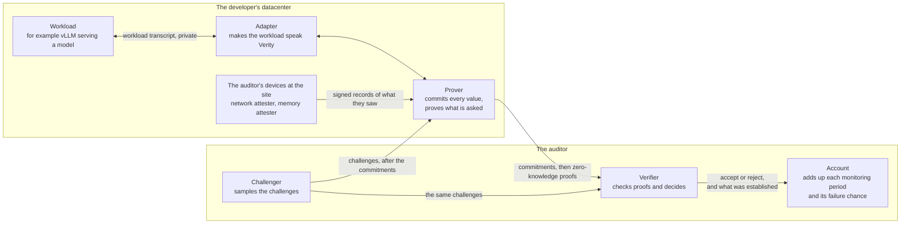
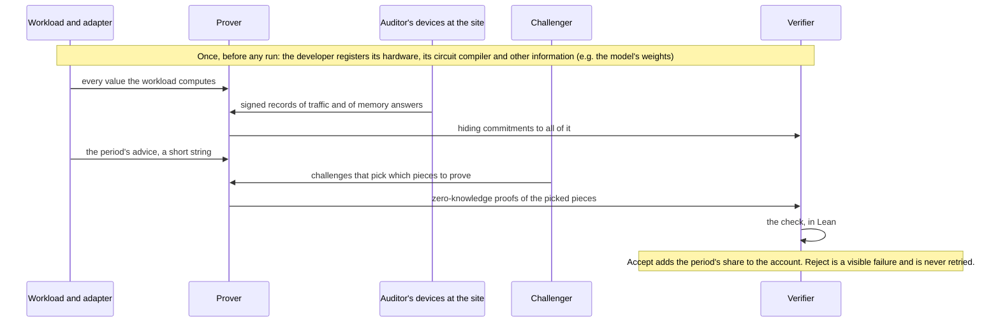
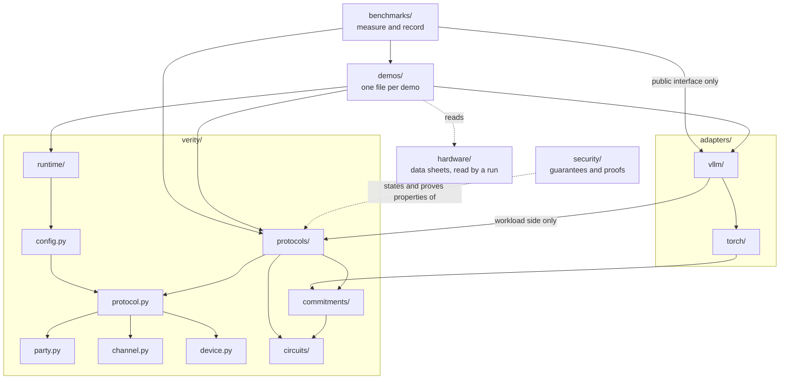
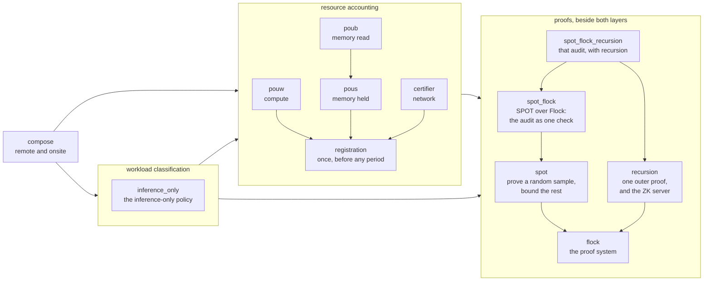
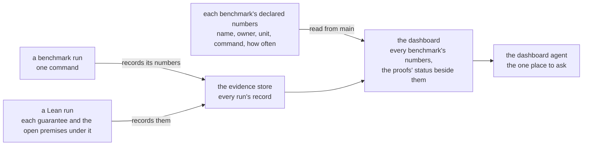

# Verity: the system and its repository at the end state

This file is Verity's architecture: the system and its repository at the end state, in sections 1 to 7.
[GLOSSARY.md](GLOSSARY.md) is the Glossary. [AGENTS.md](AGENTS.md) says what is true on `main` now, and section 7 lists where `main` differs.

## 1. The system in one picture

Verity lets a developer prove to an auditor that the workloads it runs have certain properties, and that its hardware did little else. The auditor never runs the workload, and learns the verdicts and nothing more.



- **Only messages cross between boxes.** The workload transcript never leaves the developer. The protocol transcript is what the prover and the verifier exchange.
- **The auditor's devices hand what they see to the prover, signed.** The auditor sees only proofs about it. This is today's rule, and it is still to be confirmed.
- **Challenges come only from the auditor's side**, and only after the commitments they sample are recorded: from the challenger, and at the site from the memory attester, which samples the challenges of its own timed rounds.
- **Whatever the auditor decides, the verifier decides, and the verifier is Lean.**

## 2. The ideas that organize everything

1. **Three roles, messages only.** The workload is outside Verity. The prover is the developer's. The verifier is the auditor's, with its devices at the site.
2. **A protocol is the unit.** One protocol establishes one property of the workload. Every protocol has the same three sides: its check, its parties and the messages they exchange, and what it needs of the workload. Every protocol's directory has the same three parts: `verifier/` (its check), `prover/` (the developer's side, with the GPU code it runs) and `attester/` (the auditor's own devices, never the developer's GPUs).
3. **Protocols come in two layers, and both call the proofs.** The resource accounting layer measures resources: compute (PoUW), memory (PoUS and PoUB) and network (network attestation). Its base is registration, a protocol that runs once, before any period: the developer registers its hardware, its circuit compiler and other information, the auditor's check accepts or refuses it, and the other accounting protocols account for what it accepted. The workload classification layer sits on the resource accounting layer and holds one protocol, inference-only. Beside both sits the proofs module: the proof system (Flock), with sampling (SPOT) and recursion on it, which any protocol calls to prove a statement about committed values. The proofs take the circuit, its pieces and the sampling rule as given, and read no registration. Compose is on top: remote and onsite are each a list of protocols run on one registration.
4. **Verity knows circuits and values, never models.** Only an adapter names PyTorch, vLLM or a model. A new serving system is a new adapter and changes nothing in `verity/`.
5. **What decides is Lean. What must be fast is Python and CUDA. Public facts are TOML.** Python never returns accept or reject.
6. **Parameters flow one way.** A protocol is pure logic: it takes every parameter as a public input and holds none. `security/` states and proves what holds as a function of the parameters. Calibration chooses the parameters, from measurements and data sheets, and nothing imports calibration code. An application is one file that sets every parameter of a run, with which protocols run and which party runs on which machine; `verity run NAME` runs it.
7. **Benchmarks measure performance and cost, and nothing else.** A benchmark never decides a verdict and never chooses a parameter: a run that chooses one, or tests an assumption a parameter rests on, is calibration. Every benchmark's numbers show on one dashboard.
8. **Trust follows the directory.** What the auditor runs and must trust is each protocol's `verifier/` and `attester/`. What a reader checks to believe a guarantee is its statement and its named assumptions in `security/`, and that Lean's kernel accepted its proof, which the check does again on every change. Nothing else in the repository is trusted.
9. **What a guarantee may rest on.** That SHA-512 resists collisions, that Lean's kernel is right, that the auditor's verifier and devices are honest and sample uniformly random challenges, and the few assumptions approved by name. Anything else a guarantee needs is an open premise with an owner and a date, printed beside the figure.
10. **GPU code implements and never defines.** A kernel computes what its owner states: a commitment, a protocol's circuit, an operation the adapter serves. It lives beside the prover or adapter that runs it, a run names it by the hash of its binary, and a benchmark measures the same binary the served run loads.

## 3. One period, step by step



The compiler is a circuit the developer registers up front. Given the period's advice (which requests ran together, how long each was) it outputs the circuit the workload ran, cut into pieces small enough to prove one at a time.

## 4. The parts and their interfaces

| Part | What it does | Takes in | Hands out | Never knows |
| --- | --- | --- | --- | --- |
| **Workload** (not Verity) | The developer's computation. | What the prover sends it. | Every value it computes. | Anything about the auditor. |
| **Adapter** `adapters/` | Makes one serving system a workload Verity can audit. `vllm/` sits on `torch/`. It holds the compiler and the circuits of the kernels the system serves. | The serving system and its settings. From the prover: what a protocol asks of the workload (run this multiply under PoUW, store these weights). | To the prover only. Up front: the compiler and the weights. Each period: the values and the advice. | The verifier, the auditor's devices, the runtime; how a protocol samples or decides; any protocol's code beyond the one call it makes. |
| **Circuits** `verity/circuits/` | The language circuits are written in, and the circuits a protocol itself names: each GPU operation bit for bit, SHA-512, the universal circuit. | Nothing. | Circuits, each named by its hash. | Models, hardware schedules, proof systems. |
| **Commitments** `verity/commitments/` | Hiding commitments to values, the one hash, signatures. Where the values sit on a GPU, GPU code computes the same bytes there. | Values. | Roots, and openings on request. | What a value means. |
| **Flock** `verity/protocols/proofs/flock` | The proof system: proves in zero knowledge that one statement about one circuit holds of committed values. | A circuit, commitments, challenges. | A proof. Its verifier says accept or reject. | Where the circuit came from. |
| **SPOT** `verity/protocols/proofs/spot` | Sampling: the challenger picks pieces at random after the commitments; from proofs of those it bounds how many of all pieces can be wrong. In its two-stage form it first picks whole requests, the prover then commits the inside of each picked request, and it picks pieces of those. | Commitments, challenges, proofs. | "At most this share is wrong, except with this probability." | What the pieces compute. |
| **Recursion** `verity/protocols/proofs/recursion` | One outer proof says the verifier accepted the developer's proofs. Holds the ZK server, the only exit from the datacenter to the auditor. | Flock's proofs. | One outer proof per statement. | Which protocol asked. |
| **SPOT[Flock]** `verity/protocols/proofs/spot_flock` | SPOT applied to Flock: the sampled audit as one check an auditor runs, in its one-stage and two-stage forms, with the check of what a caller hands in. It is what stands on compose's lists for the proofs. | What the calling protocol passes in (the circuit, its pieces, the sampling rule), commitments, challenges, Flock's proofs. | Accept or reject, with SPOT's bound. | Recursion; which protocol called. |
| **SPOT[Flock] with recursion** `verity/protocols/proofs/spot_flock_recursion` | The recursive audit: the same sampled audit, with recursion's outer proofs standing for the developer's proofs. It sits on `spot_flock` and `recursion`, and nothing below uses it. | What SPOT[Flock] takes, and recursion's outer proofs. | Accept or reject, with SPOT's bound. | Which protocol called. |
| **PoUW** `verity/protocols/resource_accounting/compute/pouw` | Compute: how many of the served matrix multiplies' multiply-adds the GPU really computed, credited against its data sheet's capacity. A workload makes one call, "run this matrix multiply under PoUW", over GPU buffers. | The registered devices and their data sheets, the prover's commitments to each multiply, the challenger's challenges, proofs of the sampled tiles. | Credited work for the period, with its error, to compose's account. | Memory, network; the served values in the clear; the GPU's own word on what it is. |
| **PoUS** and **PoUB** `verity/protocols/resource_accounting/memory/pous`, `poub` | Memory. PoUS: how much of the registered store each device held, with the memory wipe inside it (between two stretches of serving, a server's whole memory is overwritten, so nothing it held before survives). PoUB: how many reads of the store a node made, and so how much of its memory's read rate is left uncertified. | The registered memory and its data sheets, the prover's commitments, the memory attester's signed records, the challenger's challenges. Through compose, the network attester's counts of what entered and left the node. | Bits held and bits read for the period, each with its error, to compose's account. | Compute; the weights; another protocol's code. |
| **Network attestation** `verity/protocols/resource_accounting/network` | Network: what left on a link is what the registered circuit produces from what entered. The auditor's device sits on every registered link out of a host, releases traffic on a fixed schedule and signs a record of what crossed. | The registered links, the network attester's signed records, the prover's commitments to requests and responses, the challenger's challenges. | To compose's account: the period's exfiltration capacity (how many bits could have left unseen), with its error. Through compose, to memory: what entered and left each node. | Compute, memory, the weights. |
| **Inference-only** `verity/protocols/workload_classification/training_detection/inference_only` | The policy: the registered circuit divides into inference blocks that each read little fresh input. | The circuit's description. From training, as data: how much such a circuit slows training. | Accept or reject, to compose. | Values, traffic. |
| **Registration** `verity/protocols/registration` | The accounting protocol that runs once, before any challenge. The developer sends the registration: the hardware, the circuit compiler, and commitments to other information such as the model's weights. The auditor's check accepts it only if it is complete, each device's figures are its data sheet's, and every registered device is accounted for by a protocol on the run's list. It measures nothing itself: it fixes what the other accounting protocols account for. | The registration, the auditor's data sheets, the run's list of protocols. | Accepted or refused. An accepted registration is what the other accounting protocols, the policy and compose then read. A protocol that calls the proofs passes them the registered circuit, and the proofs read no registration. | How any other protocol works inside. |
| **Compose** `verity/protocols/compose` | What an auditor runs. Remote and onsite are each a list of protocols on one registration. Accepts only if every protocol accepts and they agree on the commitments. One theorem covers any list: a prover who adapts across all the protocols at once is still held to each one's claim, except with the summed error. | Registration's outcome and each protocol's. | One verdict, and the period's account. | How any one protocol works inside. |
| **Party, channel, device, protocol, config** five files in `verity/` | The shared types: what a party is, what two parties exchange, the registered hardware, what a protocol declares, the file a run starts from. | Nothing. | Types every protocol uses. | Any one protocol. |
| **Runtime** `verity/runtime/` | Runs a configuration's parties on real machines: sockets, randomness, clock, transcripts. | A configuration. | Running parties and their transcripts. | Any protocol's rules. |
| **Hardware** `hardware/` | One data sheet per GPU, host or server model: what one device can do in a second and what it holds. Each figure names its source and says whether it is a ceiling or a measurement. Data, no code. The auditor brings it. | The vendor's published figures and our own measurements, written in by hand. | Figures a run passes to the registration check. The protocols take a device's capacity from the registration. | Everything. It never holds a figure the audited device reports about itself. |
| **Demos** `demos/` | One file each, a configuration: its protocols, its adapter, which party on which machine. The remote demo, and the onsite demo at three sizes: network, compute (the default) and full. A demo holds no code and is never tuned. | All of the above. | A run anyone can repeat with one command. | Nothing uses a demo. |
| **Security** `security/` | Lean, in three parts: what each protocol guarantees, written to be read; what ties each guarantee to the verifier's own Lean code; and the proofs. A statement never reads a proof. | The verifiers' Lean. | Guarantees, each with its named assumptions and its open premises; one composition theorem for any list of protocols; and the error budget, each failure chance summed over a week, a month and a year (above 1 it prints "no bound at this period"). | Nothing in the system uses it. |
| **The Lean check and the guarantee record** `tools/`, and one record file beside each Lean package | Has Lean's kernel check every proof again. Refuses a missing proof, an added axiom or a way around the kernel. Records each guarantee's statement and every premise it rests on. | Every Lean file: each protocol's `verifier/`, and `security/`. | Pass or fail, to the check. For each guarantee the deployed system rests on, the open premises still under it, to the dashboard. | What a proof is about. It decides no verdict. |
| **Benchmarks** `benchmarks/` | Each benchmark is one command that records named numbers, each marked measured or modeled. Each benchmark's directory declares its numbers: name, owner, unit, command, and how often it should run. | The system, as a user. | Numbers, in the evidence store. | It never decides a verdict, and nothing uses a benchmark. |
| **The training slowdown** its bound in `security/`, its calculator in `benchmarks/slowdown/` | What an accepted period buys: the least factor by which a training run hidden inside declared inference is slowed. | From compose: the policy that held and the compute left uncredited. From `hardware/`: the data sheets. As stated parameters: the share of hardware that is unregistered, and the reference training run. | The slowdown for a week, a month and a year, with the premises it rests on, to the dashboard. | A model, a value, any protocol's insides. Nothing in the system uses it. |
| **Dashboard** (the team's website, not this repository) | Shows every maintained benchmark's numbers under its owner: value, unit, measured or modeled, the run and commit, and age. The proofs' status sits beside them. | From `main`, read-only: each benchmark's declared numbers and who owns each. From the evidence store: every run's record, the Lean run's included. | The page to its reader, and the same report to every agent. | Verity's code. It never runs a benchmark or Lean, never computes or edits a number, and nothing in the repository reads it. |
| **Tools** `tools/` | The `verity` command and the check. The check runs everything that can fail on one commit: every test suite, the Lean build and its proof audit, and the circuit checker. | A commit. | A verdict for each step: pass or fail, and which test failed. | What a change means. It never trusts a developer's word that something passed, and nothing in the system uses it. |

Who runs what, and who must trust it:

| Runs it | What | Who must trust it |
| --- | --- | --- |
| The developer | The workload, the adapter, every protocol's `prover/` | Nobody. A wrong prover can only get honest work rejected. |
| The developer | The ZK server | The developer, for zero knowledge. |
| The auditor | Every protocol's `verifier/`, in Lean | The auditor. |
| The auditor, on machines the developer does not control | Every protocol's `attester/`, and the challenger in SPOT's and compose's `verifier/`: the challenger, the network attester, the memory attester | The auditor. |

## 5. How the parts depend on each other

An arrow reads "uses". Nothing points upward.



Inside `verity/protocols/`:



How a number reaches its reader:



## 6. The repository at the end state

```text
hardware/          data only: one data sheet per GPU or host model
verity/
  party.py         what a party is
  channel.py       what two parties exchange: a message and its types
  device.py        the registered hardware: hosts, devices, memory, links
  protocol.py      what a protocol declares: its parties and messages, what it needs of the workload,
                   which part of the hardware it accounts for
  config.py        reads the one public file a run starts from
  runtime/         runs parties over channels: sockets, randomness and clock, transcripts
  protocols/       each protocol with verifier/ (its Lean check), prover/ (with the GPU code it runs) and attester/
    proofs/        flock, spot, recursion, spot_flock, spot_flock_recursion: what the other protocols call to prove
    resource_accounting/  compute/pouw, memory/pous, memory/poub, network: compute, memory and network
    registration/  runs once, before any challenge: the hardware against its data sheets, the circuit compiler,
                   the commitments to other information, every device accounted for
    workload_classification/  training_detection/inference_only, on resource_accounting/
    compose/       remote and onsite, on workload_classification/ and resource_accounting/
    experimental/  a protocol being tried, which no demo lists: dither, pearl_c4
    interface/     the shape every protocol's check has in Lean, with the registered hardware's type and the
                   account, which every protocol's package reads
  circuits/        the circuit language; ops/ holds the circuits a protocol names
  commitments/     hiding commitments, the one hash, signatures, and their GPU code
adapters/
  torch/
  vllm/            on torch/, with the circuits of the kernels it serves
demos/             one file per demo, the configuration `verity run` reads. A demo holds no code
  README.md        one table: the file, what it shows, its command, how far it runs and is proved
  remote.toml      SPOT, PoUW and the inference-only policy
  onsite_network.toml    the network attester, SPOT and the memory wipe
  onsite_compute.toml    the default: those three, PoUW and the inference-only policy
  onsite_full.toml       those five, PoUS and PoUB
security/          Lean: what each protocol guarantees, and the proofs
benchmarks/        every measurement, each one command, each on the dashboard
tools/             the verity command, the check, the test harnesses
tests/             the rules of the whole tree, as tests
```

Not in it: `fixtures/` (each file goes beside its reader), an archive directory (deleted), and the team's own platform (`infra/`: our machines, the check's runner, the run recorder, the merge queue that moves `main`, and the agents' messages with their lead registry and message router), which is not part of the system. The team's website with the dashboard is already in the platform repository.

The rules that keep the parts apart. A test enforces each one:

1. Nothing in `verity/` uses `adapters/` or `demos/`, or names PyTorch, vLLM or a model.
2. No code uses `security/` or `hardware/`. A run reads the data sheets and passes them in.
3. `runtime/` uses no protocol, and no protocol or adapter uses `runtime/`. Only what starts a run does.
4. `party.py`, `channel.py` and `device.py` use nothing. `protocol.py` uses only those three. `config.py` uses only `protocol.py`.
5. `circuits/` uses nothing. `commitments/` uses only `circuits/`.
6. An adapter uses a protocol's workload side, which is one call over GPU buffers (for PoUW: "run this matrix multiply"). A protocol never uses an adapter.
7. Inside `verity/protocols/`: two layers, resource_accounting (compute/pouw, memory/pous, memory/poub, network) and workload_classification (training_detection/inference_only), with registration beside them, workload_classification on resource_accounting and compose on top of both. Both layers use the proofs (flock, with spot and recursion on it, spot_flock on those and spot_flock_recursion on top), and the proofs use neither layer, so they read no registration: a protocol that calls them passes in the circuit, its pieces and the sampling rule. Registration is the base of resource accounting: it uses the shared files and `commitments/` and no other protocol, and the other accounting protocols, the policy and compose read the registration it accepted. Each group is a directory of its own: `proofs/`, `resource_accounting/` and `workload_classification/`.
8. A verifier uses no prover code.
9. Nothing uses a benchmark, and nothing in the repository reads the dashboard. A measurement reaches a guarantee one way only: a person writes it into a data sheet with its source, marked as a measurement, and the guarantee takes the sheet as a parameter.
10. The tree above is one file in the repository, and a test fails on anything that is not in it. Both are on `main`. The file also lists the places `main` still holds that the tree does not (one, `infra/`), each with its owner and its day, and that list only shrinks.
11. Outside code uses an adapter through its public interface only. The test is on `main` today, with 133 exceptions listed.

| Written in | What goes there |
| --- | --- |
| Lean | Everything that decides: each protocol's check, the registration check, whether a configuration is acceptable, compose. And every guarantee with its proof. |
| TOML | Public facts with no logic: a run's configuration, the hardware data sheets. |
| Python and CUDA | What must be fast or touch the world: provers, adapters, sockets and processes. Python restates Lean only where the prover needs speed, and a test holds each such copy to the Lean. |

## 7. Where `main` differs today

Each difference's owner and day are in `tests/tree.toml` (its `[[not_yet]]` lines and its dated `[[tree]]` entries) and on the Goals page. A landing that closes a row deletes the row here.

**Files that only change place**

| What | Today | At the end |
| --- | --- | --- |
| The circuits of served kernels | `adapters/vllm/verity_vllm/definitions/`, the circuits a protocol names among them | what a protocol names to `verity/circuits/ops/` |
| GPU code | 64 directories, 30 of them under `benchmarks/` | each protocol's `prover/`, `verity/commitments/`, the adapter |
| The compute audit's cost model, and the commands that run an audit on a served run | in SPOT (`prover/audit/`, `prover/cost/`, `verifier/one_stage/`, `verifier/challenger/`), but the audit commands still load scripts under `benchmarks/` (the proof subprotocol, the network attester's pieces, the one-stage replay, the tampered stagings, the bundle's format), and the demo's orchestration script runs them | SPOT's `prover/` and `verifier/`, started from a demo's configuration. The measured proving costs stay recorded under `benchmarks/` and are handed in as data |
| Registration | The log's Lean and Python, the site entry's check and both difftests are in `verity/protocols/registration/`. The site log's own types (its entries, refusals and digests, and `Site.ofLog`) are still in the interface's `CoreProtocol/Site.lean`, and their Python (the log and the site entry's check) in `verity/device.py` | `verity/protocols/registration/`, an accounting protocol that runs once, over `device.py`'s types. Its Lean is cut out of the interface's package, so it is a code change and not in the two chains of moves |
| The policy's two calculators | `benchmarks/inference_only/` and `benchmarks/slowdown/` | training renames the slowdown one |
| The network attester's developer side | Its serving loop and keys are in `attester/`, which the auditor's device starts. Its developer side hangs off one edge, the served table's `CERTIFIER_PIECE`: about 6,800 lines of `benchmarks/network_traces/`, which start the proof drivers in `prover/` on about 4,900 lines of `benchmarks/one_stage/` (`proof_drivers.install`), which rule 9 forbids | network attestation's `prover/` |
| vLLM's scheduler and the advice format, which rule 1 keeps out of `verity/` | The modules that restate the scheduler (the replay step and chain, the compile slices, the cache step, the served rows, tie and statics, the advice check) are in `adapters/vllm/verity_vllm/compiler/`. Four files of the advice's format and its charge are in network attestation's `verifier/` and `prover/` (`advice.py`, `arith_encode.py`, `charge_chain.py`, `window_charge.py`) | The four stay until network attestation takes the advice through an interface: the trusted tie service reads the format, and the charge is mirrored in network attestation's Lean (`AdviceV1`, `WindowCharge`), so moving it changes a Lean statement |
| The areas of `security/` | named before the carve | each carries its protocol's name, and the accounting area holds one protocol's files |
| Applications | `demos/`, the name sections 3 to 6 still use | `applications/`, one file per application, run by `verity run NAME` |
| Calibration | `hardware/`'s data sheets, and under `benchmarks/` the probes and harnesses that choose a parameter or test an assumption one rests on | `calibration/`, which nothing imports |

**Code that has to be written**

| What | Today |
| --- | --- |
| Every protocol has parties | SPOT, PoUW, PoUS, PoUB, network attestation and the inference-only policy declare theirs; the proofs below SPOT, registration and compose don't |
| The messages between workload and prover as one stated list | Function calls and files; 15 files with no settled name or place |
| PoUW's serving code and GPU kernels in one package under `verity/protocols/resource_accounting/compute/pouw/`, reached by one call | The serving code is in `verity/protocols/resource_accounting/compute/pouw/prover/serving/` (12,000 lines), reached by `run_matmul` and `observe_matmul`. The adapter keeps the option with its H1 hooks, the serve loops (`serve_h1`, `serve_pearl`, `serve_tie`), Pearl's row GEMM (`gemm_rows`), H1's commit at acquire, the ncp-v2 replay check and the GPU row-table commit (3,500 lines); the last two and `serve_pearl` still import modules below `serving`. Kernel checks are under `benchmarks/` |
| Benchmarks and demos reach the adapter through its public interface only | 133 modules are reached past it |
| Each demo is one file under `demos/` that `verity run` starts: `remote.toml`, `onsite_network.toml`, `onsite_compute.toml` (the default) and `onsite_full.toml` | The four files are there and `demos/` holds nothing else. `verity run` resolves only `onsite_full.toml`, as a dry run with no party live: it refuses `remote.toml` by name, since Pearl+ has no party, and stops on the two smaller onsite files. Its table writes each file and reads back only the pins, where the file should be the source the code reads |
| Dither and the FP4 variant (Pearl-C4) are protocols being tried, under `verity/protocols/experimental/` | Dither's kernels and circuit are there, and Pearl-C4's kernel; Pearl-C4's scheme, circuit and vectors are in PoUW's package, whose own circuits load its circuit |
| The team's platform is in its own repository, today's `compute-verification/infra` | `infra/`, the run recorder and the agents' guard are in this one until their day in `tests/tree.toml`. The move tool stays, since its maps are this tree's records |
| Python never returns accept or reject | Several protocols still decide in Python. SPOT's two-stage outcome is joined in Python; its Lean verifier accepts the form ahead of its proof, and the accept's record says its form is not yet proved |
| Each accounting protocol takes the registered hardware and says which part it accounts for | None does |
| The security model has the auditor's devices as parties, each with a key the auditor pins and its whole signing history | Only the challenger is a party, so no onsite memory or network claim can be proved yet |
| A device's figures have one source: the registration reads them from the auditor's data sheet | Written in two places that disagree (the H200's tensor rate at two clocks) |
| "Registration" names one thing: SPOT's own record of a run takes another name | SPOT's prose, its Lean (`Spot.Docket`), its module (`one_stage/docket.py`) and the names it alone defines call it the docket. Its Python still calls the docket `registration` where the name is one other lanes' functions share (`rows.registration`, `network_attester_rows.registration`, the network attester service's). Its CLI flags and subcommands (`--registration`, `--window-registration`, `weights-registration`, `public-registration`), file names, formats and keys keep the word: they are wire words that scripts and records already carry |
| The circuit checker is handed the served circuits and names none | It names them |
| The compiler cuts a period's circuit into pieces wired to each other | For the demo's model the pieces are wired only where the eight GPUs combine results, so the audit's second round runs over a stand-in |
| Every kernel the serving settings run has a circuit held to the kernel on an H200 | Three of five on `main` (the cache's write and both its reads) |
| Every kind of piece in a request has a statement the Lean verifier accepts | 111 of the plan's 1,272 kinds (5 on Boolean versions only) by a stored record; the other 1,161 have none; `cover_count.py --card` checks its kinds |
| The proofs' status on the dashboard: guarantees fully proved, open premises per lead | Printed by the Lean check only |
| Every area of `security/` has a lead | 826 of its 4,816 files fall to lean because no lead claims them |
| A memory-read session is proved in zero knowledge | Each span's openings go to the verifier as they are |
| PoUS's setup is a proof about the store | The check reads the whole store |
| PoUS's session is checked inside a proof | The check reads the memory attester's signed record as it is: for each round, which block was asked, when it was sent and answered, and the block's SHA-512 digest. It also reads a table of every block's digest. A digest hides nothing from someone who holds a candidate block |

## Documentation

- Specifications: the [program format](verity/circuits/PROTOCOL.md), the commitment schemes ([frame-v3](verity/commitments/frame_v3/PROTOCOL.md), [vllm-v1](adapters/vllm/verity_vllm/commitments/vllm_v1/PROTOCOL.md)), the protocols, stated in Lean (`security/`) with each one's README as its outline, and Flock's verifier, stated in Lean (`verity/protocols/proofs/flock/verifier/`), with [its outline](verity/protocols/proofs/flock/prover/agreement/README.md).
- Each subprotocol's README; [AGENTS.md](AGENTS.md) for contributors (the map, the rules, how a change lands).
