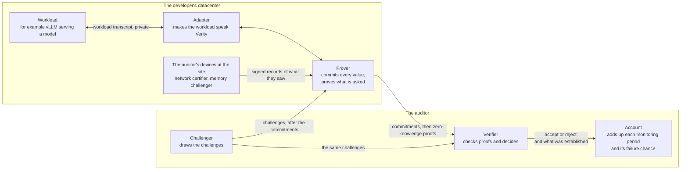
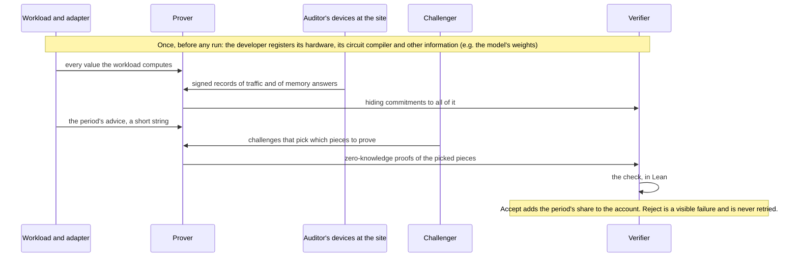
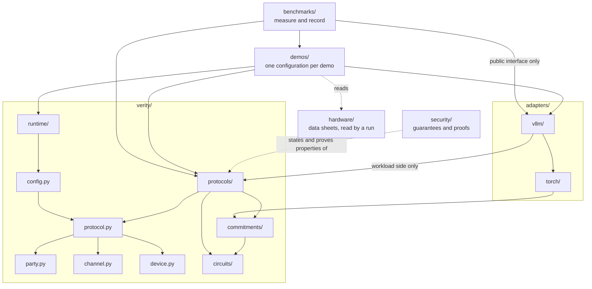
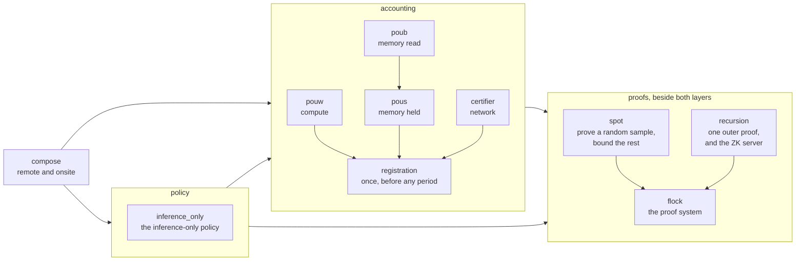
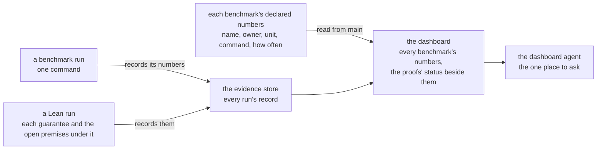

# Verity: the system and its repository at the end state

This file is Verity's architecture: the system and its repository at the end state, in sections 1 to 7, with the
Glossary at the end. [AGENTS.md](AGENTS.md) says what is true on `main` now, and section 7 lists where `main` differs.

## 1. The system in one picture

Verity lets a developer prove to an auditor that the workloads it runs have certain properties, and that its hardware did little else. The auditor never runs the workload, and learns the verdicts and nothing more.



- **Only messages cross between boxes.** The workload transcript never leaves the developer. The protocol transcript is what the prover and the verifier exchange.
- **The auditor's devices hand what they see to the prover, signed.** The auditor sees only proofs about it. This is today's rule, and it is still to be confirmed.
- **Challenges come only from the auditor's side**, and only after the commitments they sample are recorded: from the challenger, and at the site from the memory challenger, which draws the challenges of its own timed rounds.
- **Whatever the auditor decides, the verifier decides, and the verifier is Lean.**

## 2. The ideas that organize everything

1. **Three roles, messages only.** The workload is outside Verity. The prover is the developer's. The verifier is the auditor's, with its devices at the site.
2. **A protocol is the unit.** One protocol establishes one property of the workload. Every protocol has the same three sides: its check, its parties and the messages they exchange, and what it needs of the workload. Every protocol's directory has the same three parts: `verifier/` (its check), `prover/` (the developer's side, with the GPU code it runs) and `device/` (the auditor's own devices, never the developer's GPUs).
3. **Protocols come in two layers, and both call the proofs.** The accounting layer measures resources: compute (PoUW), memory (PoUS and PoUB) and network (the certifier). Its base is registration, a protocol that runs once, before any period: the developer registers its hardware, its circuit compiler and other information, the auditor's check accepts or refuses it, and the other accounting protocols account for what it accepted. The policy layer sits on the accounting layer and holds one protocol, inference-only. Beside both sits the proofs module: the proof system (Flock), with sampling (SPOT) and recursion on it, which any protocol calls to prove a statement about committed values. The proofs take the circuit, its pieces and the sampling rule as given, and read no registration. Compose is on top: remote and onsite are each a list of protocols run on one registration.
4. **Verity knows circuits and values, never models.** Only an adapter names PyTorch, vLLM or a model. A new serving system is a new adapter and changes nothing in `verity/`.
5. **What decides is Lean. What must be fast is Python and CUDA. Public facts are TOML.** Python never returns accept or reject.
6. **Hardware and configuration are data, passed in.** A data sheet per GPU model. One file per run that says which protocols run and which party runs on which machine.
7. **Measuring is separate from the system.** A benchmark never decides a verdict. Every benchmark's numbers show on one dashboard.
8. **Trust follows the directory.** What the auditor runs and must trust is each protocol's `verifier/` and `device/`. What a reader checks to believe a guarantee is its statement and its named assumptions in `security/`, and that Lean's kernel accepted its proof, which the check does again on every change. Nothing else in the repository is trusted.
9. **What a guarantee may rest on.** That SHA-512 resists collisions, that Lean's kernel is right, that the auditor's verifier and devices are honest and draw uniformly random challenges, and the few assumptions approved by name. Anything else a guarantee needs is an open premise with an owner and a date, printed beside the figure.
10. **GPU code implements and never defines.** A kernel computes what its owner states: a commitment, a protocol's circuit, an operation the adapter serves. It lives beside the prover or adapter that runs it, a run names it by the hash of its binary, and a benchmark measures the same binary the served run loads.

## 3. One period, step by step



The compiler is a circuit the developer registers up front. Given the period's advice (which requests ran together, how long each was) it outputs the circuit the workload ran, cut into pieces small enough to prove one at a time.

## 4. The parts and their interfaces

| Part | What it does | Takes in | Hands out | Never knows |
| --- | --- | --- | --- | --- |
| **Workload** (not Verity) | The developer's computation. | What the prover sends it. | Every value it computes. | Anything about the auditor. |
| **Adapter** `adapters/` | Makes one serving system a workload Verity can audit. `vllm/` sits on `torch/`. It holds the compiler and the circuits of the kernels the system serves. | The serving system and its settings. From the prover: what a protocol asks of the workload (run this multiply under PoUW, store these weights). | To the prover only. Up front: the compiler and the weights. Each period: the values and the advice. | The verifier, the auditor's devices, the runtime; how a protocol samples or decides; any protocol's code beyond the one call it makes. |
| **Circuits** `verity/circuits/` | The language circuits are written in, and the circuits a protocol itself names: each GPU operation bit for bit, SHA-512, the universal circuit. | Nothing. | Circuits, each named by its hash. | Models, hardware schedules, proof systems. |
| **Commitments** `verity/commitments/` | Hiding commitments to values, the one hash, signatures. Where the values sit on a GPU, GPU code computes the same bytes there. | Values. | Roots, and openings on request. | What a value means. |
| **Flock** `protocols/proofs/flock` | The proof system: proves in zero knowledge that one statement about one circuit holds of committed values. | A circuit, commitments, challenges. | A proof. Its verifier says accept or reject. | Where the circuit came from. |
| **SPOT** `protocols/proofs/spot` | Sampling: the challenger picks pieces at random after the commitments; from proofs of those it bounds how many of all pieces can be wrong. In its two-stage form it first picks whole requests, the prover then commits the inside of each picked request, and it picks pieces of those. | Commitments, challenges, proofs. | "At most this share is wrong, except with this probability." | What the pieces compute. |
| **Recursion** `protocols/proofs/recursion` | One outer proof says the verifier accepted the developer's proofs. Holds the ZK server, the only exit from the datacenter to the auditor. | Flock's proofs. | One outer proof per statement. | Which protocol asked. |
| **PoUW** `protocols/accounting/pouw` | Compute: how many of the served matrix multiplies' multiply-adds the GPU really computed, credited against its data sheet's capacity. A workload makes one call, "run this matrix multiply under PoUW", over GPU buffers. | The registered devices and their data sheets, the prover's commitments to each multiply, the challenger's challenges, proofs of the sampled tiles. | Credited work for the period, with its error, to compose's account. | Memory, network; the served values in the clear; the GPU's own word on what it is. |
| **PoUS** and **PoUB** `protocols/accounting/pous`, `poub` | Memory. PoUS: how much of the registered store each device held, with the memory wipe inside it (between two stretches of serving, a server's whole memory is overwritten, so nothing it held before survives). PoUB: how many reads of the store a node made, and so how much of its memory's read rate is left uncertified. | The registered memory and its data sheets, the prover's commitments, the memory challenger's signed records, the challenger's challenges. Through compose, the network certifier's counts of what entered and left the node. | Bits held and bits read for the period, each with its error, to compose's account. | Compute; the weights; another protocol's code. |
| **Certifier** `protocols/accounting/certifier` | Network: what left on a link is what the registered circuit produces from what entered. The auditor's device sits on every registered link out of a host, releases traffic on a fixed schedule and signs a record of what crossed. | The registered links, the network certifier's signed records, the prover's commitments to requests and responses, the challenger's challenges. | To compose's account: the period's exfiltration capacity (how many bits could have left unseen), with its error. Through compose, to memory: what entered and left each node. | Compute, memory, the weights. |
| **Inference-only** `protocols/policy/inference_only` | The policy: the registered circuit divides into inference blocks that each read little fresh input. | The circuit's description. From training, as data: how much such a circuit slows training. | Accept or reject, to compose. | Values, traffic. |
| **Registration** `protocols/accounting/registration` | The accounting protocol that runs once, before any challenge. The developer sends the registration: the hardware, the circuit compiler, and commitments to other information such as the model's weights. The auditor's check accepts it only if it is complete, each device's figures are its data sheet's, and every registered device is accounted for by a protocol on the run's list. It measures nothing itself: it fixes what the other accounting protocols account for. | The registration, the auditor's data sheets, the run's list of protocols. | Accepted or refused. An accepted registration is what the other accounting protocols, the policy and compose then read. A protocol that calls the proofs passes them the registered circuit, and the proofs read no registration. | How any other protocol works inside. |
| **Compose** `protocols/compose` | What an auditor runs. Remote and onsite are each a list of protocols on one registration. Accepts only if every protocol accepts and they agree on the commitments. One theorem covers any list: a prover who adapts across all the protocols at once is still held to each one's claim, except with the summed error. | Registration's outcome and each protocol's. | One verdict, and the period's account. | How any one protocol works inside. |
| **Party, channel, device, protocol, config** five files in `verity/` | The shared types: what a party is, what two parties exchange, the registered hardware, what a protocol declares, the file a run starts from. | Nothing. | Types every protocol uses. | Any one protocol. |
| **Runtime** `verity/runtime/` | Runs a configuration's parties on real machines: sockets, randomness, clock, transcripts. | A configuration. | Running parties and their transcripts. | Any protocol's rules. |
| **Hardware** `hardware/` | One data sheet per GPU, host or server model: what one device can do in a second and what it holds. Each figure names its source and says whether it is a ceiling or a measurement. Data, no code. The auditor brings it. | The vendor's published figures and our own measurements, written in by hand. | Figures a run passes to the registration check. The protocols take a device's capacity from the registration. | Everything. It never holds a figure the audited device reports about itself. |
| **Demos** `demos/` | One configuration each: its protocols, its adapter, which party on which machine. The remote demo and the onsite demo. | All of the above. | A run anyone can repeat with one command. | Nothing uses a demo. |
| **Security** `security/` | Lean, in three parts: what each protocol guarantees, written to be read; what ties each guarantee to the verifier's own Lean code; and the proofs. A statement never reads a proof. | The verifiers' Lean. | Guarantees, each with its named assumptions and its open premises; one composition theorem for any list of protocols; and the error budget, each failure chance summed over a week, a month and a year (above 1 it prints "no bound at this period"). | Nothing in the system uses it. |
| **The Lean check and the guarantee record** `tools/`, and one record file beside each Lean package | Has Lean's kernel check every proof again. Refuses a missing proof, an added axiom or a way around the kernel. Records each guarantee's statement and every premise it rests on. | Every Lean file: each protocol's `verifier/`, and `security/`. | Pass or fail, to the check. For each guarantee the deployed system rests on, the open premises still under it, to the dashboard. | What a proof is about. It decides no verdict. |
| **Benchmarks** `benchmarks/` | Each benchmark is one command that records named numbers, each marked measured or modeled. Each benchmark's directory declares its numbers: name, owner, unit, command, and how often it should run. | The system, as a user. | Numbers, in the evidence store. | It never decides a verdict, and nothing uses a benchmark. |
| **The training slowdown** its bound in `security/`, its calculator in `benchmarks/slowdown/` | What an accepted period buys: the least factor by which a training run hidden inside declared inference is slowed. | From compose: the policy that held and the compute left uncredited. From `hardware/`: the data sheets. As stated parameters: the share of hardware that is unregistered, and the reference training run. | The slowdown for a week, a month and a year, with the premises it rests on, to the dashboard. | A model, a value, any protocol's insides. Nothing in the system uses it. |
| **Dashboard** (the team's website, not this repository) | Shows every maintained benchmark's numbers under its owner: value, unit, measured or modeled, the run and commit, and age. The proofs' status sits beside them. | From `main`, read-only: each benchmark's declared numbers and who owns each. From the evidence store: every run's record, the Lean run's included. | The page to its reader, and the same report to every agent. | Verity's code. It never runs a benchmark or Lean, never computes or edits a number, and nothing in the repository reads it. |
| **Tools** `tools/` | The `verity` command and the check. The check runs everything that can fail on one commit: every test suite, the Lean build and its proof audit, and the circuit checker. | A commit. | A verdict for each step: pass or fail, and which test failed. | What a change means. It never trusts a developer's word that something passed, and nothing in the system uses it. |

Who runs what, and who must trust it:

| Runs it | What | Who must trust it |
| --- | --- | --- |
| The developer | The workload, the adapter, every protocol's `prover/` | Nobody. A wrong prover can only get honest work rejected. |
| The developer | The ZK server | The developer, for zero knowledge. |
| The auditor | Every protocol's `verifier/`, in Lean | The auditor. |
| The auditor, on machines the developer does not control | Every protocol's `device/`: the challenger, the network certifier, the memory challenger | The auditor. |

## 5. How the parts depend on each other

An arrow reads "uses". Nothing points upward.



Inside `protocols/`:



How a number reaches its reader:



## 6. The repository at the end state

```text
hardware/          data only: one data sheet per GPU or host model
verity/
  party.py         what a party is
  channel.py       what two parties exchange: a message and its types
  device.py        the registered hardware: hosts, devices, memory, links
  protocol.py      what a protocol declares: its parties and messages, what it needs of the workload,
                   which part of the hardware it accounts for
  config.py        reads the one public file a run starts from
  runtime/         runs parties over channels: sockets, randomness and clock, transcripts
  protocols/       each protocol with verifier/ (its Lean check), prover/ (with the GPU code it runs) and device/
    proofs/        flock, spot, recursion: what the other protocols call to prove
    accounting/    registration, then pouw, pous, poub, certifier. Registration runs once, before any challenge:
                   the hardware against its data sheets, the circuit compiler, the commitments to other
                   information, every device accounted for. The others: compute, memory and network
    policy/        inference_only, on accounting/
    compose/       remote and onsite, on policy/ and accounting/
    experimental/  a protocol being tried, which no demo lists
  circuits/        the circuit language; ops/ holds the circuits a protocol names
  commitments/     hiding commitments, the one hash, signatures, and their GPU code
adapters/
  torch/
  vllm/            on torch/, with the circuits of the kernels it serves
demos/             one directory per demo, holding its configuration
security/          Lean: what each protocol guarantees, and the proofs
benchmarks/        every measurement, each one command, each on the dashboard
tools/             the verity command, the check, the test harnesses
tests/             the rules of the whole tree, as tests
```

Not in it: `fixtures/` (each file goes beside its reader), `archive/` (deleted), and the team's own platform (`infra/`: our machines, the check's runner, the run recorder, the merge queue that moves `main`, and the agents' messages with their lead registry and message router), which is not part of the system. The team's website with the dashboard is already in the platform repository.

The rules that keep the parts apart. A test enforces each one:

1. Nothing in `verity/` uses `adapters/` or `demos/`, or names PyTorch, vLLM or a model.
2. No code uses `security/` or `hardware/`. A run reads the data sheets and passes them in.
3. `runtime/` uses no protocol, and no protocol or adapter uses `runtime/`. Only what starts a run does.
4. `party.py`, `channel.py` and `device.py` use nothing. `protocol.py` uses only those three. `config.py` uses only `protocol.py`.
5. `circuits/` uses nothing. `commitments/` uses only `circuits/`.
6. An adapter uses a protocol's workload side, which is one call over GPU buffers (for PoUW: "run this matrix multiply"). A protocol never uses an adapter.
7. Inside `protocols/`: two layers, accounting (registration, pouw, pous, poub, certifier) and policy (inference_only), with policy on accounting and compose on top of both. Both layers use the proofs (flock, with spot and recursion on it), and the proofs use neither layer, so they read no registration: a protocol that calls them passes in the circuit, its pieces and the sampling rule. Registration is the base of `accounting/`: it uses the shared files and `commitments/` and no other protocol, and the other accounting protocols, the policy and compose read the registration it accepted. Each group is a directory of its own: `proofs/`, `accounting/` and `policy/`.
8. A verifier uses no prover code.
9. Nothing uses a benchmark, and nothing in the repository reads the dashboard. A measurement reaches a guarantee one way only: a person writes it into a data sheet with its source, marked as a measurement, and the guarantee takes the sheet as a parameter.
10. The tree above is one file in the repository, and a test fails on anything that is not in it. Both are on `main`. The file also lists the 36 places `main` still holds that the tree does not, each with its owner and its day (the last is Tue 24 Nov), and that list only shrinks.
11. Outside code uses an adapter through its public interface only. The test is on `main` today, with 114 exceptions listed.

| Written in | What goes there |
| --- | --- |
| Lean | Everything that decides: each protocol's check, the registration check, whether a configuration is acceptable, compose. And every guarantee with its proof. |
| TOML | Public facts with no logic: a run's configuration, the hardware data sheets. |
| Python and CUDA | What must be fast or touch the world: provers, adapters, sockets and processes. Python restates Lean only where the prover needs speed, and a test holds each such copy to the Lean. |

## 7. Where `main` differs today

Each difference's owner and day are in `tests/tree.toml` (its `[[not_yet]]` lines and its dated `[[tree]]` entries) and on the Goals page. A landing that closes a row deletes the row here.

**Files that only change place**

| What | Today | At the end |
| --- | --- | --- |
| The circuits of served kernels | `verity/definitions/` | what a protocol names to `verity/circuits/ops/`, the rest to `adapters/vllm/` |
| Leftovers in `verity/`: `claims/`, `settings.py`, `composite/` | `verity/` | deleted, `tools/`, and inside `compose/` |
| Loose files inside five protocols | beside `verifier/`, `prover/`, `device/` | inside one of the three, or out of `verity/` |
| `fixtures/` | the root | each file beside its reader |
| GPU code | 61 directories, 49 of them under `benchmarks/`. A served run loads PoUW's kernel from there, which rule 9 forbids | each protocol's `prover/`, `verity/commitments/`, the adapter |
| The check | `tools/verity/check/` | `tools/check/` |
| The numbers each benchmark declares | one shared list | each benchmark's own directory, its owner's |
| The compute audit's cost model, and the commands that run an audit on a served run | proofs' scripts under `benchmarks/` | SPOT's `prover/` and `verifier/`, started from a demo's configuration. The measured proving costs stay recorded under `benchmarks/` and are handed in as data |
| Registration | `protocols/interface/`, `verity/hardware/site/` and `verity/hardware/registration.py`. Three test files of SPOT's read it today and move with it | `verity/protocols/accounting/registration/`, an accounting protocol that runs once, over `device.py`'s types. Its Lean is cut out of the interface's package, so it is a code change and not in the two chains of moves |
| The policy's two calculators | inside `protocols/inference_only/` | two directories under `benchmarks/`; training renames the slowdown one |
| The network certifier a served run starts: its serving loop, its keys, its prover | `benchmarks/`, about 25,000 lines, and the auditor's device runs them from there, which rule 9 forbids | the certifier's `device/` and `prover/` |
| The areas of `security/` | named before the carve | each carries its protocol's name, and the accounting area holds one protocol's files |

**Code that has to be written**

| What | Today |
| --- | --- |
| Every protocol has parties | Only SPOT, PoUS and the remote memory-read audit do |
| A PyTorch adapter under the vLLM adapter, with one translator from PyTorch to circuits | One adapter, and a second translator inside the training benchmark |
| The messages between workload and prover as one stated list | Function calls and files; 15 files with no settled name or place |
| PoUW's serving code and GPU kernels in one package under `protocols/accounting/pouw/`, reached by one call | In the adapter (18,800 lines) and under `benchmarks/` |
| Benchmarks and demos reach the adapter through its public interface only | 114 modules are reached past it |
| The two demos start from a configuration, run by the runtime | The remote demo is a shell script under `benchmarks/`; the onsite demo is not built |
| Python never returns accept or reject | Several protocols still decide in Python. SPOT's two-stage outcome is joined in Python; its Lean check is written and refuses every audit until its proof exists |
| Each accounting protocol takes the registered hardware and says which part it accounts for | None does |
| The security model has the auditor's devices as parties, each with a key the auditor pins and its whole signing history | Only the challenger is a party, so no onsite memory or network claim can be proved yet |
| A device's figures have one source: the registration reads them from the auditor's data sheet | Written in two places that disagree (the H200's tensor rate at two clocks) |
| "Registration" names one thing: SPOT's own record of a window takes another name | SPOT's code calls the record it fixes before any challenge a registration record: the circuit's digest, its pieces, the sampling rule and the committed roots. That is SPOT's input, not the registration |
| The circuit checker is handed the served circuits and names none | It names them |
| The compiler cuts a period's circuit into pieces wired to each other | For the demo's model the pieces are wired only where the eight GPUs combine results, so the audit's second round runs over a stand-in |
| Every kernel the production settings serve has a circuit held to the kernel on an H200 | Three of five on `main` (the cache's write and both its reads) |
| Every kind of piece in a request has a statement the Lean verifier accepts | 177 of 254 kinds, holding 99.9653% of the request's 11.28 billion pieces, by a record in the store and on a branch; `main` shows none of it yet |
| One form of the network certifier | Two: the remote demo runs an older one, a proxy in front of the server; the onsite demo runs the device on the link |
| The Lean takes a data sheet as a parameter | Two Lean tables restate their data sheets |
| Every benchmark on the dashboard | 5 of 69 wired; 3 of the 5 show a value no older than their schedule allows |
| The proofs' status on the dashboard: guarantees fully proved, open premises per lead | Printed by the Lean check only |
| The Lean check passes on the public repository | On Tuesday's export 14 of 16 Lean packages pass |
| Every area of `security/` has a lead | 826 of its 4,816 files fall to lean because no lead claims them |
| A memory-read session is proved in zero knowledge | Each span's openings go to the verifier as they are |
| PoUS's setup is a proof about the store | The check reads the whole store |
| PoUS's session is checked inside a proof | The check reads the memory challenger's signed record as it is: for each round, which block was asked, when it was sent and answered, and the block's SHA-512 digest. It also reads a table of every block's digest. A digest hides nothing from someone who holds a candidate block |

## Documentation

- Specifications: the [program format](verity/circuits/PROTOCOL.md), the commitment schemes ([frame-v3](verity/commitments/frame_v3/PROTOCOL.md), [vllm-v1](adapters/vllm/verity_vllm/commitments/vllm_v1/PROTOCOL.md)), the protocols, stated in Lean (`security/`) with each one's README as its outline, and Flock's verifier, stated in Lean (`verity/protocols/proofs/flock/verifier/`), with [its outline](verity/protocols/proofs/flock/prover/agreement/README.md).
- Each subprotocol's README; [AGENTS.md](AGENTS.md) for contributors (the map, the rules, how a change lands).

## Glossary

Code, docs, CLI help and output fields use these terms. When a term changes, this section changes with it, and the new term is rolled out in the same change.

- **Developer** and **auditor**: the protocol's two parties. The developer runs computations in its datacenters, keeps private records of them and proves properties of those records; the auditor checks the proofs, with a challenger online and a verifier offline, and places its own devices, network certifiers and memory challengers, at the developer's site on machines the developer doesn't control. Nothing the developer runs or hosts is trusted. Trust in a device and its host is the named assumption `trusted-host` (`TrustedHost`), which per-party `Faithful`, `Secret` and `Confined` are to replace.
- **Program**: the computation a proof claims something about (`verity.circuits.Program`): one circuit, stored compressed as Definitions called from a root body, with the same interface at every level. The proof system is generic, so "model" never names it.
- **Registered input** and **run input**: the two binding times of a program's input gates (`verity.circuits.program`). A registered input (`RegisteredInput<w>_v1`) is bound when the program is registered and holds what the program brings: its weights, constants such as a norm's epsilon, the attention scale or a softcap, and tables such as `gelu_tanh_bf16`. A run input (`Input<w>_v1`) is bound per request and holds the request's data and parameters, such as temperature, top-p and the Philox positions. Both are values, committed under hiding leaves, so a program holds no data; a constant gate is an operation's own bits (`verity.circuits.constants`).
- **Workload**: what a datacenter runs over a monitoring period: its Programs, their inputs (weights, and requests or data) and their placement. One thing at every scale, workloads compose, and "row" never names one.
- **Operation**: a Definition whose own definition is gates: the floating-point formats' constants, the round constants of SHA-512 and Keccak-f, and every measured MUFU table (the library, `verity.circuits.library`) are its bits, not a program's data. The operations are one pinned, versioned list (`verity.circuits.operations`, `verity/operations` v2), and its guard (`operations.program_data`) lists the data a program still holds: a constant outside any operation, and a table a primitive reads that the library does not list. No statement or table claims that a program's values are always hidden until the guard returns {} for it.
- **Circuit**: gates and the wires between them. A program is a compressed circuit; an *expanded* circuit is written out gate by gate, like the files Flock's circuit prover proves. A proof system's lowering of a statement is also a circuit ("SHA-512 in circuit").
- **Gate**: a node of a circuit: an input gate, the constant 0 or 1 as one of an operation's own bits, the AND or XOR of two or more bits, or NOT, each outputting one bit (`verity.circuits.boolean`). A constant or table that a program or a request brings is a value, never a gate, even a table of a fixed function with no program parameter (`TanhF32Rn_v1`'s RN32 tanh).
- **Value**: the bit a gate takes in one run. The *trace* is all of them (`verity.circuits.evaluation.reference.Trace`), and an element's or port's value is the trace read at its gates, in order. Gates, wires, ports, elements and shapes (batch size, sequence length) are structure, public until a private-circuit protocol; values are data, even those the same in every run, and everything a program or a request brings is one: the weights, a program's constants and tables, a request's parameters. A value is always hidden, committed under a hiding leaf and touched only inside a zero-knowledge proof. The messages between prover and verifier are the *proof transcript*; "transcript" names only those.
- **Commitment scheme**: how serving committed the values being proven, such as frame-v3 rows or `vllm-v1` (`verity.commitments`), each with a stable id and the hash assumptions it rests on; `frame-v3-sha512` and `vllm-v1-sha512` are their framings through SHA-512.
- **Hiding leaf**: a leaf whose published data hides the committed value (statistically with uniform salts; `Hash.Keyed` computationally), so a low-entropy value can't be found from its digest. `hm96-sha512/v1` (`verity.commitments.hm96`) wraps a scheme's SHA-512 leaf digest with a salt stored beside the value, and opens with both; with its pinned key the bound is N·2^-192 for N leaves, except for a 2^-64 fraction of keys.
- **Statement**: what the proof system proves, the full committed relation: a circuit (a subcircuit, or the sampled proof blocks) plus the commitment scheme binding its inputs and outputs. Changing the scheme changes the statement, not the proof system.
- **Proof system**: what proves statements, the one system behind PoUW, PoUS and network certification: Flock, run by the developer's workers behind the ZK server, and the auditor's challenger and verifier. Flock's **circuit prover** proves a statement over an expanded circuit (`verity/flock-circuit`), and its zero-knowledge version, **Flock ZK**, is what the proof system runs. A protocol states only a `Spec` (`verity.protocols.proofs.spot.verifier.service`): what it commits, its selection rule, its check as a public Program and its public items, each with its reason. The proof system handles commitments, coins, proving and verifying, and the auditor learns nothing about the weights or data beyond each protocol's stated public outputs. "The proof system" means all of this, not Flock alone; the archived ones (A-GKR, B-Ligero, D-SP1, VOLE) are *backends*.
- **Partition**: a division of a program's computed gates into proof blocks, each gate in exactly one (`verity/partition/v1`, `verity.circuits.partition_object`). Gates with no inputs (registered and run inputs, constants) are bound outside it. It is a named query on the program, which a verifier evaluates itself: the object holds the program's digest and the query's name, version and parameters, such as `Q_call` v1 (each Call cut down its hierarchy until every proof block has at most `X` output bits) or `Q_word` v1. The committed set, every gate read across a proof-block boundary plus every computing gate a Call returns, follows from it and is never stored.
- **Block**: a part of a circuit, registered or actual: a set of its gates, with the ticks it runs in where it has a time span. Every semantically meaningful partition of the registered or actual circuit is a block with a prefix: a **proof block** (one part of a partition, proved on its own), a **server block** (the actual circuit's gates on one registered server between two wipes), a **replay block**, an **execution block** (one execution phase's; Reported advice, below), the inference-only policy's **inference block**, the covering argument's **multiplication block**, PoUW's **check block** (Theorem S), and **Flock's block** (one copy of the block circuit in a statement; "Flock block" outside Flock's own docs). "Block" names nothing else: a thing that is not a part of a circuit takes its own word (the older names, [GLOSSARY.md](GLOSSARY.md)), and an outside API's name (CUDA's `blockIdx`, vLLM's `block_table`, Mathlib's `Matrix.fromBlocks`) stays as it is.
- **Proof block**: one part of a partition, proved on its own: a set of gates u whose inputs in(u) and outputs out(u) (`verity.circuits.parts`) are ordered bit strings, counted in bits. Its outputs fit its Definition's public size class (16 to 262,144 bits, `sizeClasses`); its inputs are unbounded; one can be incorrect (see Incorrect proof block). The challenger's coins select the proof blocks to prove.
- **Reported advice** and the **registered circuit**: setup fixes the registered information θ (models, code, stored data) and the **registered compiler** B. In verification phase j the developer reports its committed **advice** a_j, at most ℓ_a bits Verity never interprets; B(a_j) is the phase's **execution block** E_j, and the registered circuit is D = E_1 ‖ … ‖ E_n. In the Lean, `Verity.RegisteredCircuit` holds θ and B (its `builder`), and D, 𝓘 and the proof blocks are B's output on θ and the advice (`Compiler.run`); the trace is `Verity.Committed`.
- **Registered circuit** D and **actual circuit** A: D is what the developer claims it computed, its registered programs on its committed inputs, with inference blocks 𝓘, B's output (Reported advice). A is everything the hardware actually computed, hidden work included, *placed*: each gate at a device and a tick (`Accounting.Placed`), which gives physical time and location and orders no blocks. Server blocks are A's and inference blocks D's, and they meet in verified compute, where each inference block sits inside one server block (the inference partition refines the server partition, `Verity.Partition.Refines`); gates on unregistered hardware are in no block. Credit is in Size; informational prices p_i (bits) and counting weights ω_v remain.
- **(c,k)-partition** and **inference block**: a (c,k)-partition divides a circuit's computed gates into blocks, each with gate budget c (exactly c gates) and fresh-input budget k (at most k fresh input bits), in no order (each block inherits the circuit's). An inference block is a block of 𝓘, the (c,k)-partition of D the compiler outputs, which the verifier checks each phase (the inference-only policy's check, `NciCheck`).
- **Policy**: a condition on the registered circuit that the verifier checks from it and its registered information alone, a protocol with no rounds of its own. The inference-only policy is the first; its Lean (`Nci.Complies`) states the older form, blocks of at most Γ gates each reading at most α fresh input bits per gate.
- **Subprotocol**: the older word for a protocol a configuration lists. New prose says "protocol"; identifiers and older prose keep it until the word move. Each goes by its name alone, with no alias ("integrity", "work", "space", "communication"); "leg" is retired.
- **Phase**: each subprotocol runs in three, in order: the *commit phase*; the *challenge phase*, where the auditor's challenger device flips live coins; and the *response phase*, where the prover sends openings and proofs and the verifier checks them. Protocol soundness uses that order across the whole protocol: every commitment is bound before any challenge.
- **Run**: one execution, of the protocol, a subprotocol or a circuit (a circuit's run is its trace). "Stage" for a step of a run survives only in "one-stage".
- **Replay block**: a part of a Program the prover re-executes from the last committed state to build a sampled proof block's witness, a term of the plan optimizer's cost model (`ReplayGrain`) only. It is not a level of the claims' partition (`Claims.Sampling.Partition`), whose classes hold strata of proof blocks. "Unit" never names a subcircuit.
- **Instrumented program**: the program plus what serving adds to measure it: a tap on every committed gate, and the leaf and tree hashing whose outputs are the roots. It is derived from the program, the partition and the commitment scheme, never authored, and no proof claims anything about it.
- **Integrity profile**: the verification phase's output (`verity.protocols.proofs.spot.verifier.profile.IntegrityProfile`): per-stratum bounds on how many proof blocks of a partition are incorrect (see Incorrect proof block), from the facts checked exhaustively, the verifier's sampling design and its failure probability δ. Consumers weight it (Confidence set).
- **Incorrect proof block**: a proof block whose committed outputs differ from its gates applied to its committed inputs, in the trace the developer committed. A proof block fed wrong inputs that computes faithfully from them is correct; the values downstream of an incorrect proof block just differ from the honest evaluation, and have no term of their own. The trace's incorrect proof blocks are the **incorrect set** F.
- **Sampling design**: the rule by which the challenger's coins select the sample of proof blocks from the partition, its population. It is two-stage in general: serving commits replay-block boundaries, and k proof blocks are sampled on fresh coins in each sampled replay block once its interior is committed ([GLOSSARY.md](GLOSSARY.md), "Two-stage design"). Its *one-stage* case, one proof block per replay block, is `subset:K`, `stratified:K` or `work:K` as registered. A Spec states it as a rate, resolved over the N the prover registers: `rate:NUM/DEN[:T]` (`subset:K` at `K ≥ N·NUM/DEN`), `stratified-rate:NUM/DEN` or `work-rate:NUM/DEN` (each stratum's proof blocks sampled with probability at least NUM/DEN). The verifier refuses a fixed count as a Spec's rule or a two-stage first stage, `bernoulli` at every p, and closure maps.
- **Verification strategy**: how a protocol verifies an item it committed: a proof of it (the commit-and-prove argument), a recomputation from an opening, a timed read, or an auditor-trusted device's signature. It is applied to the items the sampling design selects, or to every item where the protocol samples none, and a protocol may have several. "Check" never names it: that word is the repository's check and the Lean check.
- **Verification phase**: the phase that verifies one execution phase (section 3, "One period, step by step"). Its sample is stratified by subcircuit, each stratum being one subcircuit's proof blocks in the execution block, and its guarantee is one joint harm bound over every stratum, pooled across the verification phases of a monitoring period.
- **Miss probability** P_a(B): the probability, under the sampling design, that the sample holds no proof block of a set B, so that incorrect proof blocks B go unproved and the audit can still accept. Its complement 1 − P_a(B) is the **detection probability**. A two-stage design's is P̄_a(w) at footprints w ([GLOSSARY.md](GLOSSARY.md), "Two-stage design"). "Acceptance probability" keeps its knowledge-soundness sense: a prover's success probability, δ in κ(δ).
- **Confidence set** M_δ, for error δ: every set B of proof blocks with P_a(B) > δ. Except with probability δ + ε_ks + ε_bind, an audit rejects or the committed trace's incorrect proof blocks are a set in M_δ. A consumer's upper confidence bound on a total is the largest sum of its per-proof-block weight y_u over a set of M_δ (`verity.protocols.proofs.spot.verifier.consumers`): compute security's is size in AND gates; exfiltration's is output bits, plus which proof blocks are incorrect and every output value some set of M_δ could deliver (the Lean's `influenceSet`). A two-stage design's, M̄_δ, holds the footprints w with P̄_a(w) > δ.
- **Commit-and-prove argument**: what proves the sample: it proves each sampled proof block computes its committed outputs from its committed inputs. Its errors are knowledge soundness ε_ks, binding ε_bind (an accepted extraction disagreeing with the committed trace; the Lean's `BindSound` and `δlink`) and zero knowledge ε_zk. Flock instantiates it.
- **Workers**: the developer's servers and GPUs. They run the computation and nearly all proving, with zero knowledge off, trusted by neither party, and reach the auditor only through the ZK server.
- **ZK server**: the developer-trusted only path from the workers to the auditor. It commits every outbound message under a fresh salt, masks and checks or fixes everything else, and releases outer proofs, which are zero-knowledge, one per statement, each its own *release*, on a fixed schedule; only outer proofs reach the auditor. The prover is the workers behind it (P = F ∘ W).
- **Session**: one run of Flock's prover against its verifier on one staged statement, under the session's own live coins; its openings are released once, at close, possibly in several frames. Each staged statement gets exactly one session, and no session reads another's transcript or coins.
- **Network certifier**: an auditor-trusted device on each node's uplink, untrusted by the developer (`verity.protocols.accounting.certifier.verifier`), which attests the traffic it carries in network certificates and scrubs its timing; every node uplink passes through one. It is an *active warden* in network steganography's sense, altering the traffic to close covert channels where a passive warden only watches, but "network certifier" is its one name: "warden" appears only in that phrase, and "tap" never names it.
- **Network certificate**: a network certifier's signed record of what crossed a link (`grid.BlockGrid`, committed as a `CommittedRecord`, signed over its SHA-512 digest: `certificate.CertifiedRecord`). It is witness, never shown to the auditor in the clear: the developer proves its committed circuits consistent with it.
- **Memory challenger**: an auditor-trusted device beside a network certifier, on a machine the developer doesn't control (never a process on the developer's node), that runs PoUS's timed rounds and signs each (`verity.protocols.accounting.pous.device.memory_challenger`'s `MemoryChallenger`). Its per-round on-time bits stay in its signed record; PoUS publishes the verdict.
- **Challenger**: the auditor-controlled device every coin comes from (section 1, "The system in one picture"); onsite, a server's coins never leave its network certifier's machine in the clear, and it never sees the witness. In Flock it is the patched checkout's Rust `Server`; Fiat–Shamir's challenger keeps its own sense. Private messages (the devices' signed records and salts, the witness, a server's coins) travel only on private links, a named placement premise (`WitnessPathPrivate`, proposed): the certifier sits on the server's own uplink and the memory challenger is reached in-region.
- **Verifier**: the auditor's Lean verifier, run offline, and the outcome it writes; Flock's is `verity/protocols/proofs/flock/verifier/`, cross-checked by upstream Flock's Rust verifier. As a party in a protocol's statements (the one-stage audit's sample, a game's `Verifier`), "the verifier" is the auditor's side as a whole.
- **Selection rule**: which proof blocks of a registration are proved (`Spec.selection`): all of them, a one-stage sampling design stated as a rate such as `stratified-rate:NUM/DEN`, or a timed run's sequential sample, selected by the challenger's coins; a policy is a condition on the registered circuit, not a sample.
- **Device model**: the one device the compute, bandwidth and capacity audits are about (`Verity.Device`, in core): at most S_chip bits of on-chip state and M bits of device memory; per tick, at most BW bits from device memory to the chip, a channel's capacity over each side channel (PCIe from NVMe and the network), and each op class's own rate (tensor-core multiply-adds F, CUDA-core ops, oracle queries). A tick is its unit of time, and a period of T ticks is a `Verity.Window`.
- **Monitoring period**: the stretch of time a result is about, made of many execution phases on every machine it covers. Results are presented for monitoring periods of one week, one month and one year, and over all compute, the adversary resource model (below), though a demo checks one machine; a deployment's or a datacenter's figure goes beside it (`AGENTS.md`, "Design rules"). A bound over a monitoring period has two readings. *Per phase*, every verification phase's bound holds at once, at their δs summed. *Pooled*, the period's total holds at one δ, because each verification phase flips its own live coins. A pooled total's sampling term doesn't grow with the period, since every sample charges one detection budget, so its share of the period's compute falls; a term that accrues per tick, such as a link's capacity, grows with it. The pooled reading is the result, and a per-phase δ that looks weak is not. SPOT's text calls it "the period" for short.
- **Period**: a span of time, which "window" no longer names. From the longest: a monitoring period; a *certification period*, m consecutive execution phases on one link under one signed root, network certification's verdict unit (`NetworkCheck.Period`); an execution phase (for the certifier, T ticks, about 3.2 s); and a *tick*, one step of a device's clock, for the certifier one transfer block's span.
- **Adversary resource model**: the compute the adversary is taken to have, which every result is stated against: the world's compute. Its reference is the census entry `world-inference-2027` (`benchmarks/census/adversary.json`), all inference worldwide over a one-year monitoring period at its Sept 2027 rate; the entry holds its figures and their source.
- **Schedule**: the device's steps, one per tick (`Accounting.Schedule`). A step charges each resource it uses to a resource account, and fits the device when all accounts' charges are within its limit for every resource (`Step.Fits`), so no unit is charged twice. A circuit's run is a schedule's trace (see Value).
- **Server block** and **memory wipe**: a registered server's life is cut into server blocks, each the gates it computes between two memory wipes, over a period of ticks (`Verity.Block`, `Verity.Blocks`, in core, which read the registered circuit's gates), each opened by a certified memory wipe, the streamed-label wipe: the device fills its store with labels from a fresh seed, then the memory challenger runs timed spot reads, and the bits that leave the device meanwhile are counted as its egress (`Verity.Wipe`). Only the *carried state*, the gates computed before a boundary that a later gate reads (the KV cache, say), crosses a boundary as a committed value. A block holds it and the device's state, its on-chip state and its one store, the GPU's HBM (`Blocks.State`); of everything else the device held, only what the wipe's survivor bound allows survives (`Wipe.Separates`, `Wipe.SurvivorBound`, at the pair an accepted wipe verdict publishes, whose ε may depend on the adversary so that it carries the labels' PRF advantage, with the on-chip state counted as surviving). The model has no host store.
- **Resource account**: what a schedule charges a resource to, and in a joint audit what each resource is certified for (`Accounting.Resource`): *compute*, size in AND gates (PoUW; see Credit); *bandwidth*, bits read from device memory (the bandwidth audit); *capacity*, device memory held, in bit-ticks (one bit for one tick; PoUS). What the other accounts use is neither credited to an audit's account nor needed by it.
- **Certificate**: how much of its resource an audit's guarantee says an accepted run's account used, except with the audit's error: the verified compute V, in size; Q_cert bits read; and S_cert bits held on average over the period (S_cert · T bit-ticks) (`Run.ComputeSound`, `Run.BandwidthSound`, `Run.CapacitySound`). Each holds with the other audits' coins as advice, and bounds the account's worst case over its own coins.
- **Covert residual**: what the device's limits leave the other accounts once an account has its certificate: F·T − V of work (the device's free compute), BW·T − Q_cert bits read and M − S_cert bits held on average, over each audit's period (`Accounting.Guarantees.CovertResidual`). Weak form (some coin, not necessarily the one flipped); per run: `CovertResidualPerRun`.
- **Joint audit**: the compute, bandwidth and capacity audits run on one device at once (`Accounting.Run`), each with its own coins, resource account and period; the device sees every coin. Its guarantee (`Accounting.Guarantees.Joint`, per run `JointPerRun`): every audit accepts while some account is below its certificate with probability at most the three errors summed, in the covert residual's weak form.
- **Logical layer** and **physical layer**: the accounting layer's two parts. The logical layer is what the cryptography proves with no device premise: how much of one resource (right words, bits read or held, never time) all the developer's hardware did in a period. The physical layer interprets it on registered hardware, down to spatial units (`Accounting.Hardware.SpatialUnit`), ending in the joint ledger (`Accounting.Guarantees.Fit`), on one device the covert residual.
- **ACCEL** and **Dither**: ACCEL is the physical model 𝓜 the accounting reads; Dither is the protocol, PoUW's no-fold design. A claim reads "Dither is secure under the ACCEL model and standard cryptographic assumptions", the latter named (`ProofSystemSound`, `SAKResidual`, `SAKSha`).
- **Feasible set**, **admissible set** and **slowdown**: a bound is argued in three parts. *The feasible set* 𝓕: the computations the hardware can run from the developer's initial state a under HW (the ACCEL model 𝓜, its links and side channels, what a memory wipe clears, capacity Φ and memory M_s), unregistered hardware included; trust is a labelling beside it. *Protocol soundness*: an accepted protocol p gives its admissible set 𝒜_p, with Pr[accept ∧ (A, x) ∉ 𝒜_p] ≤ δ_p in its own game, and the admissible set is 𝒜 = 𝓕 ∩ ⋂_p 𝒜_p. *The slowdown lower bound*, from a bounding strategy, which connects the task and the admissible set and belongs to neither. A bounding strategy is a pair: a choice of necessary subcomputation, N counted objects that every successful training run must compute (counted products, products with their partial sums, or outputs from which the update can be recovered), and a pricing argument for it ([GLOSSARY.md](GLOSSARY.md)'s Notation); the bound takes the strongest that applies. Training can use verified compute (inference-block yields) as well as free compute, and the straddle term, bounded by the bits crossing between them, covers objects split between the two inside one block ([GLOSSARY.md](GLOSSARY.md), "The slowdown lower bound", has each block's yield). The bound is T_min/T_ref ≤ overhead(𝒢, 𝒜, η), T_min the least GPU-hours that can fit N and T_ref the reference training algorithm's. Slowdown is what the three buy: slowdown(𝒢, 𝒜, η) = T_𝒢(η; 𝒜)/T_𝒢(η; 𝓕), where the training cost T_𝒢(η; S) of a set S is the least GPU-hours at which some computation in S succeeds at the training task 𝒢 with probability above η, and the reference training algorithm bounds the denominator.
- **Server block's budgets** and **yields**: a server block (24 h between memory wipes at the reference schedule) has a gate budget c_S = ⌊Φ_s·Δ_wipe⌋, what its server can compute in that interval, and a fresh-input budget k_S, what the memory wipe leaves plus the network bits entering it during the block, so the server blocks, each of at most c_S gates, are a (c_S, k_S)-partition of the actual circuit's gates on registered hardware. Its server-block yield q_S is the most counted objects it can complete within its budgets, and an inference block's yield q(c, k) the same within its own. Unregistered hardware has no server blocks. Onsite, the slowdown lower bound sums over server blocks, and the joint guarantee `JointHorizonBlocks` is stated over a run of them.
- **Size**: a circuit's or a region's AND-gate count, what Flock pays for: the one unit every protocol credits and every result reports computation in, in place of work, FLOPs and pricing (tentative; why, and what counts every gate: [GLOSSARY.md](GLOSSARY.md)).
- **Credit** and **the slowdown lower bound**: a protocol credits a size S, a statement about values: except with probability δ_coin + δ_crypto, an accepted run's right values cover at least (1 − ε_skip)·S AND gates. The slowdown lower bound bounds the hidden training that could run beside it, the one place the ACCEL model's resources appear, and reports counted operations, each labelled with its AND count; SAK is its premise only.
- **Registered hardware**, **fresh input**, **verified compute** and **free compute**: the bound needs three yes/no distinctions, one per kind of thing, and nothing else. Hardware is registered when it is in the auditors' inventory, and the rest is unregistered hardware. Information is registered when it is fixed before the period (the weights, the programs, the registered compiler), and the rest is fresh input (prompts, request inputs, network bits, what the memory wipe leaves): a block can read an unlimited amount of registered information, and its fresh-input budget caps the fresh input it takes in. Verified compute V is the part of the actual circuit proved to match the registered circuit (served inference, and the protocols' own work at the public best's cost); **utilization** is the registered programs' operations per second over the card's ceiling, and γ the prover overhead. Free compute is everything else, one number with three sources: ε_undecl, registered hardware not running proved work (idle or uncredited pipes, the host CPUs, the clock above the credited one, filler, and the honest implementation's excess over the public best); ε_skip, work the proofs could miss (PoUW's misses, wrong certificates); and ε_unreg, unregistered hardware. ε_undecl + ε_skip, its part on registered hardware, goes to 0 ([GLOSSARY.md](GLOSSARY.md)).
- **Site** and **registration**: the registered hardware as one public object (`Verity.Site`, in `security/Definitions/Core/`): the sheets its devices name by digest, each an SKU's stated figures, refused unless within the auditor's tolerance of its estimate (`DeviceFigures.Accepted`), a device's model being read off its sheet (`Site.device`); a tree of locations each with its owner (the site, hosts, devices, memory leaves by tier and bytes, and the auditor's network certifiers and memory challengers) and links with their two ends, β and latency, a network certifier being the leaf that splits an uplink. A host is registered hardware with no compute rate. The registration is the append-only log the Site is folded from (`Verity.Registration`, `Site.ofLog`), and it holds only the site, θ and the registered compiler B, one kind of entry each (`Registration.Entry`; today the site entry, `Entry.site`): each entry is chained to the log's head and checked against the Site of the log before it, and refused by the name of the first check it fails (`Registration.Entry.Valid`, `Entry.refusal`). The registration commits the claim (a protocol in the code, with no coin, sample or number); three transforms build on it: SPOT, the recursion (one proof system's verifier proved in another's proofs) and compose. A workload's placement on the Site, its inference blocks and its advice are private, and only their padded counts are public. The committed trace with the registered circuit, whose inference blocks 𝓘 and proof blocks are the registered compiler's output on the registration's θ and the advice, and θ's committed values, R = (θ, D, 𝓘), is not the registration (`Verity.Committed`).
- **Φ**: a compute rate in gates per second: Φ_X for a location X, with |A[X, J]| ≤ Φ_X·|J| over an interval J, and Φ_s for a server.
- **Assumed memory capacity** M_s: server s's capacity over every tier (HBM, host RAM, disks), with |state(s, t)| ≤ M_s, a public parameter of the physical model. The memory wipe's operating point is a parameter of the model too: at each memory wipe's tick a server keeps at most 5 GB (4×10^10 bits) of prior content, plus its egress E, and that one term is the server block's residue k_S, so a server is not sampled as its GPUs only. The memory wipe certifies HBM only so far; its statement per server, over every tier, is not yet made.
- **Guarantee** (security guarantee): a proved `Prop` in which named assumptions imply a conclusion, such as network certification's bound on what a covert sender carries out. A package laid out under the four names (`AGENTS.md`, "Lean") states each as a `def G : Prop` in its `Guarantees` and proves it in `SecurityProofs.G`; the lock records its statement. A theorem is a guarantee when something relies on it as proved: a ledger row, a published table, the docs site, a claim id in `verity.claims` (which names the kinds Table 1 cites), or code that reads its result; a mention in prose, a PR, a test or an internal table doesn't make one.
- **Protocol soundness**: a configuration's soundness guarantee, `Verity.Soundness`: when the verifier accepts, the monitoring period's claims hold, except with probability δ. Never "the one theorem": AGENTS.md's rule "Soundness is one theorem" is a requirement on it, not its name.
- **Compose**: the protocol on top of the audits that holds several quantities on one registration, their named values tied by key (today `verity/protocols/compose/verifier/lean/`).
- **Fixed finder** and **fixed forger**: explicit constructions from the prover's strategy that output a SHA-512 collision, or an LMS forgery under a device's registered key. The assumptions `ecr/sha-512` and `euf-cma/lms-sha512-n64` apply only to them, and several finders combine as a uniform mixture, never by picking the best one. Their success is the Break term ([`GLOSSARY.md`](GLOSSARY.md)), charged in the bound and never assumed away.
- **Honest lemma** and **nontrivial lemma**: a guarantee's two companions. The honest lemma shows the guarantee's hypotheses hold at the honest deployed instance, built rather than assumed; the nontrivial lemma builds an instance of the guarantee where its conclusion fails.
- **Assumption**: a named `Prop` that guarantees take as a hypothesis and nothing proves, stated once with its rationale in its area's `Definitions/<Area>/Assumptions` (Flock's in `Proofs/Flock/Soundness/Assumptions` until its spec is extracted) and listed by name in its package's lock; the Lean check admits no other unproved fact. One about a primitive has a claim id `property/instance` in `verity.claims`, such as `cr/sha-512`. Proving an assumption removes it from every guarantee that took it.
- **Trusted computing base (TCB)**: what a guarantee's conclusion about the running system depends on beyond its assumptions: each spec, and the code implementing it for every role, verifier and prover, reference and fast. It is trusted, not certified: code that doesn't implement its spec degrades security, soundness for the auditor or zero knowledge and completeness for the developer. The *assurance TCB* makes "proved" and "passed `check`" believable: Lean's kernel and toolchain, the pinned Mathlib and ArkLib, the Lean check (`tools/verity/lean/`), `check`'s gates, and upstream's Rust verifier through lean-agreement.
- **Adapter**: what makes Verity work end to end with a real system (section 4, "The parts and their interfaces"). Code keeps its older names, integration and frontend (`verity_vllm.program.frontend` is the vLLM adapter's Torch-to-circuit translator).
- **Configuration**: the file `verity run` reads, a `.toml` in `demos/`, the only Verity artifact: the protocols it runs on one registration, where each party runs, and its channels. A machine runs `verity run CONFIG --party ROLE`, or every role it is given, and `verity config new|check|hash` writes, checks and hashes one. Verity has no deploy verb; its code reaches a machine by ordinary packaging. Remote and onsite are compose's two lists of protocols with their ties (Lean's `Composite`); a configuration names one.
- **Channel**: what two parties exchange messages over, declared in a configuration.
- **Serving** and **proving**: serving is the live inference path, whose cost (computing commitments while serving, say) is serving overhead; proving is proof generation, whose cost is proving overhead. Neither is called "production".
- **Approach**: a line of work (a scheme, a route or an attack) with a hypothesis, an owning lane and a status: live, parked, killed, superseded or merged. Each is a record in the evidence store (`research notes approach`), rendered into its campaign's `APPROACHES.md`, and every status but live gives its reason and evidence. A dead end is a killed or superseded approach, kept so nobody goes down it again unknowingly.
- **Project**, **milestone** and **issue**: project management's only words, Linear's. A milestone is a set of end-to-end examples, each at a degree of doneness: (example, run, proof) triples, how far each runs and how far its guarantee is proved (`demos/README.md`).

The one symbol table, with each symbol's Lean name, the older names and where each stays, the words that keep a narrower sense, and the terms of one area: [GLOSSARY.md](GLOSSARY.md).
