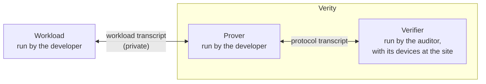
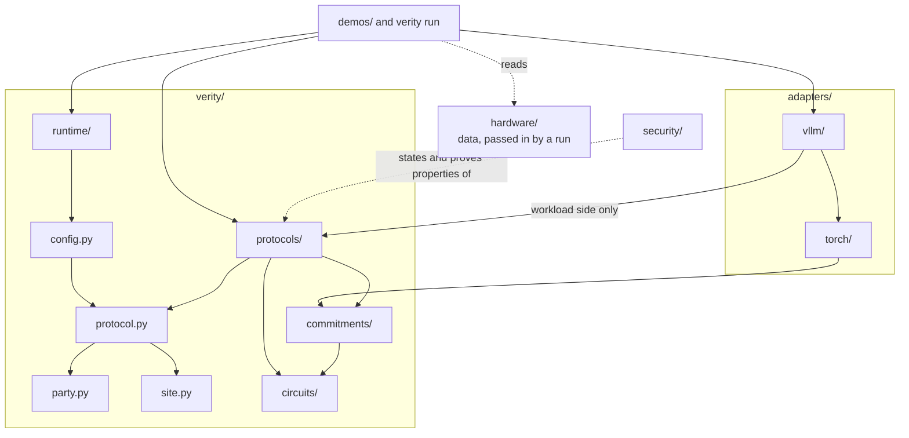

# Verity

Verity is a system that allows developers to prove to an auditor that the workloads they run have certain properties.
The developer and the auditor each learn the truth or falsehood of a prespecified set of statements on a prespecified
schedule. Every protocol is zero-knowledge, so the auditor learns those statements and nothing else about the workload.

**This page describes the architecture the repository is moving to, not the tree as it is today.**
[What `main` does not have yet](#what-main-does-not-have-yet) lists the differences. [`AGENTS.md`](AGENTS.md) maps
today's tree, with its commands and the rules in force.

## The three parties

Three parties exchange messages:



- **Workload:** a computation the developer runs. It is not part of Verity. It talks only to the prover.
- **Prover:** run by the developer. It commits to what the workload computes and proves the statements.
- **Verifier:** run by the auditor. It challenges the prover and checks its proofs. It never talks to the workload. The
  devices the auditor places at the site, the developer's datacenter, are part of it.

The three boxes are the coarse picture. Inside a protocol the parties are the actual devices, each owned by the
developer or the auditor. Examples are a challenger, which flips the verifier's coins, a network certifier, which signs
what it sees on a link, and a proof server, which writes the proofs. The protocols name devices because they are about
who learns what.

## What Verity asks of a workload

Verity describes a computation as a Boolean circuit, and the data that flows through it as values. A workload does four
things:

1. Before it runs, it registers a compiler: a circuit that, given a short input, outputs the circuit the workload ran.
   It also registers the inputs it already knows.
2. As it runs, it gives the prover every value it computes.
3. After each period of the run, it gives the prover the compiler's input for that period, the advice. The advice is
   short.
4. It takes as input what the prover sends it.

A workload also reads a configuration. To Verity that is a bit string, which the workload parses itself.

Example: language-model inference on vLLM, a server for language models. The inputs known in advance are the model's
weights. The compiler knows the model's layers and how vLLM batches requests. The advice says which requests ran
together and how long each was. The values are the requests' tokens and the tensors computed from them.

## Adapters

Developers specify computations with systems such as PyTorch or vLLM. An adapter makes every computation run with one
such system do the four things above: it turns a system plus a configuration into a workload. Adapters stack as the
systems do, so the vLLM adapter sits on a PyTorch adapter.

"Workload" is therefore a type Verity defines, not a directory.

## Protocols

A protocol is a set of rules for the prover and the verifier, and establishes one property of the workload. Circuits and
the proof system are inside the protocols, not top-level parts. The list is flat: `flock`, `spot`, `recursion`, `pouw`,
`pous`, `poub`, `certifier`, `inference_only`, `remote`, `onsite`. Flock is the proof system: it proves statements about
circuits and their values.

Two of them are what an auditor runs:

- **Remote:** the auditor has no devices at the datacenter.
- **Onsite:** the auditor has devices at the datacenter.

A protocol has three sides:

- **The check:** parameters, a commitment and evidence in; accept, reject or undecided out. It is a function in Lean,
  the language Verity's proofs are written in.
- **Its parties:** the devices it names and the messages they exchange.
- **What it needs of the workload:** proof of useful work (PoUW) replaces each matrix multiply and proof of useful
  space (PoUS) stores the weights, while `spot` only reads what the workload emits.

Who knows what: the adapter writes the compiler and knows what the advice means. A protocol knows only that the compiler
is registered before the run and that its input each period is committed and at most a fixed length. The proof system
knows only circuits and values.

## Hardware

Hardware figures are data and an input to the protocols.

- The auditor brings a data sheet for each GPU or host model.
- The developer registers its hardware: its hosts, devices, memory and links, and the figures it states for each model.
- Each protocol that accounts for hardware takes the registered hardware as an argument and declares which part it
  accounts for: PoUW the devices, PoUS the memory, the network certifier and the bandwidth audits the links.
- Remote and onsite refuse a run in which something registered is left unaccounted, within the protocol's parameters.

## What is written in what

| Written in | What goes there |
| --- | --- |
| Lean | Everything that decides: each protocol's check, the registration check, whether a configuration is acceptable, and remote and onsite as wholes. Also every guarantee and its proof. |
| TOML | Public facts with no logic: a run's configuration, the hardware data sheets. |
| Python and CUDA | What must be fast or touch the world: provers, adapters, sockets and processes. |

Python never returns accept or reject. It builds bytes, hands them to a Lean executable and reports what came back.
Python restates Lean only where the prover needs speed (evaluating circuits, hashing, proving), and a differential test
holds each such copy to the Lean.

## The repository

This is the layout the repository is moving to:

```text
hardware/        data only: one TOML data sheet per GPU or host model
verity/
  party.py       what a party is
  site.py        the registered hardware: its types and their bytes
  protocol.py    what a protocol declares: its parties, channels and messages, what it needs of the workload,
                 which part of the hardware it accounts for
  config.py      reads and hashes the public TOML file a run starts from
  runtime/       runs parties over channels: sockets, coins and clock, transcripts
  protocols/     flock, spot, recursion, pouw, pous, poub, certifier, inference_only, remote, onsite;
                 each with its Lean check and its prover
  circuits/      the circuit language, and the circuits a protocol names
  commitments/   commitments to values
adapters/
  torch/         the PyTorch adapter
  vllm/          the vLLM adapter, on torch/, with the circuits of the kernels it serves
demos/           one configuration, the protocols it names, one adapter (today's examples/)
security/        Lean: what each protocol guarantees, and the proofs
benchmarks/  tools/  tests/
```

The four files at the top of `verity/` are types and plumbing. `verity/` keeps only the circuits a protocol names: the
circuit language, the type of Boolean circuit Flock proves, matrix multiplication and the other primitives with what
each GPU instruction computes, SHA-512 and the universal circuit. The circuits of the kernels a system serves go with
that system's adapter, whose compiler emits them.

`fixtures/` is not in this tree: each of its files goes to the code that reads it. The harness for the differential
tests goes under `tools/`, and the datacenter model stays in `benchmarks/`.

What imports what. An arrow goes from a part to a part it imports, and a dotted arrow is not an import:



The rules, each of which a test can enforce:

- Nothing in `verity/` imports `adapters/` or `demos/`, or names PyTorch, vLLM or a model.
- No code imports `security/` or `hardware/`.
- `verity/runtime/` imports no protocol, and no protocol or adapter imports it. Only what starts a run does.
- `verity.party` and `verity.site` import nothing, `verity.protocol` imports only those two, and `verity.config` imports
  only `verity.protocol`.
- `verity/circuits/` imports nothing, and `verity/commitments/` imports only `verity/circuits/`. A protocol may import
  both.
- An adapter imports a protocol's workload side. A protocol never imports an adapter.
- Inside `verity/protocols/`: flock at the bottom, spot and recursion on it, the audits on those, remote and onsite on
  top.

## What `main` does not have yet

The sections above describe the target. `main` differs from it in these ways:

- **The layout.** `main` has the older tree, which `AGENTS.md` maps. `verity/` is split into `verity/core/`, the
  verifiers, and `verity/ml/`, the provers. The one adapter is `integrations/vllm/`, the demos are in `examples/`, the
  Lean is in `Security/`, the data sheets are in `verity/hardware/`, and `fixtures/` is still at the root. The four
  files at the top of `verity/` do not exist: the party type, the configuration check and the runtime are in
  `verity/core/deploy/`.
- **The import rules.** The rules above are the target's. `main` enforces the rules of today's tree, with listed
  exceptions (`tests/test_boundaries.py`).
- **A stated list of the messages between workload and prover.** Today the workload hands its values to the prover
  through function calls and files (`verity/ml/windows/`).
- **Parties for every protocol.** Only `spot`, PoUS and PoUB declare their parties. The served run that `verity run`
  knows is driven by a shell script, not by parties.
- **Hardware as an argument.** No protocol declares which part of the registered hardware it accounts for. Registration
  refuses a boundary link with no network certifier and memory that no challenger reaches. Nothing checks that every
  device is under PoUW or all memory under PoUS.
- **No decision in Python.** Python still holds decisions: the verifiers of the protocols not yet switched to Lean, a
  Python copy of the registration check, and the configuration check.
- **Two adapters.** There is one adapter, for vLLM. It is not split into a PyTorch adapter and a vLLM adapter on it.
- **The served kernels' circuits with their adapter.** They are still under `verity/`, in `verity/ml/definitions/`.
