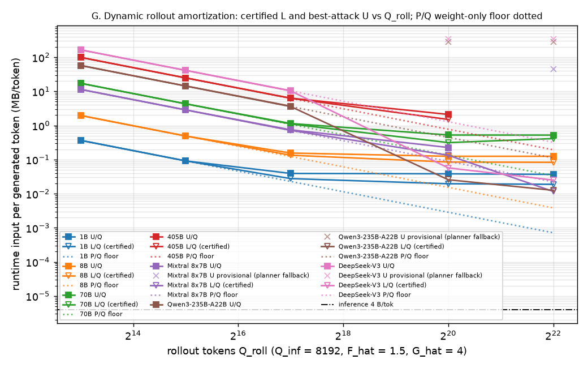

# Dynamic-rollout tables (ROLLOUT_PLAN.md P0-P4)

> **State at hand-off (8:15 AM)**
> 1. Hashes: lower `ac6c3bb0e3`, coarse `f4baa2d7be`, upper `eab50c6955` (frozen: `ac6c3bb0e3` / `f4baa2d7be` / `eab50c6955`).
> 2. Rollout rows: 49 total; U at the frozen planner 44, L at the current lower hash 44, both 44; the rest are shown greyed (stale L) or marked previous / intermediate planner (U).
> 3. Still running on the pod (not at the frozen hashes on both sides): Qwen3-235B-A22B 1M, DeepSeek-V3 1M; also the 8B 128K F_hat variants (Table 2 F axis) and the 405B / MoE 4M cells (preset `rollout-4m`, not run tonight).
> 4. Dense P0 (Q_roll = 1M, frozen hashes, 4/4 models): 1B L 0.0196 / U 0.0382 MB/tok; 8B L 0.0847 / U 0.125 MB/tok; 70B L 0.315 / U 0.525 MB/tok; 405B L 1.5 / U 2.11 MB/tok. U/L range 1.40-1.95; certified slowdown 4.9e+03x-3.8e+05x.
> 5. MoE: block family landed in the planner; 9/9 of the 8K-128K MoE cells are current on both sides; 1M rows: Mixtral 8x7B current; Qwen3-235B-A22B redoing (U is a planner-fallback value); DeepSeek-V3 redoing (U is a planner-fallback value). 4M MoE cells were not re-run tonight.
> 6. Generated 2026-09-23 15:14 from results/coarse.jsonl (387 rows); analytic values only in P2 columns 1-3; acceptance section at the bottom. Refresh after the pod finishes: `python accumulation/sweeps/pod.py pull && python -m accumulation.sweeps.final_report`.

Generated by `sweeps/final_report.py` from `results/coarse.jsonl` (387 rows). Current module hashes: `upper=eab50c6955`, `lower=ac6c3bb0e3`, `coarse=f4baa2d7be`, `adw=cf4205165a`, `extract=332385d416`, `wp=ba12ab8bf8`. Default policy point F_hat = 1.5, G_hat = 4, Q_inf = 8192; rollout rows: tokens = Q_roll, seq = min(Q_roll, Q_inf), K = 1. Never hand-edited.

**What is current vs stale.** Frozen hashes: lower `ac6c3bb0e3`, coarse `f4baa2d7be`, upper `eab50c6955`; the pod is re-running every rollout row at them (U rows at the frozen planner so far: 44 / 49). Current lower module (`lower.py` + `lower_coarse.py`) hash: `ac6c3bb0e3`. Every L is the *proven dual bound* of the certificate's master LP / MILP (HiGHS, 180 s per MILP), never an incumbent; `L_gap` = (master-LP upper bound - certified)/L is shown as `gap x%` when > 0 (28 rows), and rows whose independent separation re-check did not pass carry `recheck: <why>` (0 rows). Rollout L values in this file were produced at: `ac6c3bb0e3` x44 (current), `7ecc3524cc` x5. 5 of 49 L cells are stale and are shown greyed in *italic* with their hash -- they are sound certificates of the module that produced them, never presented as current. A `--redo stale` pass on the pod re-stamps them once Agent A declares the hash stable (dense rollout L values are expected to be unchanged since A's root-floor fix). U is forward-only here and independent of the lower hash; planner hash `f4baa2d7be`; the pod is redoing every rollout row at `f4baa2d7be` (per-sequence Up) -- rows still at the previous planner are marked in the status column and their U is expected to move down, never up (forward-only partitions are convex by construction).

**MoE rows are provisional on both sides.** U: the planner falls back to generic families (`bands` / `fine` / `single`) for the MoE forward -- a legal partition, not an attack -- so those U are shown marked `provisional` and no best-attack slowdown is derived from them; a MoE U becomes admissible when `U_detail.family` is a block / expert family (Agent B). L: the MoE certificate charges tokens + an LP cap below the dynamic-root bytes P, although every legal partition imports all of P at least once -- sound but provably loose -- so it is marked `provisional (L < P)` with the trivially-sound floor `max(L, P + tokens)` alongside (labelled floor, never certificate). A MoE L becomes admissible when L >= P + tokens at the current lower hash.

## P0 -- headline table (Q_roll = 1M, default policy point)

Dynamic rollout = the inference forward graph with the weights dynamic (`forward-nonfixed` / `forward-nonfixed-moe`); useful work per token = inference, so slowdown = (bytes/token) / 4 B. L in **bold** = current lower module `ac6c3bb0e3`; greyed *italic* = stale (older post-fix hash, shown for continuity, never current); `gap` = MILP dual gap when > 0. U from checked plans (forward-only: convex by construction); the 'previous planner' column keeps the U the superseded planner `48ee653bf3` found (whole-chunk Up) once the row has been redone at `f4baa2d7be` (per-sequence Up). No analytic values.

| Family | Model | # tokens | MAC/token | L MB/tok | U MB/tok | U previous planner (`48ee653bf3`) | U/L | Certified slowdown | Best-attack slowdown | Status |
|---|---|---|---|---|---|---|---|---|---|---|
| Dense | 1B | 1M | 1.77e+09 | **0.0196** gap 0.0% | 0.0382 | 0.0654 | 2 | 4.9e+03x | 9.6e+03x | measured; inference 4 B/tok one RU |
| Dense | 8B | 1M | 9.65e+09 | **0.0847** gap 0.0% | 0.125 | 0.212 | 1.5 | 2.1e+04x | 3.1e+04x | measured; inference 4 B/tok one RU |
| Dense | 70B | 1M | 8.02e+10 | **0.315** gap 32.2% | 0.525 | 0.987 | 1.7 | 7.9e+04x | 1.3e+05x | measured; inference 4 B/tok one RU |
| Dense | 405B | 1M | 4.38e+11 | **1.5** gap 0.0% | 2.11 | 3.64 | 1.4 | 3.8e+05x | 5.3e+05x | measured; inference 4 B/tok one RU |
| MoE | Mixtral 8x7B | 1M | 1.49e+10 | **0.134** gap 0.0% | 0.226 | 44.5 prov. | 1.7 | 3.3e+04x | 5.6e+04x | measured; inference 4 B/tok one RU |
| MoE | Qwen3-235B-A22B | 1M | 3.42e+10 | *0.0256* stale(`7ecc3524cc`) provisional (L < P); floor P+tokens = 0.448 | 277 provisional (planner fallback: fine) | (current) | [ ] provisional | [ ] provisional; floor 1.1e+05x | [ ] provisional | measured (L stale); **U provisional** (planner fallback: fine: legal partition, not an attack); **L provisional** (certificate below the P + tokens floor); inference 4 B/tok one RU; U at previous planner (redo at `f4baa2d7be` pending) |
| MoE | DeepSeek-V3 | 1M | 5.66e+10 | *0.0571* stale(`7ecc3524cc`) provisional (L < P); floor P+tokens = 1.29 | 347 provisional (planner fallback: fine) | (current) | [ ] provisional | [ ] provisional; floor 3.2e+05x | [ ] provisional | measured (L stale); **U provisional** (planner fallback: fine: legal partition, not an attack); **L provisional** (certificate below the P + tokens floor); inference 4 B/tok one RU; U at previous planner (redo at `f4baa2d7be` pending) |

## P1 -- amortization: does the floor survive Q -> inf?

Weight-only floor = P/Q (every dynamic byte read once). Recurring share of L = (L - L_root_read)/L with L_root_read = dynamic-root bytes the certificate charges once (pending Agent A's field where marked; (L - P)/L given as the P-based value meanwhile). Provisional cells (planner-fallback U, L below the P + tokens floor) are shown but excluded from the fits and never turned into slowdowns. The 405B and MoE 4M cells were deliberately not re-run at the frozen hashes tonight (too slow; preset `rollout-4m` for later): they are shown stale / older-planner and marked as such.

| Family/model | # rollout tokens | Weight-only floor P/Q MB/tok | L MB/tok | U MB/tok | U prev. planner | Certified slowdown | Best-attack slowdown | Recurring share of L |
|---|---|---|---|---|---|---|---|---|
| 1B | 8K | 0.366 | **0.366** | 0.366 | 0.366 | 9.1e+04x | 9.1e+04x | 0% |
| 1B | 32K | 0.0915 | **0.0915** | 0.0915 | 0.108 | 2.3e+04x | 2.3e+04x | 0% |
| 1B | 128K | 0.0229 | **0.0277** gap 0.0% | 0.0393 | 0.0704 | 6.9e+03x | 9.8e+03x | 17% |
| 1B | 1M | 0.00286 | **0.0196** gap 0.0% | 0.0382 | 0.0654 | 4.9e+03x | 9.6e+03x | 85% |
| 1B | 4M | 0.000715 | **0.0188** gap 0.0% | 0.0368 | 0.0635 | 4.7e+03x | 9.2e+03x | 96% |
| 8B | 8K | 1.96 | **1.96** | 1.96 | 1.96 | 4.9e+05x | 4.9e+05x | 0% |
| 8B | 32K | 0.49 | **0.49** | 0.49 | 0.523 | 1.2e+05x | 1.2e+05x | 0% |
| 8B | 128K | 0.123 | **0.134** gap 0.0% | 0.155 | 0.221 | 3.4e+04x | 3.9e+04x | 9% |
| 8B | 1M | 0.0153 | **0.0847** gap 0.0% | 0.125 | 0.212 | 2.1e+04x | 3.1e+04x | 82% |
| 8B | 4M | 0.00383 | **0.0832** gap 0.0% | 0.125 | 0.211 | 2.1e+04x | 3.1e+04x | 95% |
| 70B | 8K | 17.2 | **17.2** | 17.2 | 17.2 | 4.3e+06x | 4.3e+06x | 0% |
| 70B | 32K | 4.31 | **4.31** | 4.31 | 4.39 | 1.1e+06x | 1.1e+06x | 0% |
| 70B | 128K | 1.08 | **1.11** gap 0.0% | 1.14 | 1.32 | 2.8e+05x | 2.9e+05x | 3% |
| 70B | 1M | 0.135 | **0.315** gap 32.2% | 0.525 | 0.987 | 7.9e+04x | 1.3e+05x | 57% |
| 70B | 4M | 0.0336 | **0.413** gap 0.0% | 0.523 | 0.985 | 1.0e+05x | 1.3e+05x | 92% |
| 405B | 8K | 99.1 | **99.1** | 99.1 | 99.1 | 2.5e+07x | 2.5e+07x | 0% |
| 405B | 32K | 24.8 | **24.8** | 24.8 | 24.9 | 6.2e+06x | 6.2e+06x | 0% |
| 405B | 128K | 6.19 | **6.26** gap 0.0% | 6.32 | 6.65 | 1.6e+06x | 1.6e+06x | 1% |
| 405B | 1M | 0.774 | **1.5** gap 0.0% | 2.11 | 3.64 | 3.8e+05x | 5.3e+05x | 48% |
| 405B | 4M | 0.194 | pod-pending | pod-pending | -- | [ ] | [ ] | [ ] |
| Mixtral 8x7B | 8K | 11.4 | **11.4** gap 0.0% | 11.4 | -- | 2.9e+06x | 2.9e+06x | 0% |
| Mixtral 8x7B | 32K | 2.85 | **2.85** | 2.87 | 2.87 prov. | 7.1e+05x | 7.2e+05x | 0% |
| Mixtral 8x7B | 128K | 0.713 | **0.718** gap 0.0% | 0.745 | 0.795 prov. | 1.8e+05x | 1.9e+05x | 1% |
| Mixtral 8x7B | 1M | 0.0891 | **0.134** gap 0.0% | 0.226 | 44.5 prov. | 3.3e+04x | 5.6e+04x | 33% |
| Mixtral 8x7B | 4M | 0.0223 | *0.0116* stale(`7ecc3524cc`) provisional (L < P); floor P+tokens = 0.0223 | 45 provisional (planner fallback: fine) (older planner; not re-run tonight) | (current) | [ ] provisional; floor 5.6e+03x | [ ] provisional | [ ] (stale L; share follows the redo) |
| Qwen3-235B-A22B | 8K | 57.4 | **57.4** | 57.4 | 57.4 | 1.4e+07x | 1.4e+07x | 0% |
| Qwen3-235B-A22B | 32K | 14.3 | **14.3** | 14.4 | 14.5 prov. | 3.6e+06x | 3.6e+06x | 0% |
| Qwen3-235B-A22B | 128K | 3.59 | **3.59** gap 0.0% | 3.68 | 3.87 prov. | 9.0e+05x | 9.2e+05x | 0% |
| Qwen3-235B-A22B | 1M | 0.448 | *0.0256* stale(`7ecc3524cc`) provisional (L < P); floor P+tokens = 0.448 | 277 provisional (planner fallback: fine) | (current) | [ ] provisional; floor 1.1e+05x | [ ] provisional | [ ] (stale L; share follows the redo) |
| Qwen3-235B-A22B | 4M | 0.112 | *0.0126* stale(`7ecc3524cc`) provisional (L < P); floor P+tokens = 0.112 | 277 provisional (planner fallback: fine) (older planner; not re-run tonight) | (current) | [ ] provisional; floor 2.8e+04x | [ ] provisional | [ ] (stale L; share follows the redo) |
| DeepSeek-V3 | 8K | 165 | **165** | 165 | -- | 4.1e+07x | 4.1e+07x | 0% |
| DeepSeek-V3 | 32K | 41.2 | **41.2** | 41.2 | 41.3 prov. | 1.0e+07x | 1.0e+07x | 0% |
| DeepSeek-V3 | 128K | 10.3 | **10.3** | 10.5 | 10.7 prov. | 2.6e+06x | 2.6e+06x | 0% |
| DeepSeek-V3 | 1M | 1.29 | *0.0571* stale(`7ecc3524cc`) provisional (L < P); floor P+tokens = 1.29 | 347 provisional (planner fallback: fine) | (current) | [ ] provisional; floor 3.2e+05x | [ ] provisional | [ ] (stale L; share follows the redo) |
| DeepSeek-V3 | 4M | 0.322 | *0.025* stale(`7ecc3524cc`) provisional (L < P); floor P+tokens = 0.322 | 346 provisional (planner fallback: fine) (older planner; not re-run tonight) | (current) | [ ] provisional; floor 8.0e+04x | [ ] provisional | [ ] (stale L; share follows the redo) |

Fits over the steady-state points (Q >= 128K): `L(Q) ~ P + r_L Q`, `U(Q) ~ P + r_U Q`, r in MB/token. One certificate / one planner per fit: only L at the current lower hash and U at the frozen planner `f4baa2d7be` enter (stale or previous-planner points would mix bounds of different strength).

Reading the curves: U/Q is flat from 128K on (the planner's steady tiling), while L/Q can *rise* with Q over the same range. That is expected, not an inconsistency: L = root floor + certified block term, and at 128K-1M the one-time root term P still dominates the per-token figure, so L/Q is pulled down toward P/Q; as Q grows the recurring block term takes over and the certified recurring rate r_L converges toward the attack's r_U (the 'recurring share of L' column rising toward 100% is the same effect). r_L < r_U is the remaining certificate gap at steady state.

* **1B** (P = 3 GB): r_L = 0.0185 MB/tok (n=3, Q in ['128K', '1M', '4M'], r2 1.000); r_U = 0.0366 MB/tok (n=3, Q in ['128K', '1M', '4M'], r2 1.000). Result: the one-time dynamic model cost amortizes away, but certified recurring exposure converges to r_L = 0.0185 MB/token (4.6e+03x inference); the best attack found converges to r_U = 0.0366 MB/token.
* **8B** (P = 16.1 GB): r_L = 0.0819 MB/tok (n=3, Q in ['128K', '1M', '4M'], r2 1.000); r_U = 0.124 MB/tok (n=3, Q in ['128K', '1M', '4M'], r2 1.000). Result: the one-time dynamic model cost amortizes away, but certified recurring exposure converges to r_L = 0.0819 MB/token (2.0e+04x inference); the best attack found converges to r_U = 0.124 MB/token.
* **70B** (P = 141 GB): r_L = 0.405 MB/tok (n=3, Q in ['128K', '1M', '4M'], r2 0.988); r_U = 0.507 MB/tok (n=3, Q in ['128K', '1M', '4M'], r2 0.999). Result: the one-time dynamic model cost amortizes away, but certified recurring exposure converges to r_L = 0.405 MB/token (1.0e+05x inference); the best attack found converges to r_U = 0.507 MB/token.
* **405B** (P = 812 GB): r_L = 0.822 MB/tok (n=2, Q in ['128K', '1M'], r2 1.000); r_U = 1.5 MB/tok (n=2, Q in ['128K', '1M'], r2 1.000). Result: the one-time dynamic model cost amortizes away, but certified recurring exposure converges to r_L = 0.822 MB/token (2.1e+05x inference); the best attack found converges to r_U = 1.5 MB/token.
* **Mixtral 8x7B** (P = 93.4 GB): r_L = 0.0502 MB/tok (n=2, Q in ['128K', '1M'], r2 1.000); r_U = 0.152 MB/tok (n=2, Q in ['128K', '1M'], r2 1.000). Result: the one-time dynamic model cost amortizes away, but certified recurring exposure converges to r_L = 0.0502 MB/token (1.3e+04x inference); the best attack found converges to r_U = 0.152 MB/token.
* **Qwen3-235B-A22B** (P = 470 GB): r_L = [ ] (< 2 admissible current-hash steady-state L points); r_U = [ ] (< 2 admissible frozen-planner steady-state U points)
* **DeepSeek-V3** (P = 1.35e+03 GB): r_L = [ ] (< 2 admissible current-hash steady-state L points); r_U = [ ] (< 2 admissible frozen-planner steady-state U points)

## P2 -- closing the adversary's escape routes (slowdowns at Q_roll = 1M)

Columns 1-3 from `sweeps/analytic.py::rollout_tiers` (convex family, forward-only; derivation in its docstring): (1) weights only = P/Q; (2) + activation boundaries = optimal m-layer x t-token RU under the Work cap `m t <= G_hat Q_inf Lyr` token-layers -- with Up evaluated per sequence F never binds a forward RU at F_hat >= 1 -- importing its layers' dynamic weights and the residual stream entering the chunk, (Lyr/m - 1) boundaries per token (imports only, per SPEC's definition of runtime input; the plan's 'in and out' phrasing would double count -- that variant is listed in the cross-check); the whole-model x token-chunk plan is a second candidate; (3) + a per-RU input cap X = 5 MB forcing Loomis-Whitney tiling of every dynamic matrix larger than X, labelled analytic/OOM always (no whole-rollout composition theorem). Columns 4-5 from rows.

| Model | Weights only | + activation boundaries | + intra-matmul sharding X = 5 MB | Actual certified L | Actual best attack U |
|---|---|---|---|---|---|
| 1B | 7.2e+02x *analytic* | 8.7e+03x *analytic* (m*=3.4 layers, t*=1.55e+05 tok) | 2.2e+06x *analytic/OOM* | 4.9e+03x | 9.6e+03x |
| 8B | 3.8e+03x *analytic* | 3.0e+04x *analytic* (m*=4.1 layers, t*=2.53e+05 tok) | 1.6e+07x *analytic/OOM* | 2.1e+04x | 3.1e+04x |
| 70B | 3.4e+04x *analytic* | 1.3e+05x *analytic* (m*=4.9 layers, t*=5.31e+05 tok) | 1.6e+08x *analytic/OOM* | 7.9e+04x | 1.3e+05x |
| 405B | 1.9e+05x *analytic* | 4.4e+05x *analytic* (m*=4.6 layers, t*=9.01e+05 tok) | 9.3e+08x *analytic/OOM* | 3.8e+05x | 5.3e+05x |
| Mixtral 8x7B | 2.2e+04x *analytic* | 7.4e+04x *analytic* (m*=1.7 layers, t*=6.11e+05 tok) | 2.9e+07x *analytic/OOM* | 3.3e+04x | 5.6e+04x |
| Qwen3-235B-A22B | 1.1e+05x *analytic* | 1.8e+05x *analytic* (m*=2.9 layers, t*=1.05e+06 tok) | 4.8e+07x *analytic/OOM* | [ ] provisional | [ ] provisional |
| DeepSeek-V3 | 3.2e+05x *analytic* | 4.3e+05x *analytic* (m*=1.9 layers, t*=1.05e+06 tok) | 9.4e+07x *analytic/OOM* | [ ] provisional | [ ] provisional |

Cross-check of tier (2) against the measured U (should be within ~2x; no tuning):
* 1B: measured U / tier-2 = 1.10 (tier-2 0.0346 MB/tok, block plan, vs U 0.0382); in+out activation variant 0.0499 MB/tok would give 0.77.
* 8B: measured U / tier-2 = 1.05 (tier-2 0.119 MB/tok, block plan, vs U 0.125); in+out activation variant 0.174 MB/tok would give 0.72.
* 70B: measured U / tier-2 = 1.02 (tier-2 0.515 MB/tok, block plan, vs U 0.525); in+out activation variant 0.764 MB/tok would give 0.69.
* 405B: measured U / tier-2 = 1.19 (tier-2 1.77 MB/tok, block plan, vs U 2.11); in+out activation variant 2.64 MB/tok would give 0.80.
* Mixtral 8x7B: measured U / tier-2 = 0.76 (tier-2 0.297 MB/tok, block plan, vs U 0.226); in+out activation variant 0.442 MB/tok would give 0.51.

## P3 -- what the optimal adversary actually does (anatomy of the checked plan)

From `U_detail.anatomy` (Agent B; per-RU cells are median / max, work also as a multiple of fwd(Q_inf)); rows not yet redone at the new planner show per-RU averages derived from the plan's `U_ru_stats` / `U_by_class` and family parameters (m layers x s sequences), marked as such. MoE: active experts / active dynamic params / tokens per active expert in the strategy column.

| Model | # tokens | # RUs | median/max work per RU | layers/blocks per RU | tokens/RU | dynamic weights imported/RU (GB) | activation input/RU (MB) | partial-result input/RU (MB) | dominant strategy | source | worst RU, L side (certificate's cheapest shape) |
|---|---|---|---|---|---|---|---|---|---|---|---|
| 8B | 8K | 1 | 7.97e+13 / 7.97e+13 MACs (1.00 / 1.00 fwd(Q_inf)) | 32 / 32 | 8,192 / 8,192 | 16.1 / 16.1 | 0 / 0 | 0 / 0 | whole-model | U_detail.anatomy (median / max) | 32 layer-cells x 8,192 tok, input 1.36e+04 MB, work 5.54e+13, weights present 6.76 GB, 2.45e-04 B/MAC |
| 8B | 32K | 1 | 3.19e+14 / 3.19e+14 MACs (4.00 / 4.00 fwd(Q_inf)) | 32 / 32 | 32,768 / 32,768 | 16.1 / 16.1 | 0 / 0 | 0 / 0 | layer-chunk x token-chunk | U_detail.anatomy (median / max) | 32 layer-cells x 32,768 tok, input 1.38e+04 MB, work 2.22e+14, weights present 6.76 GB, 6.22e-05 B/MAC |
| 8B | 128K | 5 | 3.01e+14 / 3.01e+14 MACs (3.78 / 3.78 fwd(Q_inf)) | 8 / 8 | 131,072 / 131,072 | 3.49 / 4.54 | 1.07e+03 / 1.07e+03 | 0 / 0 | layer-chunk | U_detail.anatomy (median / max) | 15 layer-cells x 17,594-131,072 tok, input 4.87e+03 MB, work 3.19e+14, weights present 2.44 GB, 1.53e-05 B/MAC |
| 8B | 1M | 34 | 3.01e+14 / 3.01e+14 MACs (3.78 / 3.78 fwd(Q_inf)) | 4 / 4 | 262,144 / 524,288 | 1.74 / 2.8 | 2.15e+03 / 4.29e+03 | 0 / 0 | layer-chunk x token-chunk | U_detail.anatomy (median / max) | 2 layer-cells x 744,584-1,048,576 tok, input 654 MB, work 3.19e+14, weights present 0.327 GB, 2.05e-06 B/MAC |
| Mixtral 8x7B | 8K | 1 | 1.23e+14 / 1.23e+14 MACs (1.00 / 1.00 fwd(Q_inf)) | 32 / 32 | 8,192 / 8,192 | 93.4 / 93.4 | 0 / 0 | 0 / 0 | whole-model; active experts/RU 256 / 256, active dyn params/RU 90.2 / 90.2 GB, tokens/active expert 2,048 / 2,048 | U_detail.anatomy (median / max) | 32 layer-cells x 872-8,192 tok, input 3.07e+03 MB, work 1.07e+13, weights present 1.3 GB, 2.88e-04 B/MAC |
| Mixtral 8x7B | 32K | 3 | 1.82e+14 / 1.82e+14 MACs (1.49 / 1.49 fwd(Q_inf)) | 12 / 12 | 32,768 / 32,768 | 34.8 / 35.1 | 268 / 268 | 0 / 0 | layer-chunk; active experts/RU 96 / 96, active dyn params/RU 33.8 / 33.8 GB, tokens/active expert 8,192 / 8,192 | U_detail.anatomy (median / max) | 32 layer-cells x 3,488-32,768 tok, input 4.47e+03 MB, work 4.26e+13, weights present 1.3 GB, 1.05e-04 B/MAC |
| Mixtral 8x7B | 128K | 5 | 4.86e+14 / 4.86e+14 MACs (3.96 / 3.97 fwd(Q_inf)) | 8 / 8 | 131,072 / 131,072 | 23.2 / 23.5 | 1.07e+03 / 1.07e+03 | 0 / 0 | layer-chunk; active experts/RU 64 / 64, active dyn params/RU 22.5 / 22.5 GB, tokens/active expert 131,072 / 131,072 | U_detail.anatomy (median / max) | 32 layer-cells x 31,915-131,072 tok, input 2.68e+04 MB, work 4.83e+14, weights present 10.8 GB, 5.54e-05 B/MAC |
| Mixtral 8x7B | 1M | 34 | 4.86e+14 / 4.86e+14 MACs (3.96 / 3.97 fwd(Q_inf)) | 8 / 8 | 131,072 / 786,432 | 6.31 / 6.57 | 1.07e+03 / 6.44e+03 | 0 / 0 | layer-chunk x token-chunk; active experts/RU 16 / 16, active dyn params/RU 5.64 / 5.64 GB, tokens/active expert 524,288 / 1,048,576 | U_detail.anatomy (median / max) | 6 layer-cells x 224,085-1,048,576 tok, input 3.49e+03 MB, work 4.90e+14, weights present 1.75 GB, 7.12e-06 B/MAC |
| Qwen3-235B-A22B | 8K | 1 | 2.83e+14 / 2.83e+14 MACs (1.00 / 1.00 fwd(Q_inf)) | 94 / 94 | 8,192 / 8,192 | 470 / 470 | 0 / 0 | 0 / 0 | whole-model; active experts/RU 12032 / 12032, active dyn params/RU 454 / 454 GB, tokens/active expert 512 / 512 | U_detail.anatomy (median / max) | 93 layer-cells x 8,192 tok, input 1.63e+04 MB, work 5.41e+13, weights present 6.61 GB, 3.01e-04 B/MAC |
| Qwen3-235B-A22B | 32K | 3 | 3.79e+14 / 3.99e+14 MACs (1.34 / 1.41 fwd(Q_inf)) | 32 / 32 | 32,768 / 32,768 | 160 / 160 | 268 / 268 | 0 / 0 | layer-chunk; active experts/RU 4096 / 4096, active dyn params/RU 155 / 155 GB, tokens/active expert 2,048 / 2,048 | U_detail.anatomy (median / max) | 93 layer-cells x 32,768 tok, input 2.56e+04 MB, work 2.17e+14, weights present 6.61 GB, 1.18e-04 B/MAC |
| Qwen3-235B-A22B | 128K | 12 | 3.79e+14 / 4.61e+14 MACs (1.34 / 1.63 fwd(Q_inf)) | 8 / 8 | 131,072 / 131,072 | 39.8 / 41 | 1.07e+03 / 1.07e+03 | 0 / 0 | layer-chunk; active experts/RU 1024 / 1024, active dyn params/RU 38.7 / 38.7 GB, tokens/active expert 8,192 / 8,192 | U_detail.anatomy (median / max) | 12 layer-cells x 47,085-131,072 tok, input 6.29e+03 MB, work 9.14e+13, weights present 1.38 GB, 6.88e-05 B/MAC |
| Qwen3-235B-A22B | 1M | 3012 | 1.20e+13 (mean) / 4.25e+14 | [ ] | [ ] | 0.157 | 9.64e+04 | 0 | fine -- **provisional** (planner fallback: fine; legal partition, not an attack) | derived from U_ru_stats / U_by_class (anatomy pending Agent B) | [ ] |
| DeepSeek-V3 | 8K | 1 | 4.68e+14 / 4.68e+14 MACs (1.00 / 1.00 fwd(Q_inf)) | 61 / 61 | 8,192 / 8,192 | 1.35e+03 / 1.35e+03 | 0 / 0 | 0 / 0 | whole-model; active experts/RU 14848 / 14848, active dyn params/RU 1.31e+03 / 1.31e+03 GB, tokens/active expert 256 / 256 | U_detail.anatomy (median / max) | 4 layer-cells x 8,192 tok, input 1.97e+03 MB, work 7.59e+12, weights present 0.927 GB, 2.60e-04 B/MAC |
| DeepSeek-V3 | 32K | 3 | 6.16e+14 / 6.77e+14 MACs (1.31 / 1.45 fwd(Q_inf)) | 20 / 21 | 32,768 / 32,768 | 463 / 488 | 470 / 470 | 0 / 0 | layer-chunk; active experts/RU 5120 / 5376, active dyn params/RU 451 / 474 GB, tokens/active expert 1,024 / 1,024 | U_detail.anatomy (median / max) | 4 layer-cells x 32,768 tok, input 2.32e+03 MB, work 3.04e+13, weights present 0.927 GB, 7.65e-05 B/MAC |
| DeepSeek-V3 | 128K | 13 | 6.16e+14 / 6.16e+14 MACs (1.31 / 1.31 fwd(Q_inf)) | 5 / 5 | 131,072 / 131,072 | 116 / 116 | 1.88e+03 / 1.88e+03 | 0 / 0 | layer-chunk; active experts/RU 1280 / 1280, active dyn params/RU 113 / 113 GB, tokens/active expert 4,096 / 4,096 | U_detail.anatomy (median / max) | 4 layer-cells x 131,072 tok, input 2.41e+03 MB, work 1.58e+14, weights present 1.21 GB, 1.53e-05 B/MAC |
| DeepSeek-V3 | 1M | 2195 | 2.73e+13 (mean) / 7.03e+14 | [ ] | [ ] | 0.616 | 1.65e+05 | 0 | fine -- **provisional** (planner fallback: fine; legal partition, not an attack) | derived from U_ru_stats / U_by_class (anatomy pending Agent B) | 4 layer-cells x 1,048,576 tok, input 2.41e+03 MB, work 1.26e+15, weights present 1.21 GB, 1.91e-06 B/MAC |

## P4 -- minimal robustness: 8B rollout at Q_roll = 1M

| Setting | L MB/tok | U MB/tok | Certified slowdown | Best-attack slowdown | Status |
|---|---|---|---|---|---|
| Q_inf = 2K | **0.192** gap 0.0% | 0.257 | 4.8e+04x | 6.4e+04x | measured |
| Q_inf = 8K, F_hat = 1.5 (default) | **0.0847** gap 0.0% | 0.125 | 2.1e+04x | 3.1e+04x | measured |
| Q_inf = 32K | **0.0291** gap 0.0% | 0.0595 | 7.3e+03x | 1.5e+04x | measured |
| Q_inf = 128K | **0.0153** | 0.0306 | 3.8e+03x | 7.7e+03x | measured |
| F_hat = 3 | **0.0847** gap 0.0% | 0.125 | 2.1e+04x | 3.1e+04x | measured |
| F_hat = 10 | **0.0847** gap 0.0% | 0.125 | 2.1e+04x | 3.1e+04x | measured |
| G_hat = 10 | **0.0516** gap 0.0% | 0.0794 | 1.3e+04x | 2.0e+04x | measured |
| G_hat = 1000 | **0.0153** | 0.0153 | 3.8e+03x | 3.8e+03x | measured |

What the data show (per-sequence Up: F caps serial depth, not data-parallel tokens, so only G binds a forward RU; the certificate's G area cap is the *correct* cap for forward circuits -- F matters for training, where dW reductions couple all sequences):
* Q_inf = 128K: at least 2 RUs by work (G = 64 fwd(8K)); L = P + tokens = 0.01532 MB/tok is the root + token floor -- the block term is silent here, so L is loose by at most the 2-RU tiling cost (~0.0306 MB/tok if every RU re-imports P); U = 0.03064.
* G_hat = 1000: work = 128 fwd(8K) <= G = 1000 fwd(8K), so the whole 1M rollout is **one legal RU** and I* = P + tokens = 0.01532 MB/tok exactly; L = 0.01532 sits on it (**tight**); U = 0.01532 (matches -- one RU found).
* U at G_hat = 10, G_hat = 1000: 0.0794, 0.0153 vs 0.125 MB/tok at the default -- lower with larger G, as the per-sequence-Up planner tiles in fewer, larger RUs.
* Relaxing F: F_hat = 3: U 0.125 MB/tok, L 0.0847; F_hat = 10: U 0.125 MB/tok, L 0.0847 (default U 0.125, L 0.0847) -- F does not enter forward tiling (per-sequence Up), so U is expected to be F-independent here.

Desired conclusion: large relaxations weaken the bound but do not erase the multi-OOM wedge.

## Acceptance regressions (ROLLOUT_PLAN.md)

Reference values are the previous planner's (`48ee653bf3`, whole-chunk Up). L may only go up as the certificate improves; U may only go down as the planner improves -- a decrease at `f4baa2d7be` is reported as such, with its delta, not as a failure.

* PASS -- inference 1B 4 B/token, one RU: 4 B/tok, n_ru = 1
* PASS -- inference 8B 4 B/token, one RU: 4 B/tok, n_ru = 1
* PASS -- inference 70B 4 B/token, one RU: 4 B/tok, n_ru = 1
* PASS -- inference 405B 4 B/token, one RU: 4 B/tok, n_ru = 1
* PASS -- inference Mixtral 8x7B 4 B/token, one RU: 4 B/tok, n_ru = 1
* PASS -- inference Qwen3-235B-A22B 4 B/token, one RU: 4 B/tok, n_ru = 1
* PASS -- inference DeepSeek-V3 4 B/token, one RU: 4 B/tok, n_ru = 1
* PASS -- 8B rollout 1M: L = 0.0559 MB/tok (previous certificate): L = 0.08475 MB/tok (previous 0.0559, delta +0.02885; L increased (certificate improvement: block term + F/G geometry), sound direction)
* PASS -- 8B rollout 1M: U = 0.212 MB/tok: U = 0.1248 MB/tok (delta -0.0872; U decreased (planner improvement: per-sequence Up + whole-token layer chunks + MoE block family), sound direction)
* PASS -- 8B rollout 1M: U/L = 3.8, certified 1.4e4x, attack 5.3e4x (previous): U/L = 1.5, certified 2.1e+04x, attack 3.1e+04x (previous 3.8 / 1.4e4x / 5.3e4x)
* PASS -- 8B U(Q): 1.96 -> 0.523 -> 0.221 -> 0.212 MB/tok (previous planner): 8K: 1.96 (prev 1.96, +0.000517); 32K: 0.49 (prev 0.523, -0.0329, decreased); 128K: 0.155 (prev 0.221, -0.0657, decreased); 1M: 0.125 (prev 0.212, -0.0872, decreased) -- U decreased (planner improvement: per-sequence Up + whole-token layer chunks + MoE block family), sound direction
* PASS -- 1B attack at 1M = 0.065 MB/tok (previous planner): 0.0382 MB/tok (delta -0.0268; U decreased (planner improvement: per-sequence Up + whole-token layer chunks + MoE block family), sound direction)
* PASS -- 70B attack at 1M = 0.987 MB/tok (previous planner): 0.525 MB/tok (delta -0.462; U decreased (planner improvement: per-sequence Up + whole-token layer chunks + MoE block family), sound direction)
* PASS -- 405B attack at 1M = 3.64 MB/tok (previous planner): 2.11 MB/tok (delta -1.53; U decreased (planner improvement: per-sequence Up + whole-token layer chunks + MoE block family), sound direction)

**Overall: all pass.**
