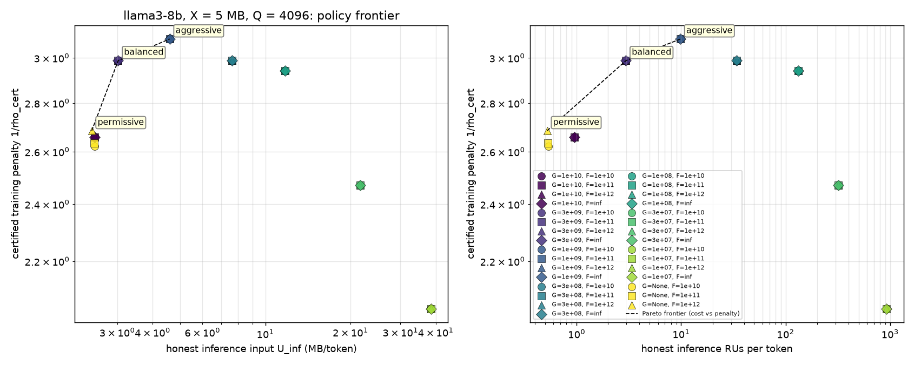

# Policy frontier: llama3-8b, X = 5 MB

Inputs: `frontier_8b.jsonl` (128 rows, 64 matched (F, G) points; Q = [4096, 65536]). Generated by `accumulation.sweeps.frontier`.

Definitions: `M` = target MACs (`credited_macs` for training, `all_macs` for inference); `kappa_low = M/U`, `kappa_high = M/L`; `rho_cert = (M_tr/L_tr)/(M_inf/U_inf)`, penalty `= 1/rho_cert`; `rho_ach = (M_tr/U_tr)/(M_inf/U_inf)`. All ratios at the same (model, Q, seq, F, G, X). **Status**: `measured` = both sides from checked plans; `L@G=None` = the lower bound ignores the per-RU work cap (valid but looser for every G; re-run when `lower_bound(..., G=)` lands); `pending` = a side is missing. `F = inf` means `F = 2^62`.

## Q = 4096 (seq 4096)

### inference-dense

| F | G | M/token | L MB/tok | U MB/tok | U/L | kappa_low=M/U | kappa_high=M/L | n_RU/tok | RU work mean | RU work max | RU input mean (B) | U attn MB/tok | U matmul MB/tok | U other MB/tok | L flag | err |
|---|---|---|---|---|---|---|---|---|---|---|---|---|---|---|---|---|
| 1e+10 | 1e+10 | 8.58e+09 | 4e-06 | 2.5 | 6.25e+05 | 3.43e+03 | 2.14e+09 | 0.953 | 9.39e+09 | 1e+10 | 2.62e+06 | 0.524 | 1.97 | 4e-06 | G=1e+10 |  |
| 1e+10 | 3e+09 | 8.58e+09 | 4e-06 | 3.02 | 7.56e+05 | 2.84e+03 | 2.14e+09 | 2.96 | 2.93e+09 | 3e+09 | 1.02e+06 | 1.05 | 1.97 | 4e-06 | G=3e+09 |  |
| 1e+10 | 1e+09 | 8.58e+09 | 4e-06 | 4.6 | 1.15e+06 | 1.87e+03 | 2.14e+09 | 9.85 | 8.79e+08 | 9.99e+08 | 4.67e+05 | 2.62 | 1.97 | 4e-06 | G=1e+09 |  |
| 1e+10 | 3e+08 | 8.58e+09 | 4e-06 | 7.64 | 1.91e+06 | 1.12e+03 | 2.14e+09 | 34 | 2.56e+08 | 3e+08 | 2.25e+05 | 5.53 | 2.11 | 2.4e-05 | G=3e+08 |  |
| 1e+10 | 1e+08 | 8.58e+09 | 4e-06 | 11.7 | 2.93e+06 | 731 | 2.14e+09 | 132 | 6.56e+07 | 9.87e+07 | 8.88e+04 | 9.22 | 2.51 | 0.0082 | G=1e+08 |  |
| 1e+10 | 3e+07 | 8.58e+09 | 4e-06 | 21.6 | 5.4e+06 | 397 | 2.14e+09 | 321 | 2.7e+07 | 2.94e+07 | 6.73e+04 | 17.5 | 4.08 | 0.0082 | G=3e+07 |  |
| 1e+10 | 1e+07 | 8.58e+09 | 4e-06 | 38.5 | 9.62e+06 | 223 | 2.14e+09 | 925 | 9.41e+06 | 9.99e+06 | 4.16e+04 | 29.6 | 8.31 | 0.532 | G=1e+07 |  |
| 1e+10 | None | 8.58e+09 | 4e-06 | 2.5 | 6.25e+05 | 3.43e+03 | 2.14e+09 | 0.534 | 1.69e+10 | 3.21e+11 | 4.68e+06 | 0.524 | 1.97 | 4e-06 | G=None |  |
| 1e+11 | 1e+10 | 8.58e+09 | 4e-06 | 2.5 | 6.25e+05 | 3.43e+03 | 2.14e+09 | 0.953 | 9.39e+09 | 1e+10 | 2.62e+06 | 0.524 | 1.97 | 4e-06 | G=1e+10 |  |
| 1e+11 | 3e+09 | 8.58e+09 | 4e-06 | 3.02 | 7.56e+05 | 2.84e+03 | 2.14e+09 | 2.96 | 2.93e+09 | 3e+09 | 1.02e+06 | 1.05 | 1.97 | 4e-06 | G=3e+09 |  |
| 1e+11 | 1e+09 | 8.58e+09 | 4e-06 | 4.6 | 1.15e+06 | 1.87e+03 | 2.14e+09 | 9.85 | 8.79e+08 | 9.99e+08 | 4.67e+05 | 2.62 | 1.97 | 4e-06 | G=1e+09 |  |
| 1e+11 | 3e+08 | 8.58e+09 | 4e-06 | 7.64 | 1.91e+06 | 1.12e+03 | 2.14e+09 | 34 | 2.56e+08 | 3e+08 | 2.25e+05 | 5.53 | 2.11 | 2.4e-05 | G=3e+08 |  |
| 1e+11 | 1e+08 | 8.58e+09 | 4e-06 | 11.7 | 2.93e+06 | 731 | 2.14e+09 | 132 | 6.56e+07 | 9.87e+07 | 8.88e+04 | 9.22 | 2.51 | 0.0082 | G=1e+08 |  |
| 1e+11 | 3e+07 | 8.58e+09 | 4e-06 | 21.6 | 5.4e+06 | 397 | 2.14e+09 | 321 | 2.7e+07 | 2.94e+07 | 6.73e+04 | 17.5 | 4.08 | 0.0082 | G=3e+07 |  |
| 1e+11 | 1e+07 | 8.58e+09 | 4e-06 | 38.5 | 9.62e+06 | 223 | 2.14e+09 | 925 | 9.41e+06 | 9.99e+06 | 4.16e+04 | 29.6 | 8.31 | 0.532 | G=1e+07 |  |
| 1e+11 | None | 8.58e+09 | 4e-06 | 2.49 | 6.22e+05 | 3.45e+03 | 2.14e+09 | 0.532 | 1.77e+10 | 3.21e+11 | 4.68e+06 | 0.512 | 1.97 | 4e-06 | G=None |  |
| 1e+12 | 1e+10 | 8.58e+09 | 4e-06 | 2.5 | 6.25e+05 | 3.43e+03 | 2.14e+09 | 0.953 | 9.39e+09 | 1e+10 | 2.62e+06 | 0.524 | 1.97 | 4e-06 | G=1e+10 |  |
| 1e+12 | 3e+09 | 8.58e+09 | 4e-06 | 3.02 | 7.56e+05 | 2.84e+03 | 2.14e+09 | 2.96 | 2.93e+09 | 3e+09 | 1.02e+06 | 1.05 | 1.97 | 4e-06 | G=3e+09 |  |
| 1e+12 | 1e+09 | 8.58e+09 | 4e-06 | 4.6 | 1.15e+06 | 1.87e+03 | 2.14e+09 | 9.85 | 8.79e+08 | 9.99e+08 | 4.67e+05 | 2.62 | 1.97 | 4e-06 | G=1e+09 |  |
| 1e+12 | 3e+08 | 8.58e+09 | 4e-06 | 7.64 | 1.91e+06 | 1.12e+03 | 2.14e+09 | 34 | 2.56e+08 | 3e+08 | 2.25e+05 | 5.53 | 2.11 | 2.4e-05 | G=3e+08 |  |
| 1e+12 | 1e+08 | 8.58e+09 | 4e-06 | 11.7 | 2.93e+06 | 731 | 2.14e+09 | 132 | 6.56e+07 | 9.87e+07 | 8.88e+04 | 9.22 | 2.51 | 0.0082 | G=1e+08 |  |
| 1e+12 | 3e+07 | 8.58e+09 | 4e-06 | 21.6 | 5.4e+06 | 397 | 2.14e+09 | 321 | 2.7e+07 | 2.94e+07 | 6.73e+04 | 17.5 | 4.08 | 0.0082 | G=3e+07 |  |
| 1e+12 | 1e+07 | 8.58e+09 | 4e-06 | 38.5 | 9.62e+06 | 223 | 2.14e+09 | 925 | 9.41e+06 | 9.99e+06 | 4.16e+04 | 29.6 | 8.31 | 0.532 | G=1e+07 |  |
| 1e+12 | None | 8.58e+09 | 4e-06 | 2.44 | 6.1e+05 | 3.52e+03 | 2.14e+09 | 0.522 | 7.05e+10 | 1.04e+12 | 4.67e+06 | 0.508 | 1.93 | 6.69e-08 | G=None |  |
| inf | 1e+10 | 8.58e+09 | 4e-06 | 2.5 | 6.25e+05 | 3.43e+03 | 2.14e+09 | 0.953 | 9.39e+09 | 1e+10 | 2.62e+06 | 0.524 | 1.97 | 4e-06 | G=1e+10 |  |
| inf | 3e+09 | 8.58e+09 | 4e-06 | 3.02 | 7.56e+05 | 2.84e+03 | 2.14e+09 | 2.96 | 2.93e+09 | 3e+09 | 1.02e+06 | 1.05 | 1.97 | 4e-06 | G=3e+09 |  |
| inf | 1e+09 | 8.58e+09 | 4e-06 | 4.6 | 1.15e+06 | 1.87e+03 | 2.14e+09 | 9.85 | 8.79e+08 | 9.99e+08 | 4.67e+05 | 2.62 | 1.97 | 4e-06 | G=1e+09 |  |
| inf | 3e+08 | 8.58e+09 | 4e-06 | 7.64 | 1.91e+06 | 1.12e+03 | 2.14e+09 | 34 | 2.56e+08 | 3e+08 | 2.25e+05 | 5.53 | 2.11 | 2.4e-05 | G=3e+08 |  |
| inf | 1e+08 | 8.58e+09 | 4e-06 | 11.7 | 2.93e+06 | 731 | 2.14e+09 | 132 | 6.56e+07 | 9.87e+07 | 8.88e+04 | 9.22 | 2.51 | 0.0082 | G=1e+08 |  |
| inf | 3e+07 | 8.58e+09 | 4e-06 | 21.6 | 5.4e+06 | 397 | 2.14e+09 | 321 | 2.7e+07 | 2.94e+07 | 6.73e+04 | 17.5 | 4.08 | 0.0082 | G=3e+07 |  |
| inf | 1e+07 | 8.58e+09 | 4e-06 | 38.5 | 9.62e+06 | 223 | 2.14e+09 | 925 | 9.41e+06 | 9.99e+06 | 4.16e+04 | 29.6 | 8.31 | 0.532 | G=1e+07 |  |
| inf | None | 8.58e+09 | 4e-06 | 4e-06 | 1 | 2.14e+09 | 2.14e+09 | 0.000244 | 3.53e+13 | 3.53e+13 | 1.64e+04 | 4.84e-07 | 3.51e-06 | 7.81e-09 | G=None |  |

### pretrain-dense

| F | G | M/token | L MB/tok | U MB/tok | U/L | kappa_low=M/U | kappa_high=M/L | n_RU/tok | RU work mean | RU work max | RU input mean (B) | U attn MB/tok | U matmul MB/tok | U other MB/tok | L flag | err |
|---|---|---|---|---|---|---|---|---|---|---|---|---|---|---|---|---|
| 1e+10 | 1e+10 | 2.63e+10 | 20.3 | 219 | 10.8 | 120 | 1.29e+03 | 45.3 | 8.07e+08 | 1e+10 | 4.84e+06 | 4.72 | 212 | 2.11 | G=1e+10 |  |
| 1e+10 | 3e+09 | 2.63e+10 | 27.7 | 223 | 8.07 | 118 | 950 | 46.7 | 7.34e+08 | 3e+09 | 4.78e+06 | 8.91 | 212 | 2.11 | G=3e+09 |  |
| 1e+10 | 1e+09 | 2.63e+10 | 43.5 | 248 | 5.71 | 106 | 605 | 54.9 | 6.23e+08 | 1e+09 | 4.52e+06 | 23.1 | 223 | 2.11 | G=1e+09 |  |
| 1e+10 | 3e+08 | 2.63e+10 | 70 | 384 | 5.49 | 68.4 | 376 | 127 | 2.66e+08 | 3e+08 | 3.03e+06 | 69.8 | 295 | 19.9 | G=3e+08 |  |
| 1e+10 | 1e+08 | 2.63e+10 | 106 | 652 | 6.17 | 40.3 | 249 | 374 | 9.16e+07 | 1e+08 | 1.75e+06 | 194 | 439 | 19.9 | G=1e+08 |  |
| 1e+10 | 3e+07 | 2.63e+10 | 164 | 1.36e+03 | 8.31 | 19.3 | 161 | 1.23e+03 | 2.72e+07 | 3e+07 | 1.1e+06 | 680 | 659 | 19.9 | G=3e+07 |  |
| 1e+10 | 1e+07 | 2.63e+10 | 241 | 3.19e+03 | 13.2 | 8.25 | 109 | 3.73e+03 | 9.12e+06 | 9.99e+06 | 8.54e+05 | 2.21e+03 | 957 | 19.9 | G=1e+07 |  |
| 1e+10 | None | 2.63e+10 | 20 | 219 | 10.9 | 120 | 1.31e+03 | 45.3 | 8.07e+08 | 1e+10 | 4.84e+06 | 4.72 | 212 | 2.11 | G=None |  |
| 1e+11 | 1e+10 | 2.63e+10 | 20.3 | 219 | 10.8 | 120 | 1.29e+03 | 45.3 | 8.07e+08 | 1e+10 | 4.84e+06 | 4.72 | 212 | 2.11 | G=1e+10 |  |
| 1e+11 | 3e+09 | 2.63e+10 | 27.7 | 223 | 8.07 | 118 | 950 | 46.7 | 7.34e+08 | 3e+09 | 4.78e+06 | 8.91 | 212 | 2.11 | G=3e+09 |  |
| 1e+11 | 1e+09 | 2.63e+10 | 43.5 | 248 | 5.71 | 106 | 605 | 54.9 | 6.23e+08 | 1e+09 | 4.52e+06 | 23.1 | 223 | 2.11 | G=1e+09 |  |
| 1e+11 | 3e+08 | 2.63e+10 | 70 | 384 | 5.49 | 68.4 | 376 | 127 | 2.66e+08 | 3e+08 | 3.03e+06 | 69.8 | 295 | 19.9 | G=3e+08 |  |
| 1e+11 | 1e+08 | 2.63e+10 | 106 | 652 | 6.17 | 40.3 | 249 | 374 | 9.16e+07 | 1e+08 | 1.75e+06 | 194 | 439 | 19.9 | G=1e+08 |  |
| 1e+11 | 3e+07 | 2.63e+10 | 164 | 1.36e+03 | 8.31 | 19.3 | 161 | 1.23e+03 | 2.72e+07 | 3e+07 | 1.1e+06 | 680 | 659 | 19.9 | G=3e+07 |  |
| 1e+11 | 1e+07 | 2.63e+10 | 241 | 3.19e+03 | 13.2 | 8.25 | 109 | 3.73e+03 | 9.12e+06 | 9.99e+06 | 8.54e+05 | 2.21e+03 | 957 | 19.9 | G=1e+07 |  |
| 1e+11 | None | 2.63e+10 | 20 | 217 | 10.8 | 121 | 1.31e+03 | 44.8 | 7.77e+08 | 1.23e+10 | 4.85e+06 | 3.15 | 212 | 2.11 | G=None |  |
| 1e+12 | 1e+10 | 2.63e+10 | 20.3 | 219 | 10.8 | 120 | 1.29e+03 | 45.3 | 8.07e+08 | 1e+10 | 4.84e+06 | 4.72 | 212 | 2.11 | G=1e+10 |  |
| 1e+12 | 3e+09 | 2.63e+10 | 27.7 | 223 | 8.07 | 118 | 950 | 46.7 | 7.34e+08 | 3e+09 | 4.78e+06 | 8.91 | 212 | 2.11 | G=3e+09 |  |
| 1e+12 | 1e+09 | 2.63e+10 | 43.5 | 248 | 5.71 | 106 | 605 | 54.9 | 6.23e+08 | 1e+09 | 4.52e+06 | 23.1 | 223 | 2.11 | G=1e+09 |  |
| 1e+12 | 3e+08 | 2.63e+10 | 70 | 384 | 5.49 | 68.4 | 376 | 127 | 2.66e+08 | 3e+08 | 3.03e+06 | 69.8 | 295 | 19.9 | G=3e+08 |  |
| 1e+12 | 1e+08 | 2.63e+10 | 106 | 652 | 6.17 | 40.3 | 249 | 374 | 9.16e+07 | 1e+08 | 1.75e+06 | 194 | 439 | 19.9 | G=1e+08 |  |
| 1e+12 | 3e+07 | 2.63e+10 | 164 | 1.36e+03 | 8.31 | 19.3 | 161 | 1.23e+03 | 2.72e+07 | 3e+07 | 1.1e+06 | 680 | 659 | 19.9 | G=3e+07 |  |
| 1e+12 | 1e+07 | 2.63e+10 | 241 | 3.19e+03 | 13.2 | 8.25 | 109 | 3.73e+03 | 9.12e+06 | 9.99e+06 | 8.54e+05 | 2.21e+03 | 957 | 19.9 | G=1e+07 |  |
| 1e+12 | None | 2.63e+10 | 20 | 217 | 10.8 | 121 | 1.31e+03 | 44.8 | 7.77e+08 | 1.23e+10 | 4.85e+06 | 3.15 | 212 | 2.11 | G=None |  |
| inf | 1e+10 | 2.63e+10 | 20.3 | 219 | 10.8 | 120 | 1.29e+03 | 45.3 | 8.07e+08 | 1e+10 | 4.84e+06 | 4.72 | 212 | 2.11 | G=1e+10 |  |
| inf | 3e+09 | 2.63e+10 | 27.7 | 223 | 8.07 | 118 | 950 | 46.7 | 7.34e+08 | 3e+09 | 4.78e+06 | 8.91 | 212 | 2.11 | G=3e+09 |  |
| inf | 1e+09 | 2.63e+10 | 43.5 | 248 | 5.71 | 106 | 605 | 54.9 | 6.23e+08 | 1e+09 | 4.52e+06 | 23.1 | 223 | 2.11 | G=1e+09 |  |
| inf | 3e+08 | 2.63e+10 | 70 | 384 | 5.49 | 68.4 | 376 | 127 | 2.66e+08 | 3e+08 | 3.03e+06 | 69.8 | 295 | 19.9 | G=3e+08 |  |
| inf | 1e+08 | 2.63e+10 | 106 | 652 | 6.17 | 40.3 | 249 | 374 | 9.16e+07 | 1e+08 | 1.75e+06 | 194 | 439 | 19.9 | G=1e+08 |  |
| inf | 3e+07 | 2.63e+10 | 164 | 1.36e+03 | 8.31 | 19.3 | 161 | 1.23e+03 | 2.72e+07 | 3e+07 | 1.1e+06 | 680 | 659 | 19.9 | G=3e+07 |  |
| inf | 1e+07 | 2.63e+10 | 241 | 3.19e+03 | 13.2 | 8.25 | 109 | 3.73e+03 | 9.12e+06 | 9.99e+06 | 8.54e+05 | 2.21e+03 | 957 | 19.9 | G=1e+07 |  |
| inf | None | 2.63e+10 | 20 | 217 | 10.8 | 121 | 1.31e+03 | 44.8 | 7.77e+08 | 1.23e+10 | 4.85e+06 | 3.15 | 212 | 2.11 | G=None |  |

### derived security table

| F | G | U_inf MB/tok | n_RU_inf/tok | L_train MB/tok | U_train MB/tok | rho_cert | penalty 1/rho_cert | rho_ach | status | frontier | operating point |
|---|---|---|---|---|---|---|---|---|---|---|---|
| 1e+10 | 1e+10 | 2.5 | 0.953 | 20.3 | 219 | 0.376 | 2.66 | 0.035 | measured |  |  |
| 1e+10 | 3e+09 | 3.02 | 2.96 | 27.7 | 223 | 0.335 | 2.99 | 0.0415 | measured |  |  |
| 1e+10 | 1e+09 | 4.6 | 9.85 | 43.5 | 248 | 0.324 | 3.09 | 0.0567 | measured |  |  |
| 1e+10 | 3e+08 | 7.64 | 34 | 70 | 384 | 0.335 | 2.99 | 0.0609 | measured |  |  |
| 1e+10 | 1e+08 | 11.7 | 132 | 106 | 652 | 0.34 | 2.94 | 0.0551 | measured |  |  |
| 1e+10 | 3e+07 | 21.6 | 321 | 164 | 1.36e+03 | 0.405 | 2.47 | 0.0487 | measured |  |  |
| 1e+10 | 1e+07 | 38.5 | 925 | 241 | 3.19e+03 | 0.489 | 2.05 | 0.037 | measured |  |  |
| 1e+10 | None | 2.5 | 0.534 | 20 | 219 | 0.382 | 2.62 | 0.035 | measured |  |  |
| 1e+11 | 1e+10 | 2.5 | 0.953 | 20.3 | 219 | 0.376 | 2.66 | 0.035 | measured |  |  |
| 1e+11 | 3e+09 | 3.02 | 2.96 | 27.7 | 223 | 0.335 | 2.99 | 0.0415 | measured |  |  |
| 1e+11 | 1e+09 | 4.6 | 9.85 | 43.5 | 248 | 0.324 | 3.09 | 0.0567 | measured |  |  |
| 1e+11 | 3e+08 | 7.64 | 34 | 70 | 384 | 0.335 | 2.99 | 0.0609 | measured |  |  |
| 1e+11 | 1e+08 | 11.7 | 132 | 106 | 652 | 0.34 | 2.94 | 0.0551 | measured |  |  |
| 1e+11 | 3e+07 | 21.6 | 321 | 164 | 1.36e+03 | 0.405 | 2.47 | 0.0487 | measured |  |  |
| 1e+11 | 1e+07 | 38.5 | 925 | 241 | 3.19e+03 | 0.489 | 2.05 | 0.037 | measured |  |  |
| 1e+11 | None | 2.49 | 0.532 | 20 | 217 | 0.38 | 2.63 | 0.035 | measured |  |  |
| 1e+12 | 1e+10 | 2.5 | 0.953 | 20.3 | 219 | 0.376 | 2.66 | 0.035 | measured |  |  |
| 1e+12 | 3e+09 | 3.02 | 2.96 | 27.7 | 223 | 0.335 | 2.99 | 0.0415 | measured |  |  |
| 1e+12 | 1e+09 | 4.6 | 9.85 | 43.5 | 248 | 0.324 | 3.09 | 0.0567 | measured |  |  |
| 1e+12 | 3e+08 | 7.64 | 34 | 70 | 384 | 0.335 | 2.99 | 0.0609 | measured |  |  |
| 1e+12 | 1e+08 | 11.7 | 132 | 106 | 652 | 0.34 | 2.94 | 0.0551 | measured |  |  |
| 1e+12 | 3e+07 | 21.6 | 321 | 164 | 1.36e+03 | 0.405 | 2.47 | 0.0487 | measured |  |  |
| 1e+12 | 1e+07 | 38.5 | 925 | 241 | 3.19e+03 | 0.489 | 2.05 | 0.037 | measured |  |  |
| 1e+12 | None | 2.44 | 0.522 | 20 | 217 | 0.373 | 2.68 | 0.0344 | measured | yes | permissive |
| inf | 1e+10 | 2.5 | 0.953 | 20.3 | 219 | 0.376 | 2.66 | 0.035 | measured |  |  |
| inf | 3e+09 | 3.02 | 2.96 | 27.7 | 223 | 0.335 | 2.99 | 0.0415 | measured | yes | balanced |
| inf | 1e+09 | 4.6 | 9.85 | 43.5 | 248 | 0.324 | 3.09 | 0.0567 | measured | yes | aggressive |
| inf | 3e+08 | 7.64 | 34 | 70 | 384 | 0.335 | 2.99 | 0.0609 | measured |  |  |
| inf | 1e+08 | 11.7 | 132 | 106 | 652 | 0.34 | 2.94 | 0.0551 | measured |  |  |
| inf | 3e+07 | 21.6 | 321 | 164 | 1.36e+03 | 0.405 | 2.47 | 0.0487 | measured |  |  |
| inf | 1e+07 | 38.5 | 925 | 241 | 3.19e+03 | 0.489 | 2.05 | 0.037 | measured |  |  |
| inf | None | 4e-06 | 0.000244 | 20 | 217 | 6.11e-07 | 1.64e+06 | 5.64e-08 | measured (degenerate: 1 RU) |  |  |

## Q = 65536 (seq 4096)

### inference-dense

| F | G | M/token | L MB/tok | U MB/tok | U/L | kappa_low=M/U | kappa_high=M/L | n_RU/tok | RU work mean | RU work max | RU input mean (B) | U attn MB/tok | U matmul MB/tok | U other MB/tok | L flag | err |
|---|---|---|---|---|---|---|---|---|---|---|---|---|---|---|---|---|
| 1e+10 | 1e+10 | 8.58e+09 | 4e-06 | 2.5 | 6.25e+05 | 3.43e+03 | 2.14e+09 | 0.939 | 9.38e+09 | 1e+10 | 2.66e+06 | 0.524 | 1.98 | 4e-06 | G=1e+10 |  |
| 1e+10 | 3e+09 | 8.58e+09 | 4e-06 | 3.04 | 7.6e+05 | 2.82e+03 | 2.14e+09 | 2.95 | 2.92e+09 | 3e+09 | 1.03e+06 | 1.05 | 1.98 | 0.0082 | G=3e+09 |  |
| 1e+10 | 1e+09 | 8.58e+09 | 4e-06 | 4.61 | 1.15e+06 | 1.86e+03 | 2.14e+09 | 9.83 | 8.78e+08 | 9.99e+08 | 4.69e+05 | 2.62 | 1.98 | 0.0082 | G=1e+09 |  |
| 1e+10 | 3e+08 | 8.58e+09 | 4e-06 | 7.65 | 1.91e+06 | 1.12e+03 | 2.14e+09 | 34 | 2.56e+08 | 2.94e+08 | 2.25e+05 | 5.53 | 2.11 | 0.0082 | G=3e+08 |  |
| 1e+10 | 1e+08 | 8.58e+09 | 4e-06 | 11.7 | 2.93e+06 | 731 | 2.14e+09 | 132 | 6.56e+07 | 9.87e+07 | 8.88e+04 | 9.22 | 2.51 | 0.0082 | G=1e+08 |  |
| 1e+10 | 3e+07 | 8.58e+09 | 4e-06 | 21.6 | 5.4e+06 | 397 | 2.14e+09 | 321 | 2.7e+07 | 2.94e+07 | 6.73e+04 | 17.5 | 4.08 | 0.0082 | G=3e+07 |  |
| 1e+10 | 1e+07 | 8.58e+09 | 4e-06 | 38.5 | 9.62e+06 | 223 | 2.14e+09 | 925 | 9.41e+06 | 9.99e+06 | 4.16e+04 | 29.6 | 8.31 | 0.532 | G=1e+07 |  |
| 1e+10 | None | 8.58e+09 | 4e-06 | 2.5 | 6.25e+05 | 3.43e+03 | 2.14e+09 | 0.526 | 1.67e+10 | 1.66e+12 | 4.75e+06 | 0.524 | 1.97 | 4e-06 | G=None |  |
| 1e+11 | 1e+10 | 8.58e+09 | 4e-06 | 2.5 | 6.25e+05 | 3.43e+03 | 2.14e+09 | 0.939 | 9.38e+09 | 1e+10 | 2.66e+06 | 0.524 | 1.98 | 4e-06 | G=1e+10 |  |
| 1e+11 | 3e+09 | 8.58e+09 | 4e-06 | 3.04 | 7.6e+05 | 2.82e+03 | 2.14e+09 | 2.95 | 2.92e+09 | 3e+09 | 1.03e+06 | 1.05 | 1.98 | 0.0082 | G=3e+09 |  |
| 1e+11 | 1e+09 | 8.58e+09 | 4e-06 | 4.61 | 1.15e+06 | 1.86e+03 | 2.14e+09 | 9.83 | 8.78e+08 | 9.99e+08 | 4.69e+05 | 2.62 | 1.98 | 0.0082 | G=1e+09 |  |
| 1e+11 | 3e+08 | 8.58e+09 | 4e-06 | 7.65 | 1.91e+06 | 1.12e+03 | 2.14e+09 | 34 | 2.56e+08 | 2.94e+08 | 2.25e+05 | 5.53 | 2.11 | 0.0082 | G=3e+08 |  |
| 1e+11 | 1e+08 | 8.58e+09 | 4e-06 | 11.7 | 2.93e+06 | 731 | 2.14e+09 | 132 | 6.56e+07 | 9.87e+07 | 8.88e+04 | 9.22 | 2.51 | 0.0082 | G=1e+08 |  |
| 1e+11 | 3e+07 | 8.58e+09 | 4e-06 | 21.6 | 5.4e+06 | 397 | 2.14e+09 | 321 | 2.7e+07 | 2.94e+07 | 6.73e+04 | 17.5 | 4.08 | 0.0082 | G=3e+07 |  |
| 1e+11 | 1e+07 | 8.58e+09 | 4e-06 | 38.5 | 9.62e+06 | 223 | 2.14e+09 | 925 | 9.41e+06 | 9.99e+06 | 4.16e+04 | 29.6 | 8.31 | 0.532 | G=1e+07 |  |
| 1e+11 | None | 8.58e+09 | 4e-06 | 2.5 | 6.25e+05 | 3.43e+03 | 2.14e+09 | 0.526 | 1.73e+10 | 1.66e+12 | 4.75e+06 | 0.524 | 1.97 | 4e-06 | G=None |  |
| 1e+12 | 1e+10 | 8.58e+09 | 4e-06 | 2.5 | 6.25e+05 | 3.43e+03 | 2.14e+09 | 0.939 | 9.38e+09 | 1e+10 | 2.66e+06 | 0.524 | 1.98 | 4e-06 | G=1e+10 |  |
| 1e+12 | 3e+09 | 8.58e+09 | 4e-06 | 3.04 | 7.6e+05 | 2.82e+03 | 2.14e+09 | 2.95 | 2.92e+09 | 3e+09 | 1.03e+06 | 1.05 | 1.98 | 0.0082 | G=3e+09 |  |
| 1e+12 | 1e+09 | 8.58e+09 | 4e-06 | 4.61 | 1.15e+06 | 1.86e+03 | 2.14e+09 | 9.83 | 8.78e+08 | 9.99e+08 | 4.69e+05 | 2.62 | 1.98 | 0.0082 | G=1e+09 |  |
| 1e+12 | 3e+08 | 8.58e+09 | 4e-06 | 7.65 | 1.91e+06 | 1.12e+03 | 2.14e+09 | 34 | 2.56e+08 | 2.94e+08 | 2.25e+05 | 5.53 | 2.11 | 0.0082 | G=3e+08 |  |
| 1e+12 | 1e+08 | 8.58e+09 | 4e-06 | 11.7 | 2.93e+06 | 731 | 2.14e+09 | 132 | 6.56e+07 | 9.87e+07 | 8.88e+04 | 9.22 | 2.51 | 0.0082 | G=1e+08 |  |
| 1e+12 | 3e+07 | 8.58e+09 | 4e-06 | 21.6 | 5.4e+06 | 397 | 2.14e+09 | 321 | 2.7e+07 | 2.94e+07 | 6.73e+04 | 17.5 | 4.08 | 0.0082 | G=3e+07 |  |
| 1e+12 | 1e+07 | 8.58e+09 | 4e-06 | 38.5 | 9.62e+06 | 223 | 2.14e+09 | 925 | 9.41e+06 | 9.99e+06 | 4.16e+04 | 29.6 | 8.31 | 0.532 | G=1e+07 |  |
| 1e+12 | None | 8.58e+09 | 4e-06 | 2.49 | 6.23e+05 | 3.44e+03 | 2.14e+09 | 0.524 | 1.94e+10 | 1.66e+12 | 4.76e+06 | 0.517 | 1.97 | 4e-06 | G=None |  |
| inf | 1e+10 | 8.58e+09 | 4e-06 | 2.5 | 6.25e+05 | 3.43e+03 | 2.14e+09 | 0.939 | 9.38e+09 | 1e+10 | 2.66e+06 | 0.524 | 1.98 | 4e-06 | G=1e+10 |  |
| inf | 3e+09 | 8.58e+09 | 4e-06 | 3.04 | 7.6e+05 | 2.82e+03 | 2.14e+09 | 2.95 | 2.92e+09 | 3e+09 | 1.03e+06 | 1.05 | 1.98 | 0.0082 | G=3e+09 |  |
| inf | 1e+09 | 8.58e+09 | 4e-06 | 4.61 | 1.15e+06 | 1.86e+03 | 2.14e+09 | 9.83 | 8.78e+08 | 9.99e+08 | 4.69e+05 | 2.62 | 1.98 | 0.0082 | G=1e+09 |  |
| inf | 3e+08 | 8.58e+09 | 4e-06 | 7.65 | 1.91e+06 | 1.12e+03 | 2.14e+09 | 34 | 2.56e+08 | 2.94e+08 | 2.25e+05 | 5.53 | 2.11 | 0.0082 | G=3e+08 |  |
| inf | 1e+08 | 8.58e+09 | 4e-06 | 11.7 | 2.93e+06 | 731 | 2.14e+09 | 132 | 6.56e+07 | 9.87e+07 | 8.88e+04 | 9.22 | 2.51 | 0.0082 | G=1e+08 |  |
| inf | 3e+07 | 8.58e+09 | 4e-06 | 21.6 | 5.4e+06 | 397 | 2.14e+09 | 321 | 2.7e+07 | 2.94e+07 | 6.73e+04 | 17.5 | 4.08 | 0.0082 | G=3e+07 |  |
| inf | 1e+07 | 8.58e+09 | 4e-06 | 38.5 | 9.62e+06 | 223 | 2.14e+09 | 925 | 9.41e+06 | 9.99e+06 | 4.16e+04 | 29.6 | 8.31 | 0.532 | G=1e+07 |  |
| inf | None | 8.58e+09 | 4e-06 | 4e-06 | 1 | 2.14e+09 | 2.14e+09 | 1.53e-05 | 5.65e+14 | 5.65e+14 | 2.62e+05 | 4.98e-07 | 3.49e-06 | 1.32e-08 | G=None |  |

### pretrain-dense

| F | G | M/token | L MB/tok | U MB/tok | U/L | kappa_low=M/U | kappa_high=M/L | n_RU/tok | RU work mean | RU work max | RU input mean (B) | U attn MB/tok | U matmul MB/tok | U other MB/tok | L flag | err |
|---|---|---|---|---|---|---|---|---|---|---|---|---|---|---|---|---|
| 1e+10 | 1e+10 | 2.63e+10 | 22.2 | 211 | 9.5 | 124 | 1.18e+03 | 42.9 | 8.36e+08 | 1e+10 | 4.92e+06 | 4.72 | 205 | 1.86 | G=1e+10 |  |
| 1e+10 | 3e+09 | 2.63e+10 | 29.9 | 216 | 7.2 | 122 | 878 | 44.3 | 7.59e+08 | 3e+09 | 4.86e+06 | 8.91 | 205 | 1.86 | G=3e+09 |  |
| 1e+10 | 1e+09 | 2.63e+10 | 45.7 | 242 | 5.28 | 109 | 574 | 53.1 | 6.37e+08 | 1e+09 | 4.55e+06 | 23.1 | 217 | 1.86 | G=1e+09 |  |
| 1e+10 | 3e+08 | 2.63e+10 | 71.5 | 382 | 5.34 | 68.8 | 368 | 126 | 2.66e+08 | 3e+08 | 3.04e+06 | 69.8 | 305 | 7.32 | G=3e+08 |  |
| 1e+10 | 1e+08 | 2.63e+10 | 106 | 646 | 6.06 | 40.7 | 247 | 366 | 9.13e+07 | 1e+08 | 1.76e+06 | 194 | 445 | 7.32 | G=1e+08 |  |
| 1e+10 | 3e+07 | 2.63e+10 | 163 | 1.36e+03 | 8.31 | 19.4 | 161 | 1.23e+03 | 2.72e+07 | 3e+07 | 1.1e+06 | 680 | 668 | 7.32 | G=3e+07 |  |
| 1e+10 | 1e+07 | 2.63e+10 | 239 | 3.18e+03 | 13.3 | 8.25 | 110 | 3.72e+03 | 9.12e+06 | 1e+07 | 8.56e+05 | 2.21e+03 | 967 | 7.32 | G=1e+07 |  |
| 1e+10 | None | 2.63e+10 | 21.5 | 211 | 9.84 | 124 | 1.22e+03 | 42.9 | 8.36e+08 | 1e+10 | 4.92e+06 | 4.72 | 205 | 1.86 | G=None |  |
| 1e+11 | 1e+10 | 2.63e+10 | 22.2 | 211 | 9.5 | 124 | 1.18e+03 | 42.9 | 8.36e+08 | 1e+10 | 4.92e+06 | 4.72 | 205 | 1.86 | G=1e+10 |  |
| 1e+11 | 3e+09 | 2.63e+10 | 29.9 | 216 | 7.2 | 122 | 878 | 44.3 | 7.59e+08 | 3e+09 | 4.86e+06 | 8.91 | 205 | 1.86 | G=3e+09 |  |
| 1e+11 | 1e+09 | 2.63e+10 | 45.7 | 242 | 5.28 | 109 | 574 | 53.1 | 6.37e+08 | 1e+09 | 4.55e+06 | 23.1 | 217 | 1.86 | G=1e+09 |  |
| 1e+11 | 3e+08 | 2.63e+10 | 71.5 | 382 | 5.34 | 68.8 | 368 | 126 | 2.66e+08 | 3e+08 | 3.04e+06 | 69.8 | 305 | 7.32 | G=3e+08 |  |
| 1e+11 | 1e+08 | 2.63e+10 | 106 | 646 | 6.06 | 40.7 | 247 | 366 | 9.13e+07 | 1e+08 | 1.76e+06 | 194 | 445 | 7.32 | G=1e+08 |  |
| 1e+11 | 3e+07 | 2.63e+10 | 163 | 1.36e+03 | 8.31 | 19.4 | 161 | 1.23e+03 | 2.72e+07 | 3e+07 | 1.1e+06 | 680 | 668 | 7.32 | G=3e+07 |  |
| 1e+11 | 1e+07 | 2.63e+10 | 239 | 3.18e+03 | 13.3 | 8.25 | 110 | 3.72e+03 | 9.12e+06 | 1e+07 | 8.56e+05 | 2.21e+03 | 967 | 7.32 | G=1e+07 |  |
| 1e+11 | None | 2.63e+10 | 21.5 | 210 | 9.76 | 125 | 1.22e+03 | 42.5 | 8.05e+08 | 1.23e+10 | 4.94e+06 | 3.15 | 205 | 1.86 | G=None |  |
| 1e+12 | 1e+10 | 2.63e+10 | 22.2 | 211 | 9.5 | 124 | 1.18e+03 | 42.9 | 8.36e+08 | 1e+10 | 4.92e+06 | 4.72 | 205 | 1.86 | G=1e+10 |  |
| 1e+12 | 3e+09 | 2.63e+10 | 29.9 | 216 | 7.2 | 122 | 878 | 44.3 | 7.59e+08 | 3e+09 | 4.86e+06 | 8.91 | 205 | 1.86 | G=3e+09 |  |
| 1e+12 | 1e+09 | 2.63e+10 | 45.7 | 242 | 5.28 | 109 | 574 | 53.1 | 6.37e+08 | 1e+09 | 4.55e+06 | 23.1 | 217 | 1.86 | G=1e+09 |  |
| 1e+12 | 3e+08 | 2.63e+10 | 71.5 | 382 | 5.34 | 68.8 | 368 | 126 | 2.66e+08 | 3e+08 | 3.04e+06 | 69.8 | 305 | 7.32 | G=3e+08 |  |
| 1e+12 | 1e+08 | 2.63e+10 | 106 | 646 | 6.06 | 40.7 | 247 | 366 | 9.13e+07 | 1e+08 | 1.76e+06 | 194 | 445 | 7.32 | G=1e+08 |  |
| 1e+12 | 3e+07 | 2.63e+10 | 163 | 1.36e+03 | 8.31 | 19.4 | 161 | 1.23e+03 | 2.72e+07 | 3e+07 | 1.1e+06 | 680 | 668 | 7.32 | G=3e+07 |  |
| 1e+12 | 1e+07 | 2.63e+10 | 239 | 3.18e+03 | 13.3 | 8.25 | 110 | 3.72e+03 | 9.12e+06 | 1e+07 | 8.56e+05 | 2.21e+03 | 967 | 7.32 | G=1e+07 |  |
| 1e+12 | None | 2.63e+10 | 21.5 | 210 | 9.76 | 125 | 1.22e+03 | 42.5 | 8.05e+08 | 1.23e+10 | 4.94e+06 | 3.15 | 205 | 1.86 | G=None |  |
| inf | 1e+10 | 2.63e+10 | 22.2 | 211 | 9.5 | 124 | 1.18e+03 | 42.9 | 8.36e+08 | 1e+10 | 4.92e+06 | 4.72 | 205 | 1.86 | G=1e+10 |  |
| inf | 3e+09 | 2.63e+10 | 29.9 | 216 | 7.2 | 122 | 878 | 44.3 | 7.59e+08 | 3e+09 | 4.86e+06 | 8.91 | 205 | 1.86 | G=3e+09 |  |
| inf | 1e+09 | 2.63e+10 | 45.7 | 242 | 5.28 | 109 | 574 | 53.1 | 6.37e+08 | 1e+09 | 4.55e+06 | 23.1 | 217 | 1.86 | G=1e+09 |  |
| inf | 3e+08 | 2.63e+10 | 71.5 | 382 | 5.34 | 68.8 | 368 | 126 | 2.66e+08 | 3e+08 | 3.04e+06 | 69.8 | 305 | 7.32 | G=3e+08 |  |
| inf | 1e+08 | 2.63e+10 | 106 | 646 | 6.06 | 40.7 | 247 | 366 | 9.13e+07 | 1e+08 | 1.76e+06 | 194 | 445 | 7.32 | G=1e+08 |  |
| inf | 3e+07 | 2.63e+10 | 163 | 1.36e+03 | 8.31 | 19.4 | 161 | 1.23e+03 | 2.72e+07 | 3e+07 | 1.1e+06 | 680 | 668 | 7.32 | G=3e+07 |  |
| inf | 1e+07 | 2.63e+10 | 239 | 3.18e+03 | 13.3 | 8.25 | 110 | 3.72e+03 | 9.12e+06 | 1e+07 | 8.56e+05 | 2.21e+03 | 967 | 7.32 | G=1e+07 |  |
| inf | None | 2.63e+10 | 21.5 | 210 | 9.76 | 125 | 1.22e+03 | 42.5 | 8.05e+08 | 1.23e+10 | 4.94e+06 | 3.15 | 205 | 1.86 | G=None |  |

### derived security table

| F | G | U_inf MB/tok | n_RU_inf/tok | L_train MB/tok | U_train MB/tok | rho_cert | penalty 1/rho_cert | rho_ach | status | frontier | operating point |
|---|---|---|---|---|---|---|---|---|---|---|---|
| 1e+10 | 1e+10 | 2.5 | 0.939 | 22.2 | 211 | 0.344 | 2.9 | 0.0362 | measured |  |  |
| 1e+10 | 3e+09 | 3.04 | 2.95 | 29.9 | 216 | 0.311 | 3.21 | 0.0432 | measured |  |  |
| 1e+10 | 1e+09 | 4.61 | 9.83 | 45.7 | 242 | 0.309 | 3.24 | 0.0585 | measured |  |  |
| 1e+10 | 3e+08 | 7.65 | 34 | 71.5 | 382 | 0.328 | 3.05 | 0.0614 | measured |  |  |
| 1e+10 | 1e+08 | 11.7 | 132 | 106 | 646 | 0.337 | 2.96 | 0.0556 | measured |  |  |
| 1e+10 | 3e+07 | 21.6 | 321 | 163 | 1.36e+03 | 0.406 | 2.47 | 0.0488 | measured |  |  |
| 1e+10 | 1e+07 | 38.5 | 925 | 239 | 3.18e+03 | 0.493 | 2.03 | 0.037 | measured |  |  |
| 1e+10 | None | 2.5 | 0.526 | 21.5 | 211 | 0.356 | 2.81 | 0.0362 | measured |  |  |
| 1e+11 | 1e+10 | 2.5 | 0.939 | 22.2 | 211 | 0.344 | 2.9 | 0.0362 | measured |  |  |
| 1e+11 | 3e+09 | 3.04 | 2.95 | 29.9 | 216 | 0.311 | 3.21 | 0.0432 | measured |  |  |
| 1e+11 | 1e+09 | 4.61 | 9.83 | 45.7 | 242 | 0.309 | 3.24 | 0.0585 | measured |  |  |
| 1e+11 | 3e+08 | 7.65 | 34 | 71.5 | 382 | 0.328 | 3.05 | 0.0614 | measured |  |  |
| 1e+11 | 1e+08 | 11.7 | 132 | 106 | 646 | 0.337 | 2.96 | 0.0556 | measured |  |  |
| 1e+11 | 3e+07 | 21.6 | 321 | 163 | 1.36e+03 | 0.406 | 2.47 | 0.0488 | measured |  |  |
| 1e+11 | 1e+07 | 38.5 | 925 | 239 | 3.18e+03 | 0.493 | 2.03 | 0.037 | measured |  |  |
| 1e+11 | None | 2.5 | 0.526 | 21.5 | 210 | 0.356 | 2.81 | 0.0365 | measured |  |  |
| 1e+12 | 1e+10 | 2.5 | 0.939 | 22.2 | 211 | 0.344 | 2.9 | 0.0362 | measured |  |  |
| 1e+12 | 3e+09 | 3.04 | 2.95 | 29.9 | 216 | 0.311 | 3.21 | 0.0432 | measured |  |  |
| 1e+12 | 1e+09 | 4.61 | 9.83 | 45.7 | 242 | 0.309 | 3.24 | 0.0585 | measured |  |  |
| 1e+12 | 3e+08 | 7.65 | 34 | 71.5 | 382 | 0.328 | 3.05 | 0.0614 | measured |  |  |
| 1e+12 | 1e+08 | 11.7 | 132 | 106 | 646 | 0.337 | 2.96 | 0.0556 | measured |  |  |
| 1e+12 | 3e+07 | 21.6 | 321 | 163 | 1.36e+03 | 0.406 | 2.47 | 0.0488 | measured |  |  |
| 1e+12 | 1e+07 | 38.5 | 925 | 239 | 3.18e+03 | 0.493 | 2.03 | 0.037 | measured |  |  |
| 1e+12 | None | 2.49 | 0.524 | 21.5 | 210 | 0.355 | 2.82 | 0.0364 | measured |  |  |
| inf | 1e+10 | 2.5 | 0.939 | 22.2 | 211 | 0.344 | 2.9 | 0.0362 | measured |  |  |
| inf | 3e+09 | 3.04 | 2.95 | 29.9 | 216 | 0.311 | 3.21 | 0.0432 | measured |  |  |
| inf | 1e+09 | 4.61 | 9.83 | 45.7 | 242 | 0.309 | 3.24 | 0.0585 | measured |  |  |
| inf | 3e+08 | 7.65 | 34 | 71.5 | 382 | 0.328 | 3.05 | 0.0614 | measured |  |  |
| inf | 1e+08 | 11.7 | 132 | 106 | 646 | 0.337 | 2.96 | 0.0556 | measured |  |  |
| inf | 3e+07 | 21.6 | 321 | 163 | 1.36e+03 | 0.406 | 2.47 | 0.0488 | measured |  |  |
| inf | 1e+07 | 38.5 | 925 | 239 | 3.18e+03 | 0.493 | 2.03 | 0.037 | measured |  |  |
| inf | None | 4e-06 | 1.53e-05 | 21.5 | 210 | 5.7e-07 | 1.75e+06 | 5.84e-08 | measured (degenerate: 1 RU) |  |  |

## Pareto frontier and operating points

Frontier in (honest inference cost `U_inf`/token, penalty `1/rho_cert`) at Q = 4096: 3 of 31 non-degenerate points.

Excluded as degenerate (honest inference = one RU, i.e. no effective policy beyond X): F=inf, G=None (U_inf 4e-06 MB/token, penalty 1.64e+06). Their penalty is the ratio of the training state floor to the token bytes, not a property of any replay policy: the single inference RU has the whole forward pass as replay work.

Operating points:

* **permissive** -- F=1e+12, G=None: honest inference 2.44 MB/token (1x the cheapest frontier point), 0.522 RU/token, certified penalty 2.68 (rho_cert = 0.373; rho_ach = 0.0344). Chosen because it is the cheapest honest inference on the frontier with a penalty above 1 -- the point that costs the honest party (almost) nothing while still certifying that training pays more per MAC.
* **balanced** -- F=inf, G=3e+09: honest inference 3.02 MB/token (1.2x the cheapest frontier point), 2.96 RU/token, certified penalty 2.99 (rho_cert = 0.335; rho_ach = 0.0415). Chosen because it is the best trade on log axes (largest penalty per factor of honest-inference cost above the minimum): the knee of the frontier.
* **aggressive** -- F=inf, G=1e+09: honest inference 4.6 MB/token (1.9x the cheapest frontier point), 9.85 RU/token, certified penalty 3.09 (rho_cert = 0.324; rho_ach = 0.0567). Chosen because it is the largest certified penalty on the frontier; what it costs honest inference is the price of that certificate.

Every `L` above was computed with the G-aware certificate (`lower_bound(..., G=)`); no `L@G=None` rows remain. `rho_ach` and every U-side quantity are measured from checked plans.
