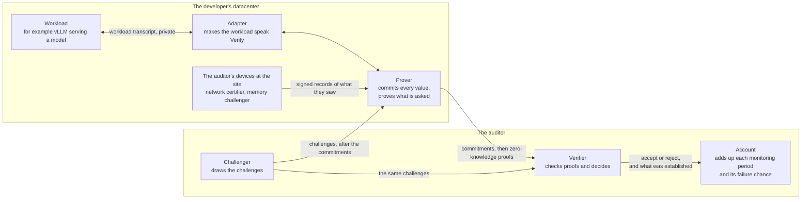
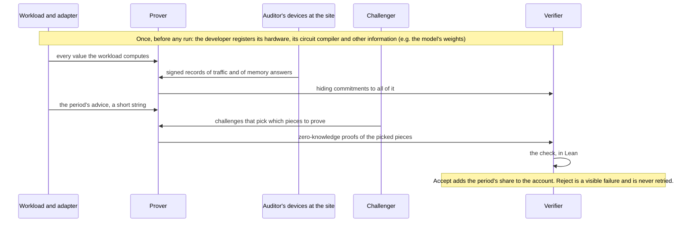
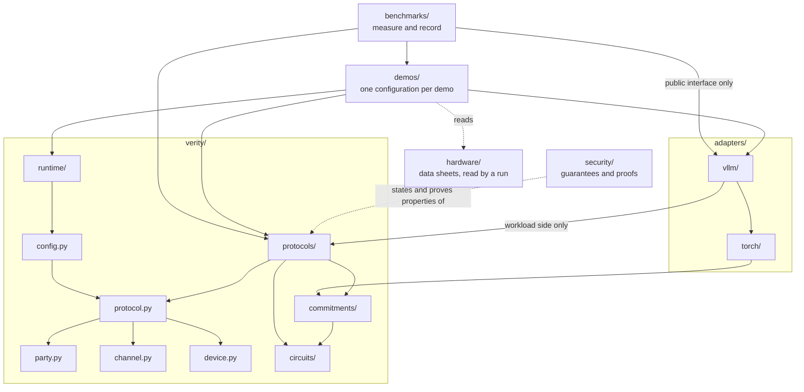
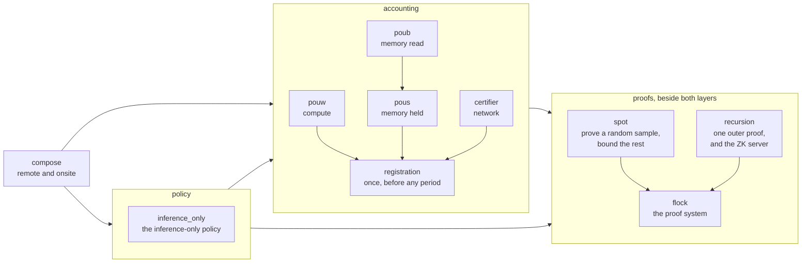
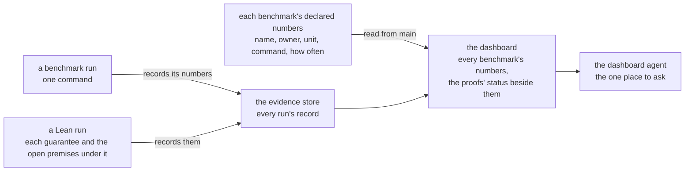

## 1. The system in one picture

Verity lets a developer prove to an auditor that the workloads it runs have certain properties, and that its hardware did little else. The auditor never runs the workload, and learns the verdicts and nothing more.



- <b>Only messages cross between boxes.</b> The workload transcript never leaves the developer. The protocol transcript is what the prover and the verifier exchange.
- <b>The auditor's devices hand what they see to the prover, signed.</b> The auditor sees only proofs about it. This is today's rule and it is still yours to confirm (section 9).
- <b>Challenges come only from the auditor's side</b>, and only after the commitments they sample are recorded: from the challenger, and at the site from the memory challenger, which draws the challenges of its own timed rounds.
- <b>Whatever the auditor decides, the verifier decides, and the verifier is Lean.</b>

## 2. The ideas that organize everything

1. <b>Three roles, messages only.</b> The workload is outside Verity. The prover is the developer's. The verifier is the auditor's, with its devices at the site.
2. <b>A protocol is the unit.</b> One protocol establishes one property of the workload. Every protocol has the same three sides: its check, its parties and the messages they exchange, and what it needs of the workload. Every protocol's directory has the same three parts: <code>verifier/</code> (its check), <code>prover/</code> (the developer's side, with the GPU code it runs) and <code>device/</code> (the auditor's own devices, never the developer's GPUs).
3. <b>Protocols come in two layers, and both call the proofs.</b> The accounting layer measures resources: compute (PoUW), memory (PoUS and PoUB) and network (the certifier). Its base is registration, a protocol that runs once, before any period: the developer registers its hardware, its circuit compiler and other information, the auditor's check accepts or refuses it, and the other accounting protocols account for what it accepted. The policy layer sits on the accounting layer and holds one protocol, inference-only. Beside both sits the proofs module: the proof system (Flock), with sampling (SPOT) and recursion on it, which any protocol calls to prove a statement about committed values. The proofs take the circuit, its pieces and the sampling rule as given, and read no registration. Compose is on top: remote and onsite are each a list of protocols run on one registration.
4. <b>Verity knows circuits and values, never models.</b> Only an adapter names PyTorch, vLLM or a model. A new serving system is a new adapter and changes nothing in <code>verity/</code>.
5. <b>What decides is Lean. What must be fast is Python and CUDA. Public facts are TOML.</b> Python never returns accept or reject.
6. <b>Hardware and configuration are data, passed in.</b> A data sheet per GPU model. One file per run that says which protocols run and which party runs on which machine.
7. <b>Measuring is separate from the system.</b> A benchmark never decides a verdict. Every benchmark's numbers show on one dashboard.
8. <b>Trust follows the directory.</b> What the auditor runs and must trust is each protocol's <code>verifier/</code> and <code>device/</code>. What a reader checks to believe a guarantee is its statement and its named assumptions in <code>security/</code>, and that Lean's kernel accepted its proof, which the check does again on every change. Nothing else in the repository is trusted.
9. <b>What a guarantee may rest on.</b> That SHA-512 resists collisions, that Lean's kernel is right, that the auditor's verifier and devices are honest and draw uniformly random challenges, and the few assumptions you have approved by name. Anything else a guarantee needs is an open premise with an owner and a date, printed beside the figure. <i>From soundness.</i>
10. <b>GPU code implements and never defines.</b> A kernel computes what its owner states: a commitment, a protocol's circuit, an operation the adapter serves. It lives beside the prover or adapter that runs it, a run names it by the hash of its binary, and a benchmark measures the same binary the served run loads. <i>From kernels.</i>

## 3. One period, step by step



The compiler is a circuit the developer registers up front. Given the period's advice (which requests ran together, how long each was) it outputs the circuit the workload ran, cut into pieces small enough to prove one at a time.

## 4. The parts and their interfaces

| Part | What it does | Takes in | Hands out | Never knows |
| --- | --- | --- | --- | --- |
| <b>Workload</b> (not Verity) | The developer's computation. | What the prover sends it. | Every value it computes. | Anything about the auditor. |
| <b>Adapter</b> <code>adapters/</code> | Makes one serving system a workload Verity can audit. <code>vllm/</code> sits on <code>torch/</code>. It holds the compiler and the circuits of the kernels the system serves. | The serving system and its settings. From the prover: what a protocol asks of the workload (run this multiply under PoUW, store these weights). | To the prover only. Up front: the compiler and the weights. Each period: the values and the advice. | The verifier, the auditor's devices, the runtime; how a protocol samples or decides; any protocol's code beyond the one call it makes. |
| <b>Circuits</b> <code>verity/circuits/</code> | The language circuits are written in, and the circuits a protocol itself names: each GPU operation bit for bit, SHA-512, the universal circuit. | Nothing. | Circuits, each named by its hash. | Models, hardware schedules, proof systems. |
| <b>Commitments</b> <code>verity/commitments/</code> | Hiding commitments to values, the one hash, signatures. Where the values sit on a GPU, GPU code computes the same bytes there. | Values. | Roots, and openings on request. | What a value means. |
| <b>Flock</b> <code>protocols/proofs/flock</code> | The proof system: proves in zero knowledge that one statement about one circuit holds of committed values. | A circuit, commitments, challenges. | A proof. Its verifier says accept or reject. | Where the circuit came from. |
| <b>SPOT</b> <code>protocols/proofs/spot</code> | Sampling: the challenger picks pieces at random after the commitments; from proofs of those it bounds how many of all pieces can be wrong. In its two-stage form it first picks whole requests, the prover then commits the inside of each picked request, and it picks pieces of those. | Commitments, challenges, proofs. | "At most this share is wrong, except with this probability." | What the pieces compute. |
| <b>Recursion</b> <code>protocols/proofs/recursion</code> | One outer proof says the verifier accepted the developer's proofs. Holds the ZK server, the only exit from the datacenter to the auditor. | Flock's proofs. | One outer proof per statement. | Which protocol asked. |
| <b>PoUW</b> <code>protocols/accounting/pouw</code> | Compute: how many of the served matrix multiplies' multiply-adds the GPU really computed, credited against its data sheet's capacity. A workload makes one call, "run this matrix multiply under PoUW", over GPU buffers. | The registered devices and their data sheets, the prover's commitments to each multiply, the challenger's challenges, proofs of the sampled tiles. | Credited work for the period, with its error, to compose's account. | Memory, network; the served values in the clear; the GPU's own word on what it is. |
| <b>PoUS</b> and <b>PoUB</b> <code>protocols/accounting/pous</code>, <code>poub</code> | Memory. PoUS: how much of the registered store each device held, with the memory wipe inside it (between two stretches of serving, a server's whole memory is overwritten, so nothing it held before survives). PoUB: how many reads of the store a node made, and so how much of its memory's read rate is left uncertified. | The registered memory and its data sheets, the prover's commitments, the memory challenger's signed records, the challenger's challenges. Through compose, the network certifier's counts of what entered and left the node. | Bits held and bits read for the period, each with its error, to compose's account. | Compute; the weights; another protocol's code. |
| <b>Certifier</b> <code>protocols/accounting/certifier</code> | Network: what left on a link is what the registered circuit produces from what entered. The auditor's device sits on every registered link out of a host, releases traffic on a fixed schedule and signs a record of what crossed. | The registered links, the network certifier's signed records, the prover's commitments to requests and responses, the challenger's challenges. | To compose's account: the period's exfiltration capacity (how many bits could have left unseen), with its error. Through compose, to memory: what entered and left each node. | Compute, memory, the weights. |
| <b>Inference-only</b> <code>protocols/policy/inference_only</code> | The policy: the registered circuit divides into inference blocks that each read little fresh input. | The circuit's description. From training, as data: how much such a circuit slows training. | Accept or reject, to compose. | Values, traffic. |
| <b>Registration</b> <code>protocols/accounting/registration</code> | The accounting protocol that runs once, before any challenge. The developer sends the registration: the hardware, the circuit compiler, and commitments to other information such as the model's weights. The auditor's check accepts it only if it is complete, each device's figures are its data sheet's, and every registered device is accounted for by a protocol on the run's list. It measures nothing itself: it fixes what the other accounting protocols account for. | The registration, the auditor's data sheets, the run's list of protocols. | Accepted or refused. An accepted registration is what the other accounting protocols, the policy and compose then read. A protocol that calls the proofs passes them the registered circuit, and the proofs read no registration. | How any other protocol works inside. |
| <b>Compose</b> <code>protocols/compose</code> | What an auditor runs. Remote and onsite are each a list of protocols on one registration. Accepts only if every protocol accepts and they agree on the commitments. One theorem covers any list: a prover who adapts across all the protocols at once is still held to each one's claim, except with the summed error. | Registration's outcome and each protocol's. | One verdict, and the period's account. | How any one protocol works inside. |
| <b>Party, channel, device, protocol, config</b> five files in <code>verity/</code> | The shared types: what a party is, what two parties exchange, the registered hardware, what a protocol declares, the file a run starts from. | Nothing. | Types every protocol uses. | Any one protocol. |
| <b>Runtime</b> <code>verity/runtime/</code> | Runs a configuration's parties on real machines: sockets, randomness, clock, transcripts. | A configuration. | Running parties and their transcripts. | Any protocol's rules. |
| <b>Hardware</b> <code>hardware/</code> | One data sheet per GPU, host or server model: what one device can do in a second and what it holds. Each figure names its source and says whether it is a ceiling or a measurement. Data, no code. The auditor brings it. | The vendor's published figures and our own measurements, written in by hand. | Figures a run passes to the registration check. The protocols take a device's capacity from the registration. | Everything. It never holds a figure the audited device reports about itself. |
| <b>Demos</b> <code>demos/</code> | One configuration each: its protocols, its adapter, which party on which machine. The remote demo and the onsite demo. | All of the above. | A run anyone can repeat with one command. | Nothing uses a demo. |
| <b>Security</b> <code>security/</code> | Lean, in three parts: what each protocol guarantees, written to be read; what ties each guarantee to the verifier's own Lean code; and the proofs. A statement never reads a proof. | The verifiers' Lean. | Guarantees, each with its named assumptions and its open premises; one composition theorem for any list of protocols; and the error budget, each failure chance summed over a week, a month and a year (above 1 it prints "no bound at this period"). | Nothing in the system uses it. |
| <b>The Lean check and the guarantee record</b> <code>tools/</code>, and one record file beside each Lean package | Has Lean's kernel check every proof again. Refuses a missing proof, an added axiom or a way around the kernel. Records each guarantee's statement and every premise it rests on. | Every Lean file: each protocol's <code>verifier/</code>, and <code>security/</code>. | Pass or fail, to the check. For each guarantee the deployed system rests on, the open premises still under it, to the dashboard. | What a proof is about. It decides no verdict. |
| <b>Benchmarks</b> <code>benchmarks/</code> | Each benchmark is one command that records named numbers, each marked measured or modeled. Each benchmark's directory declares its numbers: name, owner, unit, command, and how often it should run. | The system, as a user. | Numbers, in the evidence store. | It never decides a verdict, and nothing uses a benchmark. |
| <b>The training slowdown</b> its bound in <code>security/</code>, its calculator in <code>benchmarks/slowdown/</code> | What an accepted period buys: the least factor by which a training run hidden inside declared inference is slowed. | From compose: the policy that held and the compute left uncredited. From <code>hardware/</code>: the data sheets. As stated parameters: the share of hardware that is unregistered, and the reference training run. | The slowdown for a week, a month and a year, with the premises it rests on, to the dashboard. | A model, a value, any protocol's insides. Nothing in the system uses it. <i>From training.</i> |
| <b>Dashboard</b> (the team's website, not this repository) | Shows every maintained benchmark's numbers under its owner: value, unit, measured or modeled, the run and commit, and age. The proofs' status sits beside them. | From <code>main</code>, read-only: each benchmark's declared numbers and who owns each. From the evidence store: every run's record, the Lean run's included. | The page to you, and the same report to every agent. | Verity's code. It never runs a benchmark or Lean, never computes or edits a number, and nothing in the repository reads it. |
| <b>Tools</b> <code>tools/</code> | The <code>verity</code> command and the check. The check runs everything that can fail on one commit: every test suite, the Lean build and its proof audit, and the circuit checker. | A commit. | A verdict for each step: pass or fail, and which test failed. | What a change means. It never trusts a developer's word that something passed, and nothing in the system uses it. |

Who runs what, and who must trust it:

| Runs it | What | Who must trust it |
| --- | --- | --- |
| The developer | The workload, the adapter, every protocol's <code>prover/</code> | Nobody. A wrong prover can only get honest work rejected. |
| The developer | The ZK server | The developer, for zero knowledge. |
| The auditor | Every protocol's <code>verifier/</code>, in Lean | The auditor. |
| The auditor, on machines the developer does not control | Every protocol's <code>device/</code>: the challenger, the network certifier, the memory challenger | The auditor. |

## 5. How the parts depend on each other

An arrow reads "uses". Nothing points upward.



Inside <code>protocols/</code>:



How a number reaches you:



## 6. The repository at the end state

```txt
hardware/          data only: one data sheet per GPU or host model
verity/
  party.py         what a party is
  channel.py       what two parties exchange: a message and its types
  device.py        the registered hardware: hosts, devices, memory, links
  protocol.py      what a protocol declares: its parties and messages, what it needs of the workload,
                   which part of the hardware it accounts for
  config.py        reads the one public file a run starts from
  runtime/         runs parties over channels: sockets, randomness and clock, transcripts
  protocols/       each protocol with verifier/ (its Lean check), prover/ (with the GPU code it runs) and device/
    proofs/        flock, spot, recursion: what the other protocols call to prove
    accounting/    registration, then pouw, pous, poub, certifier. Registration runs once, before any challenge:
                   the hardware against its data sheets, the circuit compiler, the commitments to other
                   information, every device accounted for. The others: compute, memory and network
    policy/        inference_only, on accounting/
    compose/       remote and onsite, on policy/ and accounting/
    experimental/  a protocol being tried, which no demo lists
  circuits/        the circuit language; ops/ holds the circuits a protocol names
  commitments/     hiding commitments, the one hash, signatures, and their GPU code
adapters/
  torch/
  vllm/            on torch/, with the circuits of the kernels it serves
demos/             one directory per demo, holding its configuration
security/          Lean: what each protocol guarantees, and the proofs
benchmarks/        every measurement, each one command, each on the dashboard
tools/             the verity command, the check, the test harnesses
tests/             the rules of the whole tree, as tests
```

Not in it: <code>fixtures/</code> (each file goes beside its reader), <code>archive/</code> (deleted), and the team's own platform (<code>infra/</code>: our machines, the check's runner, the run recorder, the merge queue that moves <code>main</code>, and the agents' messages with their lead registry and message router), which is not part of the system (section 9). The team's website with the dashboard is already in the platform repository.

The rules that keep the parts apart. A test enforces each one:

1. Nothing in <code>verity/</code> uses <code>adapters/</code> or <code>demos/</code>, or names PyTorch, vLLM or a model.
2. No code uses <code>security/</code> or <code>hardware/</code>. A run reads the data sheets and passes them in.
3. <code>runtime/</code> uses no protocol, and no protocol or adapter uses <code>runtime/</code>. Only what starts a run does.
4. <code>party.py</code>, <code>channel.py</code> and <code>device.py</code> use nothing. <code>protocol.py</code> uses only those three. <code>config.py</code> uses only <code>protocol.py</code>.
5. <code>circuits/</code> uses nothing. <code>commitments/</code> uses only <code>circuits/</code>.
6. An adapter uses a protocol's workload side, which is one call over GPU buffers (for PoUW: "run this matrix multiply"). A protocol never uses an adapter.
7. Inside <code>protocols/</code>: two layers, accounting (registration, pouw, pous, poub, certifier) and policy (inference\_only), with policy on accounting and compose on top of both. Both layers use the proofs (flock, with spot and recursion on it), and the proofs use neither layer, so they read no registration: a protocol that calls them passes in the circuit, its pieces and the sampling rule. Registration is the base of <code>accounting/</code>: it uses the shared files and <code>commitments/</code> and no other protocol, and the other accounting protocols, the policy and compose read the registration it accepted. Each group is a directory of its own: <code>proofs/</code>, <code>accounting/</code> and <code>policy/</code>.
8. A verifier uses no prover code.
9. Nothing uses a benchmark, and nothing in the repository reads the dashboard. A measurement reaches a guarantee one way only: a person writes it into a data sheet with its source, marked as a measurement, and the guarantee takes the sheet as a parameter.
10. The tree above is one file in the repository, and a test fails on anything that is not in it. Both are on <code>main</code> since tonight. The file also lists the 36 places <code>main</code> still holds that the tree does not, each with its owner and its day (the last is Tue 24 Nov), and that list only shrinks.
11. Outside code uses an adapter through its public interface only. The test is on <code>main</code> today, with 114 exceptions listed.

| Written in | What goes there |
| --- | --- |
| Lean | Everything that decides: each protocol's check, the registration check, whether a configuration is acceptable, compose. And every guarantee with its proof. |
| TOML | Public facts with no logic: a run's configuration, the hardware data sheets. |
| Python and CUDA | What must be fast or touch the world: provers, adapters, sockets and processes. Python restates Lean only where the prover needs speed, and a test holds each such copy to the Lean. |

## 7. Where <code>main</code> differs today

Days are each owner's own, given today. A day is 6 PM PST unless it says otherwise.

<b>Files that only change place</b>

| What | Today | At the end | Who | Day |
| --- | --- | --- | --- | --- |
| Party, channel, device, protocol, config, runtime | <code>verity/configuration/</code> and <code>verity/hardware/site/</code> | the five files and <code>runtime/</code> | top | Fri 13 Nov, 8 AM; if tonight's landing slips, Sat 14 Nov |
| The eight protocols in their three groups | flat, each at <code>verity/protocols/</code> | <code>verity/protocols/proofs/</code>, <code>accounting/</code> and <code>policy/</code> | top, with lean for the Lean packages' paths | tonight, in the second chain of moves: on <code>main</code> Fri 13 Nov, 7 AM if the chain holds |
| Hardware data sheets | <code>verity/hardware/</code> | <code>hardware/</code> | compute-research | Fri 13 Nov, 6:30 PM, behind tonight's landing; the code that loads them into <code>device.py</code> Sat 14 Nov |
| Remote and onsite | two directories in <code>protocols/</code> | inside <code>protocols/compose/</code> | proofs | Sat 14 Nov with Friday's moves; Sun 15 Nov if it misses them |
| The circuits of served kernels | <code>verity/definitions/</code> | what a protocol names to <code>verity/circuits/ops/</code>, the rest to <code>adapters/vllm/</code> | top, with vllm and circuits | Sun 15 Nov; the served part may be Mon 16 Nov |
| The harness that holds Python copies to the Lean | <code>verity/difftest/</code> | <code>tools/</code> | top | Sun 15 Nov |
| Leftovers in <code>verity/</code>: <code>claims/</code>, <code>settings.py</code>, <code>composite/</code> | <code>verity/</code> | deleted, <code>tools/</code>, and inside <code>compose/</code> | top | Sat 14 Nov |
| Loose files inside five protocols | beside <code>verifier/</code>, <code>prover/</code>, <code>device/</code> | inside one of the three, or out of <code>verity/</code> | proofs, compute-accounting, memory-accounting, network-accounting | Sat 14 to Thu 19 Nov |
| <code>fixtures/</code> | the root | each file beside its reader | proofs | Wed 18 Nov |
| GPU code | 61 directories, 49 of them under <code>benchmarks/</code>. A served run loads PoUW's kernel from there, which rule 9 forbids | each protocol's <code>prover/</code>, <code>verity/commitments/</code>, the adapter | kernels, with compute-accounting, memory-accounting, proofs and vllm | memory's two provers Fri 13 Nov; PoUW's not before Tue 17 Nov; the plan with days Fri 13 Nov |
| The check that a kernel's machine code holds only instructions the verifier can recompute | <code>benchmarks/</code> | <code>protocols/accounting/pouw/prover/</code>, beside the kernels | compute-research | Fri 13 Nov after noon PST, behind kernels' timed runs that morning; Mon 16 Nov if it misses Friday's window |
| The check | <code>tools/verity/check/</code> | <code>tools/check/</code> | ci | Wed 18 Nov, after the weekend's moves and after the old queue's code is deleted (Tue 17 Nov) |
| The numbers each benchmark declares | one shared list | each benchmark's own directory, its owner's | console, with benchmarks | in review Mon 16 Nov |
| The compute audit's cost model, and the commands that run an audit on a served run | proofs' scripts under <code>benchmarks/</code> | SPOT's <code>prover/</code> and <code>verifier/</code>, started from a demo's configuration. The measured proving costs stay recorded under <code>benchmarks/</code> and are handed in as data | proofs, with benchmarks and vllm | not dated |
| Registration | <code>protocols/interface/</code>, <code>verity/hardware/site/</code> and <code>verity/hardware/registration.py</code>. Three test files of SPOT's read it today and move with it | <code>verity/protocols/accounting/registration/</code>, an accounting protocol that runs once, over <code>device.py</code>'s types (Daniel, Thu 12 Nov, 11:58 PM PST). Its Lean is cut out of the interface's package, so it is a code change and not in tonight's two chains | proofs, with soundness for its statement | not dated; proofs gives its hour by Fri 13 Nov, 6 AM PST |
| The policy's two calculators | inside <code>protocols/inference_only/</code> | two directories under <code>benchmarks/</code>; training renames the slowdown one | network-accounting moves them, training renames | Fri 13 Nov; the rename Mon 16 Nov |
| The network certifier a served run starts: its serving loop, its keys, its prover | <code>benchmarks/</code>, about 25,000 lines, and the auditor's device runs them from there, which rule 9 forbids | the certifier's <code>device/</code> and <code>prover/</code> | network-accounting | the plan with days Mon 16 Nov |

<b>Code that has to be written</b>

| What | Today | Who | Day |
| --- | --- | --- | --- |
| Every protocol has parties | Only SPOT, PoUS and the remote memory-read audit do | compute-accounting, memory-accounting, network-accounting | PoUW Thu 19 Nov; the certifier and the inference-only policy each state their parties, in review Mon 16 Nov noon (the certifier's device running as a party under the runtime is a second change, not dated: today the device does its own network I/O, and a party under the runtime does none); onsite PoUB Wed 25 Nov |
| A PyTorch adapter under the vLLM adapter, with one translator from PyTorch to circuits | One adapter, and a second translator inside the training benchmark | vllm splits it out; training owns it from that day and folds its own translator in | the split Tue 17 Nov at the earliest; the fold after it |
| The messages between workload and prover as one stated list | Function calls and files; 15 files with no settled name or place | vllm | the list reaches you as a page Mon 16 Nov; its code is dated after you read it |
| PoUW's serving code and GPU kernels in one package under <code>protocols/accounting/pouw/</code>, reached by one call | In the adapter (18,800 lines) and under <code>benchmarks/</code> | compute-accounting, with vllm and kernels | not before Tue 17 Nov; the three name the day Fri 13 Nov |
| Benchmarks and demos reach the adapter through its public interface only | 114 modules are reached past it | vllm, with benchmarks | dated Fri 13 Nov, with the list of what the adapter stops supporting |
| The two demos start from a configuration, run by the runtime | The remote demo is a shell script under <code>benchmarks/</code>; the onsite demo is not built | vllm | remote Fri 20 Nov, onsite Tue 24 Nov |
| Python never returns accept or reject | Several protocols still decide in Python. SPOT's two-stage outcome is joined in Python; its Lean check is written and refuses every audit until its proof exists | lean, then each protocol's owner | lean's page, with which verifier decides each verdict today, reaches you Mon 16 Nov, 10 AM PST; each owner dates its switch after your ruling |
| Each accounting protocol takes the registered hardware and says which part it accounts for | None does | compute-accounting for PoUW, memory-accounting for PoUS and PoUB, network-accounting for the certifier | PoUW: three days after the registered hardware's first change is on <code>main</code> (the remote merge, which it also waited on, landed tonight at 7:01 PM PST). Memory: PoUS accounts for what each device's memory can hold, PoUB for how fast its chips can read it; its day comes Mon 16 Nov, and it needs one theorem first (a device holds what its parts hold plus what is in flight between them). Network: the certifier accounts for the registered links, and a link with no certifier on it is unaccounted, Fri 20 Nov |
| The security model has the auditor's devices as parties, each with a key the auditor pins and its whole signing history | Only the challenger is a party, so no onsite memory or network claim can be proved yet | soundness | Tue 17 Nov; the challenger's logs read through it Mon 23 Nov |
| A device's figures have one source: the registration reads them from the auditor's data sheet | Written in two places that disagree (the H200's tensor rate at two clocks) | proofs (the type and the check), compute-research (the files) | agreed tonight; not dated |
| "Registration" names one thing: SPOT's own record of a window takes another name | SPOT's code calls the record it fixes before any challenge a registration record: the circuit's digest, its pieces, the sampling rule and the committed roots. That is SPOT's input, not the registration | proofs | not dated |
| The circuit checker is handed the served circuits and names none | It names them | circuits | in review Fri 13 Nov; it lands after the served circuits move, Sun 15 Nov at the earliest |
| The compiler cuts a period's circuit into pieces wired to each other | For the demo's model the pieces are wired only where the eight GPUs combine results, so the audit's second round runs over a stand-in | circuits, with vllm | one GPU's share Mon 16 Nov, all eight Thu 19 Nov, at the smallest request that uses every kind of piece; the demo's request size not dated |
| Every kernel the production settings serve has a circuit held to the kernel on an H200 | Five are written. Four are compared with the kernel on an H200 and no word differs: the FP8 cache's write, its two reads, and the accept rule. Two of the four are on <code>main</code>. The fifth, the draft layer, is three kernels: two compared tonight with no word differing but no record kept, the third in part (its worker's word, which circuits has not read) | circuits | Mon 16 Nov, 9 AM PST |
| Every kind of piece in a request has a statement the Lean verifier accepts | 18 of 254 kinds, holding 88.1% of the pieces | circuits, with proofs | the list of what each other kind lacks Fri 13 Nov, 8 AM PST |
| One form of the network certifier | Two: the remote demo runs an older one, a proxy in front of the server; the onsite demo runs the device on the link | network-accounting, with vllm | vllm names the day by Mon 16 Nov, 6 PM PST, with network-accounting's plan of the same hour; not before the remote demo is built (Fri 20 Nov) |
| The Lean takes a data sheet as a parameter | Two Lean tables restate their data sheets | compute-research, with proofs | Tue 24 Nov |
| Every benchmark on the dashboard | 5 of 69 wired (read 7:29 PM PST); 3 of the 5 show a value no older than their schedule allows | benchmarks, console | six more directories by Tue 17 Nov; the rest not dated |
| The proofs' status on the dashboard: guarantees fully proved, open premises per lead | Printed by the Lean check only | lean, console | lean's command on <code>main</code> Sat 14 Nov; the dashboard's part in review Tue 17 Nov |
| The Lean check passes on the public repository | On Tuesday's export 14 of 16 Lean packages pass | lean | Tue 17 Nov |
| Every area of <code>security/</code> has a lead | 826 of its 4,816 files fall to lean because no lead claims them | lean, soundness | Tue 17 Nov |
| A memory-read session is proved in zero knowledge | Each span's openings go to the verifier as they are | memory-accounting | not dated |
| PoUS's setup is a proof about the store | The check reads the whole store | memory-accounting | not dated; your answer in section 9 first |
| PoUS's session is checked inside a proof | The check reads the memory challenger's signed record as it is: for each round, which block was asked, when it was sent and answered, and the block's SHA-512 digest. It also reads a table of every block's digest. A digest hides nothing from someone who holds a candidate block | memory-accounting | not dated; what the auditor learns from the record is stated in Lean tonight on a branch, not proved |
